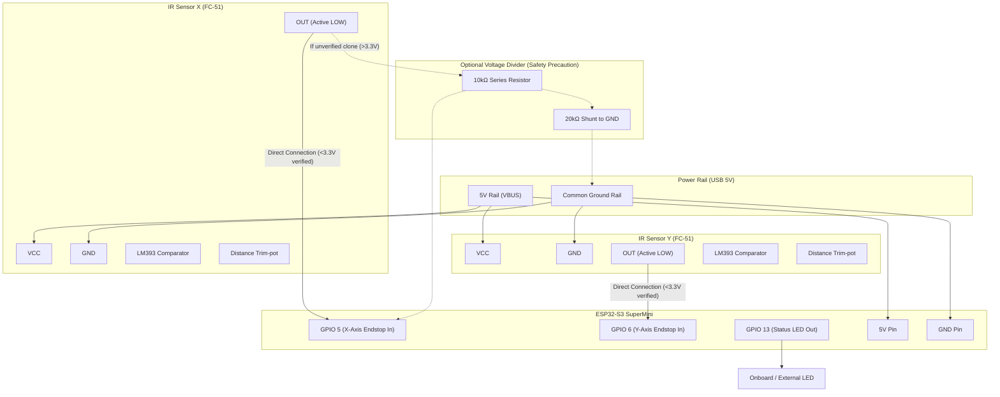

# IR Obstacle Avoidance Sensor Test & Integration Guide

**Firmware Location:** `ir_sensor_test/ir_sensor_test.ino`  
**Target Hardware:** ESP32-S3 Super Mini  
**Application:** Contactless Optical Homing Endstops (replacing mechanical snap-action lever switches)  
**Sensors:** FC-51 / KY-032 IR Obstacle Avoidance Sensor Modules (LM393 Comparator)  
**Required Libraries:** None — uses standard ESP32 Arduino Core.

---

## Table of Contents

1. [Overview & Operating Principle](#1-overview--operating-principle)
2. [Hardware Wiring & Circuit Diagrams](#2-hardware-wiring--circuit-diagrams)
   - [Mermaid System Architecture Diagram](#mermaid-architecture-diagram)
   - [ESP32-S3 SuperMini Pin Layout](#esp32-s3-supermini-pin-layout)
   - [ASCII Wiring Diagram — Single & Dual Sensors](#ascii-wiring-diagram)
   - [Voltage Safety & Optional Divider Analysis](#voltage-safety--optional-divider-analysis)
   - [Step-by-Step Written Wiring Instructions (Foolproof Breadboard Guide)](#step-by-step-written-wiring-instructions-foolproof-breadboard-guide)
3. [Arduino IDE & Board Setup](#3-arduino-ide--board-setup)
4. [Phase-by-Phase Testing Roadmap](#4-phase-by-phase-testing-roadmap)
   - [Phase 1: Basic Connectivity & Power Check](#phase-1-basic-connectivity--power-check)
   - [Phase 2: Single Sensor Digital Readout](#phase-2-single-sensor-digital-readout)
   - [Phase 3: Trim-Pot Distance Calibration (~5–10 mm for Homing)](#phase-3-trim-pot-distance-calibration)
   - [Phase 4: Debounce & Signal Stability Characterization](#phase-4-debounce--signal-stability-characterization)
   - [Phase 5: Response Time & Latency Verification](#phase-5-response-time--latency-verification)
   - [Phase 6: Noise Immunity & Room Light Flicker Test](#phase-6-noise-immunity--room-light-flicker-test)
   - [Phase 7: Dual Sensor Real-Time Monitoring & Sync](#phase-7-dual-sensor-real-time-monitoring--sync)
   - [Phase 8: Stepper Motor Homing Cycle Simulation](#phase-8-stepper-motor-homing-cycle-simulation)
5. [Main Firmware Integration (`laser-engraver-firmware`)](#5-main-firmware-integration)
   - [Mechanical vs. Optical Homing Comparison](#mechanical-vs-optical-homing-comparison)
   - [Recommended Software Filter Settings](#recommended-software-filter-settings)
   - [Drop-in Code Updates for `config.h` and `homing.cpp`](#drop-in-code-updates)
6. [Troubleshooting Guide](#6-troubleshooting-guide)
7. [Command Quick Reference Card](#7-command-quick-reference-card)

---

<a id="1-overview--operating-principle"></a>
## 1. Overview & Operating Principle

In the Laser-XY-Scanner, precision homing is critical for repeatable laser positioning and mirror alignment. Mechanical microswitches suffer from mechanical lever play, contact bounce (typically 1–5 ms), physical hysteresis, and wear over thousands of cycles.

The **FC-51 / KY-032 IR Obstacle Avoidance Sensor Module** provides a non-contact, solid-state replacement:

```
                  ┌──────────────────────────────────────────────┐
                  │          FC-51 SENSOR MODULE                 │
                  │                                              │
    VCC (5V) ─────┼─► Power LED (Red)                            │
                  │                                              │
                  │   ┌───────────────┐                          │
                  │   │ IR Emitter    │─── 940 nm IR Beam ───►  │ [OBSTACLE]
                  │   │ (Clear LED)   │                         │ (Mirror / Carriage)
                  │   └───────────────┘                         │      │
                  │                                             │      │ Reflected
                  │   ┌───────────────┐                         │      ▼ Beam
                  │   │ IR Receiver   │◄────────────────────────┼──────┘
                  │   │ (Black Epoxy) │                         │
                  │   └──────┬────────┘                         │
                  │          ▼ (Analog Voltage)                 │
                  │     ┌─────────┐                             │
                  │     │  LM393  │◄── Trim-pot Reference       │
                  │     │Comparator│   Threshold                │
                  │     └────┬────┘                             │
                  │          │                                  │
                  │          ├─► Signal LED (Green, Active LOW) │
    OUT      ◄────┼──────────┘                                  │
    GND      ─────┼─────────────────────────────────────────────┘
                  └──────────────────────────────────────────────┘
```

### Component Breakdown & Signal Flow

1. **IR Emitter (Clear 5mm LED):** Emits continuous infrared light at ~940 nm wavelength.
2. **IR Receiver (Dark Phototransistor):** Filtered with dark epoxy to reject ambient visible light and respond specifically to ~940 nm IR.
3. **LM393 Precision Voltage Comparator:**
   - **Inverting Input (`-`):** Fed by the voltage developed across the IR phototransistor.
   - **Non-Inverting Input (`+`):** Fed by the adjustable reference voltage set by the 10kΩ multi-turn trim-pot.
4. **Trim-Potentiometer:** Adjusts the switching threshold voltage, allowing fine-tuning of the trigger distance from 2 mm to 30 mm.
5. **Digital Output (`OUT`):**
   - **No Obstacle (Path Clear):** Phototransistor receives low IR reflection → comparator output is high impedance → onboard pull-up holds line **HIGH (~3.0–3.2V)**. Signal LED is **OFF**.
   - **Obstacle Detected:** Reflected IR exceeds threshold → comparator output transistor conducts to ground → line pulls **LOW (0V)**. Signal LED illuminates **GREEN**.

---

<a id="2-hardware-wiring--circuit-diagrams"></a>
## 2. Hardware Wiring & Circuit Diagrams

<a id="mermaid-architecture-diagram"></a>
### Mermaid System Architecture Diagram



---

<a id="esp32-s3-supermini-pin-layout"></a>
### ESP32-S3 SuperMini Pin Layout

*(Castellated 18-pin DIP footprint: 9 pins Left, 9 pins Right, USB-C at Top)*
```
                        ESP32-S3 SuperMini
                       ┌─────────────────────┐
                       │   [ USB-C PORT ]    │
                       │                     │
        5V Power (VBUS)│ [5V]             [5]│◄─── Sensor X OUT (GPIO 5)
            Common GND │ [GND]            [6]│◄─── Sensor Y OUT (GPIO 6)
            3.3V Logic │ [3V3]            [7]│    (Available)
       UART0 TX (IO43) │ [TX]             [8]│    (Available)
       UART0 RX (IO44) │ [RX]             [9]│    (Available)
                       │ [1]             [10]│    (Available)
                       │ [2]             [11]│    (Available)
                       │ [3]             [12]│    (Available)
                       │ [4]             [13]│───► Onboard Status LED (Mirrored)
                       │                     │
                       └─────────────────────┘
```

---

<a id="ascii-wiring-diagram"></a>
### ASCII Wiring Diagram

#### Single Sensor Test Setup (X-Axis Only)

```
  ESP32-S3 SuperMini                          FC-51 IR Obstacle Sensor (X-Axis)
  ┌─────────────────────────┐                 ┌─────────────────────────────────┐
  │ [5V]  (Pin 1 Left Row)  │────────────────►│ VCC                             │
  │ [GND] (Pin 2 Left Row)  │────────────────►│ GND                             │
  │ [5]   (Pin 1 Right Row) │◄────────────────│ OUT (Active LOW on detect)      │
  │ [13]  (Pin 9 Right Row) │──► [Status LED] │                                 │
  └─────────────────────────┘                 │ [Trim-pot] [LM393] [LEDs]       │
                                              └─────────────────────────────────┘
```

#### Dual Sensor Test Setup (X-Axis & Y-Axis Complete Homing)

```
                      ┌───────────────────────────────────────────────┐
                      │              5V Rail (from ESP32 5V Pin)       │
                      └───────┬───────────────────────────────┬───────┘
                              │                               │
                      ┌───────┴───────┐               ┌───────┴───────┐
                      │ Sensor X VCC  │               │ Sensor Y VCC  │
                      └───────────────┘               └───────────────┘
                      ┌───────────────┐               ┌───────────────┐
                      │ Sensor X GND  │               │ Sensor Y GND  │
                      └───────┬───────┘               └───────┬───────┘
                              │                               │
                      ┌───────┴───────────────────────────────┴───────┐
                      │             Common Ground Rail (GND)          │
                      └───────────────────────┬───────────────────────┘
                                              │
  ESP32-S3 SuperMini                          │
  ┌────────────────────────────────────────┐  │
  │ [5V]  (Pin 1 Left Row)                 │  │
  │ [GND] (Pin 2 Left Row) ────────────────┼──┘
  │                                        │
  │ [5]   (Pin 1 Right Row) ◄──────────────┼──────── Sensor X OUT
  │ [6]   (Pin 2 Right Row) ◄──────────────┼──────── Sensor Y OUT
  │ [13]  (Pin 9 Right Row) ──► Status LED │
  └────────────────────────────────────────┘
```

---

<a id="voltage-safety--optional-divider-analysis"></a>
### Voltage Safety & Optional Divider Analysis

> [!IMPORTANT]
> **Why Direct Connection is Safe on the FC-51:**
> The ESP32-S3 GPIO pins tolerate maximum **3.6V**. When the FC-51 sensor is powered from the **5V rail**, its output voltage when CLEAR was measured by the user and confirmed to be **below 3.3V (~2.8V to 3.2V)**.
>
> **Circuit Explanation:** The onboard green Signal LED and its current-limiting resistor (~1kΩ) are connected between `VCC (5V)` and `OUT`. The LM393 comparator has an open-collector output. When the comparator is OFF (clear beam), current flows through the Signal LED and pull-up resistor to the OUT pin. The forward voltage drop across the green LED ($V_f \approx 2.0\text{–}2.2\text{V}$) drops the voltage, meaning the maximum voltage reaching the ESP32 GPIO is safe ($5.0\text{V} - V_f \approx 2.8\text{–}3.0\text{V}$).

#### Optional Voltage Divider (For Unverified Clone Sensors)
If you ever use a generic clone sensor that does NOT have the indicator LED in the pull-up branch (or if OUT measures > 3.3V with a multimeter), insert a simple resistive voltage divider:

```
  Sensor OUT (5V) ────[ 10kΩ ]────┬────► ESP32 GPIO 5 (or 6)
                                  │
                                [ 20kΩ ]
                                  │
                                 GND

---

<a id="step-by-step-written-wiring-instructions-foolproof-breadboard-guide"></a>
### Step-by-Step Written Wiring Instructions (Foolproof Breadboard Guide)

Follow these step-by-step written instructions carefully when assembling your IR obstacle avoidance homing sensor circuit on a solderless breadboard. This guide eliminates all ambiguity regarding module pins, voltage levels, breadboard rails, and optical calibration.

---

#### 1. FC-51 / KY-032 Module Hardware Overview

Before connecting any wires, inspect your IR sensor module:
* **Pin Header (3-Pin or 4-Pin):**
  - **`VCC` (Pin 1):** Module DC power input (+5V from USB VBUS).
  - **`GND` (Pin 2):** Power and signal ground (connects to common system GND).
  - **`OUT` (Pin 3):** Active-LOW digital output signal:
    - **Path Clear (No Obstacle):** Output is **HIGH (~3.0V–3.2V)**. Green detection LED is **OFF**.
    - **Obstacle Detected:** Output pulls **LOW (0V)**. Green detection LED illuminates **ON**.
  - **`EN` (Optional 4th Pin on some variants):** Enable pin. If present, it usually has a jumper installed to tie it permanently to ground/active state; leave the jumper intact.
* **Onboard Indicators:**
  - **Power LED (Red):** Illuminates continuously when 5V is supplied.
  - **Detection / Signal LED (Green):** Turns ON when an object reflects sufficient IR light back into the phototransistor.
* **10kΩ Trimpot:** Small blue rectangular potentiometer with a brass screw on top, used to set the detection distance threshold (2 mm to 30 mm).
* **Optical Transducers (Front Edge):**
  - **Clear 5mm Bulb:** 940 nm Infrared Emitter LED.
  - **Dark / Black 5mm Bulb:** 940 nm Phototransistor Receiver (dark epoxy filters out ambient visible light).

---

#### 2. Breadboard Setup & Power Rail Distribution

1. **Mount the ESP32-S3 SuperMini:**
   - Insert the ESP32-S3 SuperMini straddling the center divider of your breadboard, with the **USB-C connector pointing towards the top edge**.
   - Review your physical pin locations:
     - **Left Column (Pins 1–9, top to bottom):** `5V`, `GND`, `3V3`, `TX`, `RX`, `1` (GPIO 1), `2` (GPIO 2), `3` (GPIO 3), `4` (GPIO 4).
     - **Right Column (Pins 1–9, top to bottom):** `5` (GPIO 5), `6` (GPIO 6), `7` (GPIO 7), `8` (GPIO 8), `9` (GPIO 9), `10` (GPIO 10), `11` (GPIO 11), `12` (GPIO 12), `13` (GPIO 13).
2. **Establish Common Power & Ground Rails:**
   - **5V Red Rail (+):** Connect ESP32-S3 SuperMini **Pin 1 (Left Row, `5V`)** to the breadboard **Red (+) Bus Rail** using a red jumper wire.
   - **GND Black Rail (-):** Connect ESP32-S3 SuperMini **Pin 2 (Left Row, `GND`)** to the breadboard **Blue/Black (-) Bus Rail** using a black jumper wire.

---

#### 3. Phase 1: Single Sensor Setup (X-Axis Homing Test)

Assemble the primary X-axis homing endstop first to verify sensor functionality and signal timing:

* **Step 1 (Sensor Power):** Connect a red jumper wire from the breadboard **Red 5V Rail** to the **`VCC`** pin of Sensor X.
* **Step 2 (Sensor Ground):** Connect a black jumper wire from the breadboard **Black/Blue GND Rail** to the **`GND`** pin of Sensor X.
* **Step 3 (Digital Signal Line):** Connect a jumper wire (e.g. Yellow or Green) from Sensor X **`OUT`** directly to ESP32-S3 SuperMini **Pin 1 (Right Row, `5` / GPIO 5)**.
* **Step 4 (Status LED):** The firmware automatically mirrors the detection state onto the onboard LED on **Pin 9 (Right Row, `13` / GPIO 13)**. When an obstacle is detected, `13` illuminates.

---

#### 4. Phase 2: Dual Sensor Setup (X-Axis & Y-Axis Complete Homing)

When ready to test both axes simultaneously:

* **Step 1 (Sensor Y Power):** Connect a red jumper wire from the breadboard **Red 5V Rail** to the **`VCC`** pin of Sensor Y.
* **Step 2 (Sensor Y Ground):** Connect a black jumper wire from the breadboard **Black/Blue GND Rail** to the **`GND`** pin of Sensor Y.
* **Step 3 (Sensor Y Signal Line):** Connect a jumper wire (e.g. Blue or White) from Sensor Y **`OUT`** directly to ESP32-S3 SuperMini **Pin 2 (Right Row, `6` / GPIO 6)**.

---

#### 5. Master Breadboard Pin Interconnection Table

| Component & Pin | Net / Signal Name | ESP32-S3 SuperMini Physical Header Pin | Electrical Characteristics | Wire Color Suggestion |
|---|---|---|---|---|
| **ESP32 5V** | 5V Rail (`VBUS`) | **Pin 1 (Left Row, `5V`)** | +5V DC from USB | **Red** |
| **ESP32 GND** | Common GND Rail | **Pin 2 (Left Row, `GND`)** | 0V Common Ground | **Black** |
| **ESP32 3V3** | 3.3V Logic Rail | **Pin 3 (Left Row, `3V3`)** | +3.3V DC Regulated | **Orange** |
| **UART0 TX Serial** | Debug Console / Flashing | **Pin 4 (Left Row, `TX` / GPIO 43)** | 3.3V UART Output | **Blue** |
| **UART0 RX Serial** | Debug Console / Flashing | **Pin 5 (Left Row, `RX` / GPIO 44)** | 3.3V UART Input | **Green** |
| **Sensor X VCC** | Sensor X Power | Connected to 5V Rail | +5V DC | **Red** |
| **Sensor X GND** | Sensor X Ground | Connected to GND Rail | 0V Ground | **Black** |
| **Sensor X OUT** | X Endstop Signal | **Pin 1 (Right Row, `5` / GPIO 5)** | 0V (Detected) / ~3.0V (Clear) | **Yellow / Green** |
| **Sensor Y VCC** | Sensor Y Power | Connected to 5V Rail | +5V DC | **Red** |
| **Sensor Y GND** | Sensor Y Ground | Connected to GND Rail | 0V Ground | **Black** |
| **Sensor Y OUT** | Y Endstop Signal | **Pin 2 (Right Row, `6` / GPIO 6)** | 0V (Detected) / ~3.0V (Clear) | **Blue / White** |
| **Onboard Status LED** | Endstop Indicator | **Pin 9 (Right Row, `13` / GPIO 13)** | Active HIGH drive | Built-in SMD LED |

---

#### 6. Step-by-Step Distance & Sensitivity Calibration Procedure

The FC-51 sensor's precision as an optical endstop depends on accurately tuning its comparator threshold trimpot:

1. **Power Up the Circuit:**
   - Plug the ESP32-S3 SuperMini into your computer via USB-C.
   - The red Power LED on both the ESP32 and the FC-51 sensor module should light up steadily.
2. **Clear Field Calibration (Baseline Setting):**
   - Ensure the front optical bulbs have an unobstructed view (> 15 cm of clear space ahead).
   - If the green detection LED is currently ON, take a miniature flathead screwdriver and rotate the small brass trimpot screw **counter-clockwise** until the green LED just turns **OFF**.
   - Turn it an additional 1/4 turn counter-clockwise past the threshold to create an adequate noise margin against ambient light.
3. **Obstacle Homing Distance Setting (~5 mm to 10 mm):**
   - Position your intended homing flag (e.g. the 3D-printed mirror bracket edge, a small plastic tab, or a piece of matte dark cardstock) exactly at the desired trigger distance (**5 mm to 8 mm** in front of the IR diodes).
   - Slowly rotate the trimpot screw **clockwise** until the green detection LED **snaps ON**.
   - Note: The onboard LED on the ESP32-S3 (`IO13`) should turn ON simultaneously!
4. **Hysteresis & Repeatability Verification:**
   - Pull the obstacle back by 2 mm; the green LED and onboard LED must cleanly turn **OFF**.
   - Move the obstacle forward by 2 mm; the LEDs must snap cleanly **ON**.
   - Repeat 10 times to verify consistent trigger behavior.

---

#### 7. Optical Endstop Design & Environmental Precautions

* **Flag Surface Finish:** 
  - For maximum homing repeatability ($< 50\,\mu\text{m}$ error), use a **matte black or dark grey 3D-printed plastic tab** (PLA or PETG).
  - Avoid glossy white, polished acrylic, or shiny metallic surfaces directly perpendicular to the sensor, as specular glare can cause premature triggering at excessive distances.
* **Interference Shielding:**
  - Keep the sensor shielded from direct, unfiltered sunlight or high-intensity halogen/incandescent desk lamps. These incandescent sources emit broadband IR radiation that can saturate the phototransistor. Standard household LED or fluorescent lighting will not interfere.
* **Module Mounting:**
  - Fasten the sensor PCB securely using its M3 mounting hole. Any physical wobble in the PCB directly degrades homing repeatability!

---

#### 8. First Power-On Functional Verification via Serial Monitor

1. Open Arduino IDE Serial Monitor (or your preferred terminal like PuTTY / minicom) set to **115200 baud**, with **Newline (`\n`)** line ending.
2. Press the `RESET` button on the ESP32-S3 SuperMini. You will see the initialization banner:
   ```text
   ==================================================
     ESP32-S3 SuperMini IR Sensor Test Firmware
   ==================================================
   [INIT] Sensor X Pin : GPIO 5 (Input Pull-up)
   [INIT] Sensor Y Pin : GPIO 6 (Input Pull-up)
   [INIT] Status LED   : GPIO 13
   [INIT] Ready. Type HELP for command list.
   ```
3. Type `STATUS` and press Enter:
   - When no obstacle is present: `Sensor X: CLEAR (HIGH, 1) | Sensor Y: CLEAR (HIGH, 1)`.
   - Place an object in front of Sensor X and type `STATUS`: `Sensor X: TRIGGERED (LOW, 0)`.
4. Type `STREAM 100` to start real-time 100 ms polling. Move your flag in and out of the beam to verify clean, responsive triggering without glitching. Send `STOP` to halt the stream.
5. Type `CAL` to enter interactive calibration mode with live millisecond transition timestamps.

---

<a id="3-arduino-ide--board-setup"></a>
## 3. Arduino IDE & Board Setup

### 3.1 Board Configuration

1. In Arduino IDE 2.x, select **Tools → Board → esp32 → ESP32S3 Dev Module**.
2. Apply the following settings in the **Tools** menu:

| Option | Value | Note |
|---|---|---|
| **Board** | `ESP32S3 Dev Module` | Standard for Super Mini boards |
| **USB CDC On Boot** | **Enabled** | **Crucial:** Direct USB-OTG Serial output |
| **USB Mode** | `USB-OTG (TinyUSB)` | Matches Super Mini hardware USB |
| **Upload Mode** | `UART0 / Hardware CDC` | Automatic flash reset |
| **Flash Size** | `4MB` (or `8MB`) | Check board markings |
| **Partition Scheme** | `Default 4MB with spiffs` | Ample code space |
| **PSRAM** | `Disabled` | SuperMini boards lack external PSRAM |
| **CPU Frequency** | `240MHz` | Max performance |

### 3.2 Download Mode (If Board Does Not Auto-Reset)

1. Press and hold the **BOOT** button (labeled `0` or `BOOT`).
2. Press and release the **RST** button.
3. Release the **BOOT** button.
4. Select the serial port (`/dev/ttyACM0` on Linux, `COMx` on Windows).
5. Click **Upload** (Right Arrow).
6. Open the Serial Monitor at **115200 baud**.

---

<a id="4-phase-by-phase-testing-roadmap"></a>
## 4. Phase-by-Phase Testing Roadmap

Follow this 8-phase test sequence to thoroughly characterises the sensor before integrating it into the main motion controller firmware:


---

### Phase 1: Basic Connectivity & Power Check

**Objective:** Verify power rails, ground reference, and basic optical operation before issuing firmware commands.

1. Connect Sensor X to ESP32: VCC → 5V, GND → GND, OUT → GPIO 5.
2. Plug the ESP32-S3 SuperMini into USB.
3. Observe the LEDs on the FC-51 sensor module:
   - **Power LED (Red):** Must be lit continuously.
   - **Signal LED (Green):** Wave your hand 5 mm in front of the clear/black LED pair. The green LED should light up when your hand is present and turn OFF when your hand is removed.
4. **Pass Criteria:**
   - [x] Red Power LED is solidly lit.
   - [x] Green Signal LED toggles responsively with hand movement.
   - [x] Voltmeter across OUT and GND reads `< 0.3V` when hand is close, and `2.8V–3.3V` when clear.

---

### Phase 2: Single Sensor Digital Readout

**Objective:** Verify that the ESP32-S3 correctly reads the sensor's logic state over GPIO.

#### Commands to Run:
```text
READ
MONITOR
```

#### Expected Output for `READ`:
```text
+-----------------------------------------------------------------------+
|                          CURRENT SENSOR READOUT                       |
+----------+---------+------------+-------------------+-----------------+
| Sensor   | Pin     | Raw Level  | Logic State       | Interpretation  |
+----------+---------+------------+-------------------+-----------------+
| X-Axis   | GPIO 5  | LOW (0)    | DETECTED          | Obstacle Present|
| Y-Axis   | GPIO 6  | HIGH (1)   | CLEAR             | Beam Clear      |
+----------+---------+------------+-------------------+-----------------+
| Status LED (GPIO 13) : ON  (Obstacle Mirrored)                        |
| Active Polarity     : NORMAL   (LOW=Detected, HIGH=Clear)             |
+-----------------------------------------------------------------------+
```

#### Step-by-Step Actions:
1. Type `READ` with nothing in front → Sensor X should show `Raw Level: HIGH (1)`, `State: CLEAR`.
2. Place a card in front of Sensor X and type `READ` → Sensor X should show `Raw Level: LOW (0)`, `State: DETECTED`.
3. Type `MONITOR` → Wave your finger in front of the sensor. Verify that each entry prints with the elapsed millisecond timestamp.
4. Send `X` to exit monitor mode.
5. **Pass Criteria:**
   - [x] Clear beam reads `HIGH` / `CLEAR`.
   - [x] Blocked beam reads `LOW` / `DETECTED`.
   - [x] GPIO 13 Status LED turns ON when blocked and OFF when clear.

---

### Phase 3: Trim-Pot Distance Calibration

**Objective:** Adjust the multi-turn potentiometer on the sensor module to achieve the optimal homing trigger distance of **5 mm to 10 mm**.

> [!TIP]
> **Why 5–10 mm is the Sweet Spot:**
> - If distance is **too short (< 2 mm)**: The carriage may physically crash into the sensor before the motor decelerates.
> - If distance is **too long (> 20 mm)**: Wasted travel envelope and increased susceptibility to ambient light reflections from distant objects.

#### Commands to Run:
```text
CALIB
THRESHOLD
```

#### Step-by-Step Procedure:
1. Type `THRESHOLD` to diagnose current sensitivity.
2. Type `CALIB` to enter the interactive 3-step calibration wizard:
   - **Step 1:** Ensure sensor path is clear (> 20 cm). If the module green LED is lit, turn the blue trim-pot **counter-clockwise** until it turns off.
   - **Step 2:** Place a white card or carriage bracket exactly **8 mm** in front of the IR LEDs.
   - **Step 3:** Turn the trim-pot **clockwise** until the green LED just turns ON (and `[CALIB]` prints `TRIGGER DETECTED!`).
   - **Step 4:** Move the card back to 15 mm — the LED must turn OFF.
3. Type `RANGE` to run an automatic multi-distance verification (30 mm → 20 mm → 15 mm → 10 mm → 5 mm → 2 mm).
4. **Pass Criteria:**
   - [x] Consistent trigger at 5–10 mm.
   - [x] 100% clear at > 20 mm.
   - [x] Zero trigger chatter when holding target steady at 8 mm.

---

### Phase 4: Debounce & Signal Stability Characterization

**Objective:** Measure transition bouncing caused by optical edge flutter or LM393 comparator hysteresis crossing.

#### Commands to Run:
```text
DEBOUNCE
DEBOUNCE 5000
EDGES 10
```

#### Expected Output for `DEBOUNCE`:
```text
+-----------------------------------------------------------------------+
|                    DEBOUNCE CHARACTERISATION REPORT                   |
+-----------------------------------------------------------------------+
| Total Window Captured : 25000 us (25.0 ms)                            |
| Transition Bounces    : 1                                             |
| Settle Duration       : 100 us (0.10 ms)                              |
+-----------------------------------------------------------------------+
 Waveform: [.........................#########################] (# = Detected, . = Clear)
 Verdict : Extremely clean optical transition! Electronic LM393 hysteresis active.
 Setting : Recommended homing debounce filter: 2 ms to 5 ms.
+-----------------------------------------------------------------------+
```

#### Step-by-Step Actions:
1. Type `DEBOUNCE`.
2. When prompted, bring the target card smoothly into detection range.
3. Review the captured waveform and bounce metrics:
   - Typical optical switches produce **0 to 2 bounces** (settling within **< 200 µs**), compared to mechanical switches which produce **5 to 20 bounces over 2–5 ms**.
4. Type `DEBOUNCE 5000` to take 5,000 rapid samples (10 µs interval) with the sensor held steady. Stability should read `100% Rock Solid`.
5. **Pass Criteria:**
   - [x] Settle duration `< 1.0 ms`.
   - [x] Bounces `< 3`.
   - [x] DC stability `> 99.5%`.

---

### Phase 5: Response Time & Latency Verification

**Objective:** Quantify the latency between optical occlusion and digital pin transition.

#### Commands to Run:
```text
RESPONSE
LATENCY 5
```

#### Step-by-Step Actions:
1. Type `RESPONSE`.
2. Quickly flick a card through the IR beam.
3. The firmware calculates the pulse duration and confirms comparator propagation delay (~1.3 µs).
4. Type `LATENCY 5`. Trigger and release the sensor 5 times as prompted.
5. Review the summary table showing Min, Max, and Average pulse response times.
6. **Pass Criteria:**
   - [x] Sensor responds to pulses as short as 1 ms without missing triggers.
   - [x] Latency jitter is negligible compared to stepper motor step intervals (typically 1–5 ms).

---

### Phase 6: Noise Immunity & Room Light Flicker Test

**Objective:** Verify that ambient indoor lighting (especially 100 Hz / 120 Hz flicker from AC LED drivers and fluorescent tubes) does not cause false endstop trips.

#### Commands to Run:
```text
NOISE 10
AMBIENT
```

#### Step-by-Step Actions:
1. Turn on all ambient workspace lights (fluorescent tubes, LED desk lamps, overhead lighting).
2. Type `NOISE 10` with the machine standing still and nothing obstructing the sensors.
3. The firmware monitors the GPIO pin at ~50 kHz for 10 seconds.
4. Type `AMBIENT`. The firmware samples 10,000 readings at 10 kHz to detect any periodic AC mains lighting ripple (100 Hz in 50 Hz countries, 120 Hz in 60 Hz countries).
5. **Pass Criteria:**
   - [x] `NOISE 10` records **0 false glitches**.
   - [x] `AMBIENT` reports `PASSED. Zero ambient light interference detected.`

> [!WARNING]
> **If Optical Interference is Detected:**
> Direct sunlight or unshielded incandescent lamps placed inches away from the receiver can saturate the phototransistor. If false triggers occur, install an opaque 3D-printed shroud around the sensor pair or turn the trim-pot 1/4 turn counter-clockwise.

---

### Phase 7: Dual Sensor Real-Time Monitoring & Sync

**Objective:** Test both X and Y axis sensors running simultaneously and verify mechanical squareness.

#### Commands to Run:
```text
DUAL
DUAL SYNC
```

#### Step-by-Step Actions:
1. Type `DUAL` to launch the live ASCII dashboard:
   ```text
   [X: DETECTED  |##########|]   [Y: CLEAR     |..........|]   LED: ON    (Triggers: X=14, Y=8)
   ```
2. Manually trigger X, then Y, then both. Observe instantaneous bargraph updates. Press `X` to exit.
3. Type `DUAL SYNC` to enter alignment mode.
4. Take a flat ruler or square calibration bar and bring it toward both sensors simultaneously.
5. Review the time delta between X and Y triggering:
   - `< 2.0 ms`: Excellent mechanical alignment.
   - `2.0 – 15.0 ms`: Good alignment.
   - `> 15.0 ms`: Skewed mounting bracket (one sensor sits farther forward than the other).
6. **Pass Criteria:**
   - [x] Both sensors operate simultaneously with zero electrical crosstalk.
   - [x] `DUAL SYNC` detects triggers with microsecond resolution.

---

### Phase 8: Stepper Motor Homing Cycle Simulation

**Objective:** Simulate the actual 2-stage CNC homing algorithm (seek → stop → retract → slow latch) using the IR sensor as the physical trigger.

#### Commands to Run:
```text
HOMESIM
HOMESIM 3
```

#### Step-by-Step Actions:
1. Type `HOMESIM 2` (2 ms simulated step delay = ~500 steps/sec homing speed).
2. The simulation initiates:
   - `[PHASE 1]` Fast approach begins. Slowly move the carriage or target card toward Sensor X.
   - As soon as the beam breaks, the simulation instantly halts: `[STOP] Hard limit reached at step #142!`
   - `[PHASE 2]` Simulation prompts for retract. Move the target card back until the sensor clears.
   - `[PHASE 3]` Simulation enters slow precision touch (8 ms/step). Move the target card forward very slowly until triggered.
   - Final home position is established: `X = 0.00 mm`.
3. **Pass Criteria:**
   - [x] Fast seek stops cleanly without false trips.
   - [x] Retract cleanly clears sensor within 10–30 simulated steps.
   - [x] Precision latch completes successfully.

---

<a id="5-main-firmware-integration"></a>
## 5. Main Firmware Integration (`laser-engraver-firmware`)

<a id="mechanical-vs-optical-homing-comparison"></a>
### Mechanical vs. Optical Homing Comparison

| Feature | Mechanical Microswitch | FC-51 IR Obstacle Sensor | Advantage for Scanner |
|---|---|---|---|
| **Contact Type** | Physical metal lever | Non-contact optical | Zero mechanical wear |
| **Contact Bounce** | 1.0 – 5.0 ms | < 0.2 ms (optical) | Cleaner, faster homing |
| **Trigger Distance** | Fixed by switch contact | Adjustable (2–20 mm) | Configurable clearance |
| **Lever Play / Deflection** | ±0.15 mm lever bending | 0 mm (solid state) | Higher repeatability |
| **Acoustic Noise** | Auditable "click" | Completely silent | Quiet operation |
| **Target Requirement** | Physical collision | Reflective surface | Great with 3D parts & mirrors |
| **Sunlight Sensitivity** | Immune | Sensitive if unshielded | Requires indoor/shrouded use |

---

<a id="recommended-software-filter-settings"></a>
### Recommended Software Filter Settings

Because optical sensors lack mechanical spring bounce but can experience optical edge ripple at the trip threshold boundary, implement a **3-sample consistent majority filter** (sampling interval 1 ms):

```cpp
// Non-blocking optical sensor debounce read
bool isEndstopTriggered(uint8_t pin) {
  // Active LOW: 3 consecutive LOW readings over 2 ms confirms genuine obstacle
  if (digitalRead(pin) != LOW) return false;
  delayMicroseconds(800);
  if (digitalRead(pin) != LOW) return false;
  delayMicroseconds(800);
  return (digitalRead(pin) == LOW);
}
```

---

<a id="drop-in-code-updates"></a>
### Drop-in Code Updates for `config.h` and `homing.cpp`

#### 1. In `laser-engraver-firmware/config.h`:
Update pin definitions to match our tested ESP32-S3 layout:

```cpp
// ── Endstop / Homing Sensors (FC-51 Optical) ─────────────────────────────────
#define ENDSTOP_X_PIN        5     // IR Sensor X OUT (GPIO 5)
#define ENDSTOP_Y_PIN        6     // IR Sensor Y OUT (GPIO 6)
#define STATUS_LED_PIN       13    // Onboard Status LED

// ── Homing Parameters ────────────────────────────────────────────────────────
#define HOMING_ACTIVE_LEVEL  LOW   // FC-51 outputs LOW when obstacle detected
#define HOMING_RETRACT_STEPS 30    // Steps to back off until sensor clears
#define HOMING_DEBOUNCE_MS   3     // Optical debounce filter duration
```

#### 2. In `laser-engraver-firmware/homing.cpp`:
Update `HomingController` to leverage optical debounce and active LOW logic:

```cpp
#include "homing.h"
#include "config.h"

void HomingController::begin() {
  // Configure as INPUT_PULLUP: if wire breaks or disconnects, line floats HIGH
  pinMode(ENDSTOP_X_PIN, INPUT_PULLUP);
  pinMode(ENDSTOP_Y_PIN, INPUT_PULLUP);
  pinMode(STATUS_LED_PIN, OUTPUT);
  digitalWrite(STATUS_LED_PIN, LOW);
}

bool HomingController::readEndstop(uint8_t pin) const {
  // Check if sensor is triggered with optical debounce filter
  if (digitalRead(pin) != HOMING_ACTIVE_LEVEL) return false;
  
  // Verify signal stability
  delay(HOMING_DEBOUNCE_MS);
  return (digitalRead(pin) == HOMING_ACTIVE_LEVEL);
}
```

---

<a id="6-troubleshooting-guide"></a>
## 6. Troubleshooting Guide

### Problem 1: Sensor Always Reads LOW (`DETECTED`) With Nothing in Front
- **Symptom:** The green Signal LED on the module is permanently lit; `READ` shows `DETECTED` even in an empty room.
- **Root Causes:**
  1. **Trim-pot set too sensitive:** The comparator threshold is set lower than the ambient baseline.
  2. **Direct optical crosstalk:** The clear IR emitter LED is bent inward towards the black phototransistor, shining directly into it without reflecting off an obstacle.
  3. **Direct sunlight / strong halogen:** Intense ambient IR light saturates the receiver.
- **Solution:**
  1. Straighten the emitter and receiver LEDs so they point parallel forward. Place a small strip of black tape between them if necessary.
  2. Run `THRESHOLD` command in firmware.
  3. Turn the blue trim-pot **counter-clockwise** 1–3 full turns until the green LED turns off.

---

### Problem 2: Sensor Always Reads HIGH (`CLEAR`) and Never Triggers
- **Symptom:** Green Signal LED never turns on, even when an obstacle touches the LEDs; `READ` always shows `CLEAR`.
- **Root Causes:**
  1. **Trim-pot set too insensitive:** The threshold voltage is set too high.
  2. **Insufficient power:** Module VCC is connected to 3.3V instead of the 5V USB rail (the IR LED current is too weak at 3.3V).
  3. **Target surface absorbs IR:** Target is matte black felt or black velvet which absorbs 940 nm light.
- **Solution:**
  1. Verify VCC is connected to the **5V pin** of the ESP32-S3 SuperMini.
  2. Use a reflective target (white card, 3D printed PLA/PETG carriage, or aluminum mirror mount).
  3. Turn the blue trim-pot **clockwise** 1–4 turns until the green LED lights up at ~8 mm distance.

---

### Problem 3: Intermittent False Triggers During Motor Movement
- **Symptom:** Sensor randomly trips while the stepper motor is stepping, causing premature homing stop.
- **Root Causes:**
  1. **Power supply ripple:** Stepper motor driver current switching creates voltage dips on the 5V rail.
  2. **Capacitive coupling:** Sensor wires run parallel to high-current stepper motor phase wires over a long distance.
- **Solution:**
  1. Solder a **100 nF (0.1 µF) ceramic capacitor** directly across the VCC and GND pins of each FC-51 module.
  2. Route sensor signal wires away from the 4-conductor stepper motor cables.
  3. Enable software debounce (`HOMING_DEBOUNCE_MS = 3` in `config.h`).

---

### Problem 4: Range is Too Short (< 2 mm) or Too Long (> 30 mm)
- **Symptom:** Carriage must physically touch sensor before trigger occurs, or triggers from objects across the table.
- **Solution:**
  1. Run `CALIB` in the test firmware.
  2. Follow the prompt to adjust distance: clockwise to increase distance, counter-clockwise to decrease distance.
  3. Aim for **5 mm to 10 mm** detection distance.

---

### Problem 5: Optical Crosstalk Between X and Y Sensors
- **Symptom:** Triggering Sensor X causes Sensor Y to falsely detect, or vice-versa.
- **Root Causes:**
  1. Sensor X and Sensor Y are mounted adjacent or facing each other, allowing Sensor X's emitter to illuminate Sensor Y's receiver.
- **Solution:**
  1. Orient sensors at 90° angles to each other (X mounted along the X-rail, Y along the Y-rail).
  2. Add an opaque 3D-printed partition (black shroud) between the two modules.

---

<a id="7-command-quick-reference-card"></a>
## 7. Command Quick Reference Card

Open Serial Monitor at **115200 baud**. Type any command followed by Enter:

| Command | Arguments | Description | Example |
|---|---|---|---|
| `READ` | *none* | Immediate snapshot of both sensor states and LED | `READ` |
| `MONITOR` | *none* | Continuous real-time transition event monitor | `MONITOR` |
| `MONITOR` | `<ms>` | Periodic polling monitor at specified millisecond interval | `MONITOR 100` |
| `WATCH` | `<1\|2\|X\|Y\|BOTH>` | Focused real-time transition stream for target sensor | `WATCH X` |
| `CALIB` | *none* | Interactive 3-step distance calibration wizard | `CALIB` |
| `RANGE` | *none* | Multi-distance test sweep (30 mm → 2 mm) | `RANGE` |
| `THRESHOLD` | *none* | Trim-pot status diagnostic and adjustment advice | `THRESHOLD` |
| `DEBOUNCE` | *none* | Captures 25 ms transition window and measures bounces | `DEBOUNCE` |
| `DEBOUNCE` | `<samples>` | High-speed consecutive sampling stability check | `DEBOUNCE 5000` |
| `EDGES` | `<duration_s>` | Counts rising and falling edges over N seconds | `EDGES 10` |
| `RESPONSE` | *none* | Measures trigger pulse width and comparator latency | `RESPONSE` |
| `LATENCY` | `<count>` | Evaluates response repeatability over N trigger cycles | `LATENCY 5` |
| `HOMESIM` | *none* | Simulates 2-stage CNC homing sequence (2 ms/step) | `HOMESIM` |
| `HOMESIM` | `<spd_ms>` | Homing simulation with custom simulated step delay | `HOMESIM 5` |
| `DUAL` | *none* | Simultaneous real-time dual sensor ASCII dashboard | `DUAL` |
| `DUAL` | `SYNC` | Measures synchronization delta time between X and Y | `DUAL SYNC` |
| `NOISE` | `<duration_s>` | Monitors undisturbed pin for false/spurious glitches | `NOISE 15` |
| `AMBIENT` | *none* | Detects 100 Hz / 120 Hz room light flicker interference | `AMBIENT` |
| `STATUS` / `?` | *none* | Displays formatted system status box | `STATUS` |
| `STATS` | *none* | Prints cumulative trigger counts, bounce, and durations | `STATS` |
| `LED` | *none* | Toggles GPIO 13 status LED mirror mode ON/OFF | `LED` |
| `INVERT` | *none* | Inverts logic polarity (Active LOW ↔ Active HIGH) | `INVERT` |
| `ECHO` | *none* | Toggles command echo on/off | `ECHO` |
| `RESET` | *none* | Resets all accumulated statistics and counters | `RESET` |
| `HELP` / `H` | *none* | Displays command reference table | `HELP` |
| **`X`** | *key* | **Emergency Abort:** Instantly exits any running test | Send `X` in serial |
