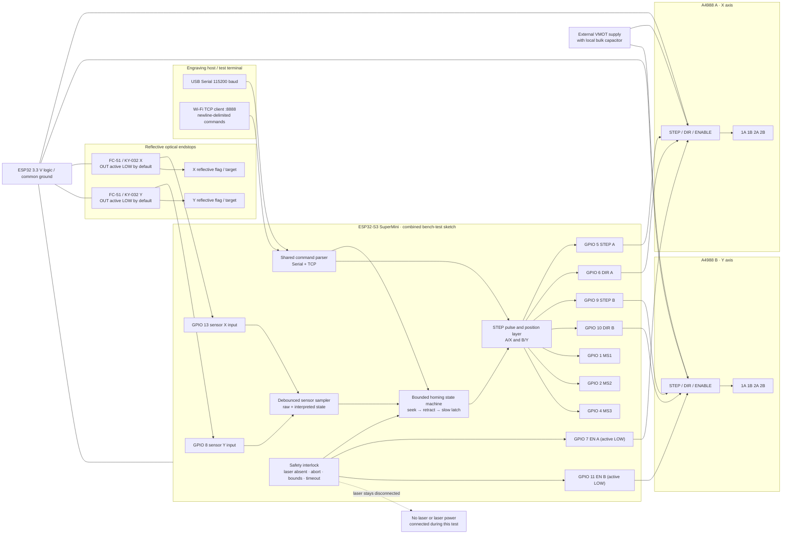

# Combined Stepper-Motor and IR Homing Test: Execution Plan

> **Status:** Planning handoff for a future implementation agent. This document does not itself implement firmware. The repository copy is `resources/combined_stepper_ir_homing_test_plan.md`; the implementation blueprints linked below provide a concise coding and guide-author starting point.
>
> **Minimum length requirement:** The final repository copy must contain at least 10,000 words. Count words in the final saved file, not in a rendered or truncated preview. If the implementation agent edits this plan, preserve the detailed requirements and diagrams and recheck the count before reporting completion.
>
> **Hardware update:** The target board has no LED connected to GPIO 13. The combined fixture therefore uses GPIO 13 for Sensor X OUT, GPIO 8 for Sensor Y OUT, and leaves GPIO 3 unused. GPIO 13 must remain an input. See the concise [coder-agent blueprint](./combined_stepper_ir_homing_coder_blueprint.md) and [guide-author blueprint](./combined_stepper_ir_homing_author_guide.md) for implementation-ready instructions.

## 1. Executive summary

Create a dedicated, standalone ESP32-S3 SuperMini bench-test sketch that brings together the existing A4988 dual-stepper test and the FC-51/KY-032 dual-IR-sensor test. The combined test must exercise both motors and both sensors as one functional system, not merely read the sensors and simulate a home sequence in software. In particular, a homing request must cause the mapped motor or motors to move in the configured home direction, stop on a stable optical trigger, back away until the signal clears, perform a slower final approach, and establish a zero reference only when that sequence has actually succeeded.

The sketch must retain the complete user-facing motor testing capability of `stepper_motor_test/stepper_motor_test.ino`: independent and coordinated movement, the existing serial command concepts, microstepping, driver control, direction changes, speed and acceleration settings, position reporting, geometric patterns, characterization routines, self-test, benchmark, idle disable, status, reset, and abort behavior. The implementation agent must verify each existing command branch and helper while porting. “Retain” means preserve test intent and a documented way to run every capability; it does not require copying unsafe implementation details or retaining misleading claims. In particular, a benchmark that only toggles a GPIO is not a physical motor test, open-loop “stall” measurements cannot prove a mechanical stall, and an unverified self-test cannot truthfully claim a motor moved. Update output wording and acceptance criteria to reflect what the hardware can actually verify.

The IR test features should be selectively carried forward. Keep the capabilities needed to qualify actual homing inputs: raw and interpreted readings for both sensors, active-level configuration, boot-time readout, continuous monitoring, edge/bounce and stability checks, trigger latency or response measurement, two-sensor observation, range/threshold calibration guidance, accumulated event statistics, noise/ambient-light checks, status, help, and reset. Replace the old `HOMESIM` as the primary homing test with real motor movement. A dry-run or sensor-only simulation may remain as a clearly labeled optional diagnostic, but must never be presented as evidence that a stepper axis homed successfully.

The user confirmed two important scope choices. First, the combined sketch should provide both a serial command route and Wi-Fi/TCP command handling so a client can send a `G28`-style request over the same general path used by the current engraving firmware. Second, the new sketch remains a **bench-test rig** using the standalone test sketches’ A4988/ESP32 pin map. It does not silently rewrite or claim compatibility with the current production firmware wiring. The production firmware currently uses different endstop pins and a different motor output arrangement; the implementation guide must make this distinction prominent.

Plan the future implementation in a new directory, `stepper_ir_homing_test/`, containing `stepper_ir_homing_test.ino` and `TESTING_GUIDE.md`. The document requested for this planning phase belongs at `resources/combined_stepper_ir_homing_test_plan.md` after review and approval. No source firmware, existing guide, existing circuit, main engraving firmware, or user-modified file should be altered merely to produce the plan. If implementation is later authorized, work only on the new combined test files unless a separately approved scope explicitly expands to production integration.

## 2. User requirements and confirmed decisions

The implementation handoff must begin by restating the requested outcome in operational language: combine the useful test coverage of two existing sketches into one new test sketch and one new guide; preserve all motor-test capabilities; choose only the relevant IR checks; add ideas that make the combined assembly reliable to test; demonstrate how the IR sensors make the motors find their home position when asked by engraving software; and include a combined wiring view and test process.

The user does not request a firmware implementation in this task. The immediate deliverable is a highly descriptive Markdown plan for another agent. The user specified that the plan be located in the repository’s `resources/` folder and be at least 10,000 words. The precise planned document name is `resources/combined_stepper_ir_homing_test_plan.md`. The future combined test sketch and test guide are planned for `stepper_ir_homing_test/`, keeping the new fixture distinct from the two source tests and from the production firmware.

The user chose **both serial and TCP/Wi-Fi homing requests**. The sketch should retain the serial interface used by the current motor test and provide a line-oriented TCP service on the project’s existing port, 8888, so that the software-side request path can be exercised. A serial `G28` command should also be supported as a convenient equivalent. The guide must explicitly distinguish “the combined fixture accepts the same kind of request” from “the production application has been fully integrated and validated”; the former does not automatically prove the latter.

The user chose the **bench-only hardware boundary**. Use the common map documented by the standalone motor and IR sketches, not the different pin definitions in `laser-engraver-firmware/config.h`. The plan must not conflate the A4988 pulse/direction outputs with the production firmware’s current coil-control pin map. Nor should it imply that changing an IR pin in a test sketch is sufficient to make the production stepper drivers work. Production integration remains a separate future task.

The user has not supplied physical measurements or final mechanical directions. Therefore, the implementation agent should not invent a physical “negative” direction, an absolute sensor trip distance, a maximum carriage travel, or a universal optical threshold. Instead, expose direction and bounded travel as named, reviewable settings, provide a safe bring-up procedure, instruct the operator to validate direction at low speed, and make all acceptance criteria measurable in steps, time, input state, and observed physical movement. If a meaningful safe bound cannot be set without machine dimensions, choose a conservative configurable default, require explicit operator confirmation in the guide, and fail with an informative timeout/step-limit result rather than continuing indefinitely.

## 3. Repository facts that constrain the plan

The motor source sketch is `stepper_motor_test/stepper_motor_test.ino`. It targets an ESP32-S3 SuperMini and two 28BYJ-48 motors converted to bipolar operation and driven by two A4988 modules. It uses Arduino core APIs and no external motor library. Its motor A/X signals are STEP GPIO 5, DIR GPIO 6, and active-low ENABLE GPIO 7. Motor B/Y uses STEP GPIO 9, DIR GPIO 10, and active-low ENABLE GPIO 11. The shared microstep-select signals are MS1 GPIO 1, MS2 GPIO 2, and MS3 GPIO 4. The source sketch assumes GPIO 13 is an onboard status LED, but the user has confirmed GPIO 13 is not connected to an LED on the target board. The combined sketch must not rely on an onboard LED.

The IR source sketch is `ir_sensor_test/ir_sensor_test.ino`. Its original standalone map expects sensor X OUT on GPIO 3 and sensor Y OUT on GPIO 8. For the new combined fixture, the user requests moving Sensor X OUT from GPIO 3 to GPIO 13 because GPIO 13 is not connected to an onboard LED. Therefore the combined-test map is Sensor X GPIO 13 and Sensor Y GPIO 8; GPIO 3 is unused. This combined map supersedes the standalone IR sketch’s GPIO 3 mapping and the source sketches’ former GPIO 13 status-LED assumption. The source sketches treat the usual FC-51/KY-032 LM393 module output as active LOW when the reflective target is detected and configure the ESP32 inputs with internal pull-ups.

On the combined-test fixture, the two sensors do not collide with the A4988 control pins. Sensor X GPIO 13 and Sensor Y GPIO 8 are separate from the motor STEP/DIR/ENABLE pins and from MS1/MS2/MS3. GPIO 3 is intentionally unused. Document the physical header positions for GPIO 13 and GPIO 8 using the exact board revision and cross-check them against the circuit diagrams before publishing a wiring table. Do not infer that a board silk-screen number is the GPIO number.

The production project is a different concern. `laser-engraver-firmware/config.h` currently defines endstop X/Y pins as GPIO 11 and GPIO 12. Its motion implementation initializes coil-control outputs, not A4988 STEP/DIR/ENABLE signals, and `laser-engraver-firmware/homing.cpp` contains stub methods that currently return success without moving the motors. The production sketch’s Wi-Fi server listens on TCP port 8888; it passes parsed `G28` commands to `homeAll()` and then reports `ok` without checking the boolean result. These facts make a direct “the fixture is identical to production” claim false. The new guide must call out both the pin-map/driver mismatch and the not-yet-implemented production homing behavior.

Both source sketches and both guides are large, active project artifacts. The working tree was already dirty during plan preparation: the IR sketch and two guides have existing local modifications, `graphify-out/` is untracked, and `ir_sensor_test/circuit_diagram.html` is untracked. The implementation agent must treat all such content as user-owned, preserve it, and avoid cleanup or reversal. This plan intentionally specifies a new fixture rather than merging or rewriting the modified source files.

The source circuit diagrams are `stepper_motor_test/circuit_diagram.html` and `ir_sensor_test/circuit_diagram.html`. The future guide should be consistent with their verified electrical layout but should produce a single combined diagram and a single authoritative combined connection table. Do not copy contradictory pin maps or overstate sensor voltage safety from a diagram without checking the exact module output circuit and measuring it.

## 4. Deliverables and boundaries

### 4.1 Planning deliverable

Create `resources/combined_stepper_ir_homing_test_plan.md` as a standalone Markdown handoff. It must contain at least 10,000 words, a detailed implementation sequence, a system diagram written in Mermaid, at least one equation formatted in LaTeX, a pin-by-pin combined wiring specification, a complete motor feature-retention matrix, a considered sensor-feature selection, the homing control contract, command/interface requirements, risk and safety requirements, a manual test protocol, acceptance criteria, and a traceability table. The plan must remain clear that it describes future work and is not evidence that the firmware has been compiled or tested.

### 4.2 Future firmware deliverable

Create `stepper_ir_homing_test/stepper_ir_homing_test.ino` as a standalone Arduino sketch for the combined test rig. It must be understandable and buildable when opened as a sketch folder in Arduino IDE or compiled with the project’s established tooling. Avoid introducing a dependency merely for convenience. Reuse the existing standard Arduino APIs and ESP32 Wi-Fi APIs only. Preserve familiar command semantics where possible; document any safe, necessary differences.

The firmware should have a single axis abstraction or clearly parallel axis state for X/A and Y/B, a unified and testable command dispatcher, independent sensor state tracking, a sensor debounce/filter helper, a motor pulse/movement layer that can be interrupted, and a homing state machine that produces explicit results. Keep the architecture simple enough for one sketch file, but separate conceptual responsibilities into named functions and well-labeled sections. Do not create a broad framework or extract an unnecessary library for a one-off fixture.

### 4.3 Future testing guide

Create `stepper_ir_homing_test/TESTING_GUIDE.md` as the complete operator manual. It should guide a reader from unpowered wiring inspection through first sensor reading, low-speed motor direction checks, individual axis homing, dual-axis homing, stop/timeout behavior, command transport tests, preserved characterization tests, and final results reporting. Include a safety checklist, combined Mermaid circuit/architecture diagram, concise pin matrix, exact command examples, expected responses, failure symptoms and recovery steps, and a section explaining the production-firmware mismatch.

### 4.4 Out of scope unless separately approved

Do not change `laser-engraver-firmware/`, replace its motion layer, add production homing, change the existing test sketches, revise the main application, drive a laser, implement laser PWM, add network security/authentication to the project as a whole, or promise compatibility with other boards. Do not retarget pins to the production firmware’s current config in an attempt to blend two incompatible driver schemes. Do not modify dependencies or add libraries unless implementation discovers a concrete build requirement and reports it for authorization.

## 5. Combined electrical and software architecture

The bench-test rig has four functional layers. The ESP32-S3 is the test controller and command endpoint. The two A4988 drivers translate STEP/DIR/ENABLE signals into motor coil current. Two motors represent the X and Y test axes. Two optical sensors provide endstop-like feedback to the controller. The sensor signals are software inputs, not a substitute for driver fault detection: the A4988 has no position encoder, so the sketch knows commanded steps, not verified mechanical position between sensor events.

The plan’s wiring must represent a shared ground reference, distinct logic and motor-power paths, driver current limiting, sensor supply, and the fact that the laser is not part of the fixture. The stepper test guide currently differentiates ESP32 USB/logic power from an external 5 V VMOT rail. Preserve that separation and the guide’s capacitor and current-limit checks. Confirm the actual A4988 board’s VDD/VMOT range, coil current, resistor value, and current-limit formula against its module before recommending a Vref number. Never imply that a current setting from one sense-resistor variant is universal.

Use this Mermaid diagram as a required architecture illustration in the plan and as the basis for the final guide diagram. The implementation agent should check Mermaid syntax and ensure all pin labels match the verified table. The diagram is logical rather than a replacement for physical pinout and safety instructions.

The architecture diagram intentionally does not show a laser output. The current motor test uses GPIO 9 as Motor B STEP, whereas the IR testing guide’s integrated laser view uses GPIO 12 for laser PWM. The current production config uses GPIO 12 as an endstop Y input. The new bench sketch must not initialize or pulse a laser pin, and the wiring guide must say that no laser module or laser power is connected during these tests. GPIO 13 is Sensor X OUT and must remain an input.

## 6. Electrical pin map, wiring, and power requirements

Use one table as the authoritative combined fixture map. The implementation agent must verify each entry against the actual source sketch and both HTML circuits before finalizing the guide. Physical header position descriptions should be retained where useful, with GPIO names presented prominently. Axis terminology must be consistent: Motor A = X and Sensor X = X endstop; Motor B = Y and Sensor Y = Y endstop. Avoid switching between A/B and X/Y without defining the aliases.

| Function | ESP32-S3 GPIO | Destination / behavior |
|---|---:|---|
| Motor A/X STEP | 5 | A4988 A STEP; rising-edge pulse |
| Motor A/X DIR | 6 | A4988 A DIR; homing direction is configurable and verified physically |
| Motor A/X ENABLE | 7 | A4988 A ENABLE; active LOW |
| Motor B/Y STEP | 9 | A4988 B STEP; rising-edge pulse |
| Motor B/Y DIR | 10 | A4988 B DIR; homing direction is configurable and verified physically |
| Motor B/Y ENABLE | 11 | A4988 B ENABLE; active LOW |
| Shared MS1 | 1 | Both A4988 modules; microstep truth table |
| Shared MS2 | 2 | Both A4988 modules; microstep truth table |
| Shared MS3 | 4 | Both A4988 modules; microstep truth table |
| Sensor X OUT | 13 | INPUT_PULLUP, active LOW default, configurable polarity; moved from standalone GPIO 3 |
| Sensor Y OUT | 8 | INPUT_PULLUP, active LOW default, configurable polarity |
| Sensor power | board-appropriate rail | Follow measured module requirements; share ground |
| A4988 logic VDD | 3.3 V per verified module | Common ESP32 logic level and ground |
| A4988 VMOT | separate motor supply | Sized for the motor and driver, with local bulk capacitance |
| Laser | none | Not connected or controlled by the test sketch |

The user has confirmed GPIO 13 is not connected to an LED on the target board, and the combined fixture assigns GPIO 13 to Sensor X OUT. Never configure GPIO 13 as an output or use it for an indicator. Report status through Serial and TCP. If a physical indicator is added later, choose a separately verified unused GPIO and update the mapping only after checking conflicts.

Every sensor’s OUT signal must be measured before direct connection to an ESP32-S3 input. The board’s module may use an open-collector comparator, an indicator LED, or a clone-specific output stage. A module powered from 5 V is not automatically safe to connect to a 3.3 V GPIO. The guide must require checking whether the output is pulled up to the ESP32’s 3.3 V or to 5 V; use an appropriate level shifter or divider if the output can exceed the MCU’s allowed input voltage. The existing sensor guide mentions a 10 kΩ/20 kΩ divider as an optional safety precaution; verify the chosen network against the actual sensor output, signal edge speed, and board specifications before adopting it as mandatory or sufficient. Avoid presenting “direct connection” as universally safe.

The shared ground must connect ESP32 GND, both A4988 logic grounds, both A4988 motor grounds, sensor ground, and the external motor supply negative. The high-current motor return should not be routed through a fragile signal path. A4988 modules must have RESET tied to SLEEP as their board requires, the MS truth table should be matched to the actual module, and the VMOT rail should have an appropriate local electrolytic capacitor close to the driver. Confirm capacitor polarity and voltage rating. Check the motor coil pairs with a meter and connect only with all power removed.

The guide must include the mandatory no-hot-plug rule: remove motor-driver power before inserting or removing a stepper coil connector. It must require current-limit adjustment before running both motors and must not assume “5 V motor supply” means every 28BYJ-48 conversion is safe at arbitrary current. State that the operator should use the motor/driver specifications and exact sense resistor to calculate current limit and should stop if the driver overheats, the motor stalls, or wiring becomes warm. A software speed cap is not an electrical current limit.

The first power-on sequence must keep VMOT off while verifying the controller boots, input levels are sensible, STEP/DIR pins idle safely, ENABLE remains disabled, and the laser is absent. Only after these checks should the driver supply be enabled with one motor connected. Tests involving two motors should be introduced after single-axis movement and current-limit checks pass.

## 7. Command routing and communication protocol

Implement one command parser used by both input sources. Serial remains available even if Wi-Fi credentials are blank or an access point is unreachable. TCP support must use the existing project port, 8888, when configured. Both interfaces accept one trimmed, newline-terminated command per line. Strip an optional trailing carriage return and normalize command names case-insensitively. Enforce a maximum input line length and reject overlong or malformed input with an explicit error instead of allowing an unbounded buffer or silently truncating into a different valid command.

The command source must be carried through parsing and execution so responses return to the originating interface. A serial command should not produce a misleading TCP `ok`, and a TCP command should not rely on a user watching the serial log. Human-readable serial diagnostics may remain richer than the network acknowledgement, but every network request must receive a deterministic outcome. Use a small response contract such as:

* `ok` only after a completed command has actually succeeded.
* `error: <stable-code> <short explanation>` for invalid arguments, disabled network service, unavailable sensor, failed homing, timeout, step-limit exhaustion, abort, busy state, or internal failure.
* Optional extra diagnostic lines may be sent before the final result if the host protocol permits them; otherwise keep the TCP response one line and publish detailed status separately.

The current main firmware speaks line-based TCP on port 8888 and recognizes exact `G28`/`g28` as a homing request. The test fixture should accept exact `G28` from TCP as well as serial. It should also provide clear fixture-oriented aliases such as `HOME X`, `HOME Y`, and `HOME ALL` on both transports. Because the existing production parser treats `G28` as the homing token and replies with `ok`, accepting that token provides useful protocol-path testing. Do not imply that this alone integrates the main client with the bench fixture: document network address discovery, credential setup, whether the host can connect to this fixture’s server, and that the same IP/port cannot simultaneously be served by a separate running firmware instance.

A single active TCP client is adequate for a bench fixture. Define and document how a second connection is handled. The simplest safe policy is to reject it or close it explicitly while one client is active; do not allow two clients to interleave commands or both believe they own a homing cycle. Wi-Fi initialization should be bounded and non-blocking or time-limited so missing credentials, unavailable access points, and interrupted connectivity cannot prevent serial control or make the motors remain enabled. Do not print or include the Wi-Fi password in logs or the guide. If example credentials are needed, use placeholders and instruct the user to keep real credentials local and out of version control.

Define command priority. An emergency stop must be recognized over serial and over the active TCP connection during motion. If both transports issue requests concurrently, a stop wins, while ordinary commands received during a homing operation are rejected as busy or queued only if queue semantics are deliberately implemented and tested. Prefer rejecting new motion commands during homing over a hidden command queue. Only one motion-owning operation may execute at a time.

### 7.1 Command inventory that must be documented

Preserve and test the existing motor command families, reconciling spelling and aliases when porting. At minimum the guide must list enable/disable, continuous start/stop, relative step, speed configuration, absolute goto, position and zero, direction setting/inversion, revolution-based moves, RPM reporting, microstepping, acceleration setting, auto-disable, dual step, dual goto, dual speed, square and circle tracing, dual return-to-zero behavior, backlash routine, stall/speed characterization, self-test, benchmark, status, help, reset, echo, and abort. The exact existing command syntax should be read from the source `printHelp()` and command handler; this plan intentionally does not invent alternatives for every legacy alias.

Add sensor and homing commands for raw/interpreted readout, monitoring/watch, debounce or edge characterization, response/latency tests, sensor calibration/range/threshold checks, two-sensor status, noise/ambient-light tests, event stats, and real homing. The old `HOMESIM` behavior must either be retired or renamed unmistakably as a simulation; a real physical `HOME` or `G28` must not be routed to that simulation.

Suggested compact shared commands are `READ`, `MONITOR`, `WATCH`, `CALIB`, `RANGE`, `THRESHOLD`, `DEBOUNCE`, `EDGES`, `RESPONSE`, `LATENCY`, `NOISE`, `AMBIENT`, `STATS`, `STATUS`, `HELP`, `RESET`, `INVERT`, `ENABLE`, `DISABLE`, `START`, `STOP`, `STEP`, `SPEED`, `GOTO`, `POS`, `ZERO`, `DIR`, `REV`, `RPM`, `MICRO`, `DUAL`, `BACKLASH`, `STALL`, `ACCEL`, `AUTODISABLE`, `TEST`, `BENCHMARK`, `HOME`, and `G28`. Do not retain the source `LED` command as an LED-mirroring toggle because no LED is connected and GPIO 13 is Sensor X. The implementation agent must resolve overlapping command prefixes carefully: for example `DUAL HOME` currently means return both open-loop positions to coordinate zero, whereas a sensor-controlled `HOME ALL` should seek the optical sensors. Keep these semantically distinct, document the difference, and do not let one command’s name conceal the other’s behavior.

Any legacy command that cannot safely run through TCP can be explicitly marked serial-only if the shared command router returns a clear unsupported-transport error. However, all commands that can move motors must be serialized with homing and must share the same emergency stop path. In the final guide, indicate which commands are safe to run with VMOT off, which require one or both drivers powered, and which are characterization routines rather than safety-certified measurements.

## 8. Motion model and step accounting

Represent axes consistently: Motor A is X, Motor B is Y. Maintain signed commanded step positions, microstep mode, configured speed, direction inversion, enable state, and operation state per axis. Explain in help and guide that positions are open-loop counts. A4988 drivers do not report the number of steps physically completed, and a stalled or disconnected motor can make the software count diverge from reality until a sensor event or manual reset.

Retain the existing A4988 pulse requirements from the source sketch, including the minimum STEP high duration and DIR setup margin, but verify the A4988 datasheet/module requirements and any ESP32 API timing implications. Keep speed constrained to a reasonable range. Current maximum speed values are not evidence that a 28BYJ-48, converted motor, driver, power supply, or mechanism can safely attain those rates. Make the guide emphasize gradual speed characterization. Use integer-safe conversion and prevent divide-by-zero, overflow, invalid negative-to-unsigned conversion, or excessive `abs()` behavior at the minimum signed value.

Microstepping is shared by the two drivers in the source wiring, so it changes both axes together. Any position accounting must preserve the meaning of the current position when resolution changes. The implementation may either scale the position by the ratio of old and new microstep resolutions or disallow changing microstep mode away from a known zero/idle state; choose one explicit behavior and test it. Do not quietly reinterpret a count as the same mechanical distance after changing from full to sixteenth step. Document the source sketch’s nominal base steps per revolution and its assumptions about the 28BYJ-48 conversion, gear ratio, coil sequence, and output calibration; do not state a false exact linear distance without the machine’s mechanics.

The existing pulse loops are blocking in some routines and check serial abort only periodically. The combined implementation must preserve responsive abort and sensor monitoring while a motor moves. The preferred design is a cooperative motion engine: each loop iteration polls serial, services Wi-Fi, samples endstops, updates the homing state machine, and emits due pulses without blocking for long intervals. If a fully cooperative refactor is too risky for one implementation step, at minimum every finite movement loop must service both communication paths, sample the relevant endstop, honor stop/abort, and enforce elapsed-time and step bounds. A fixed-count check every 32 steps is not sufficient for homing if it delays response or blocks the network. Avoid long `delay()` calls in real homing.

For a two-axis coordinated linear move, preserve the current DDA/Bresenham-style ratio behavior and prove the final commanded coordinates for unequal positive and negative distances. For square and circle traces, retain the existing trajectory intent but ensure abort checks occur between and during segments. Circle/square shape commands are not part of homing. They must reject invalid sizes and segment counts, bound operation duration, and return a partial/aborted status rather than claiming completion after stop.

The command-position variables must be reset only when the operator requests `ZERO`, when a completed sensor homing sequence establishes the relevant axis origin, or when a documented reset operation explicitly invalidates coordinates. A reset must not tell the operator that an unhomed physical axis is known to be at machine home. Use a distinct `homed` state per axis and report it in `STATUS`. On abort, timeout, power loss, or an ambiguous sensor condition, mark the affected axis unhomed. If the movement operation can be aborted between pulse edges, guarantee STEP returns to its inactive level before returning.

## 9. Homing behavior and state machine

### 9.1 Required functional behavior

Homing means moving the real mapped motor while observing its paired sensor. X homes using Motor A and Sensor X; Y homes using Motor B and Sensor Y. An individual-axis request must not move the other axis. `HOME ALL` and TCP/serial `G28` should home both axes in a deterministic order by default, preferably sequentially so each move is bounded and operator-observable. Simultaneous seek is an optional future optimization only if independent sensor monitoring, abort responsiveness, power/current constraints, and safety limits have been validated. The implementation must not use the current simulated `HOMESIM` step counter as a physical position.

Each home request should start only when no other motion-owning operation is active. Before motion, verify that the requested driver can be enabled, the sensor input is configured, no stop latch is active, and the initial sensor state is known. Emit an explicit state transition message for serial diagnostics and a deterministic network result. If the sensor is already active at startup, do not blindly move farther into the endstop. First move away in the configured retract direction until a stable clear condition is observed, within a configured maximum retreat count and timeout. If the sensor cannot clear, fail safely, stop pulses, disable or hold the drivers according to the configured safety policy, and leave the axis unhomed.

If the sensor begins clear, perform a bounded fast approach toward the endstop. During motion, sample the paired sensor through the stable-state filter. On a stable trigger, stop issuing steps promptly. Back away in the opposite direction until the sensor reads clear stably; enforce both a maximum retract count and a timeout. Then perform a slower, bounded final approach toward the sensor. Require a stable trigger at the slow-latch stage before declaring home. The final known position may be represented as zero at the trigger point or as a documented offset after a final clearance move; choose one convention, apply it consistently, and report it. Do not set the axis zero at the first noisy transition.

The algorithm above is sometimes called fast seek, pull-off, and slow latch. If the implementation chooses a different order or omits a stage, it must explain why in the plan’s handoff and guide, and still satisfy repeatability and safe handling of a sensor initially blocked. Because the intended reflective target may have a finite optical trip band, the guide must explain that the slow re-approach improves repeatability but does not guarantee accuracy beyond the sensor, target geometry, mounting stiffness, and filter latency.

### 9.2 State model

Use explicit named states at least conceptually equivalent to:

1. `IDLE`: no active homing operation.
2. `VALIDATING`: check parameters, sensor state, transport request, and busy/abort state.
3. `CLEARING_INITIAL_TRIGGER`: if input is active before seek, back away until stable clear.
4. `FAST_SEEK`: move toward the endstop at a bounded fast speed and sample the input.
5. `FAST_STOP`: stop at stable trigger and preserve the step count at the detected edge.
6. `PULL_OFF`: retreat until stable clear or a safety bound expires.
7. `SLOW_LATCH`: make a bounded low-speed approach until stable trigger.
8. `SET_ORIGIN`: record the chosen machine coordinate and set that axis’s homed flag.
9. `COMPLETE`: publish success exactly once and release the operation lock.
10. `ABORTED`: stop motion, mark position uncertain/unhomed, report abort and release.
11. `FAILED`: stop motion, preserve diagnostics, mark unhomed, report a stable failure code.

Whether these states are separate enum values or functions is an implementation detail, but the control flow must be observable and testable. Never allow `COMPLETE` to be reached from a timeout or canceled request. Use an explicit result type or an equivalently clear enum rather than a boolean that conflates “no request,” “still in progress,” and “success.”

### 9.3 Timing, step, and distance bounds

Every homing phase needs a maximum elapsed duration and maximum commanded step count. Both are required: a timer alone does not protect against unexpectedly fast pulses, and a step limit alone does not protect against a blocked state that emits no pulses. Use unsigned elapsed-time comparisons that remain safe across `millis()` wraparound. Define configuration constants with units in their names, such as `HOMING_FAST_SPS`, `HOMING_SLOW_SPS`, `HOMING_MAX_SEEK_STEPS`, `HOMING_MAX_RETRACT_STEPS`, `HOMING_PHASE_TIMEOUT_MS`, `HOMING_DEBOUNCE_MS`, and `HOMING_STABLE_SAMPLES`. Avoid unlabelled magic values.

Initial defaults must be conservative and documented as commissioning defaults, not universal machine dimensions. Start at low speed and short travel for the first physical validation; require the operator to confirm travel limits and direction before increasing bounds. Where no mechanical travel limit is known, a bounded number of steps prevents infinite movement but does not guarantee the carriage cannot hit a hard stop. The guide must tell the user to place the machine near a safe starting location and use a low, conservative first run.

### 9.4 Result and safety semantics

`G28` should return `ok` only if all requested axes home successfully. If X succeeds and Y fails, report partial state clearly, mark Y unhomed, and do not tell the host the full home request succeeded. If the client protocol only supports one final line, return a stable error indicating which axis and phase failed, such as `error: HOME_TIMEOUT Y FAST_SEEK`; keep detailed counts and duration in status/log output. The implementation should decide whether X remains homed if later Y fails; the recommended choice is to preserve X’s valid homed flag and report the partial result, unless the mechanical system couples axes such that moving Y invalidates X. Document the choice.

On abort, leave no active STEP pulse, stop issuing pulses, report the actual counted positions as provisional, set the affected axis unhomed, and release locks. Whether to de-energize immediately or hold torque briefly is a hardware-risk decision. The default should prioritize stopping movement; if holding coils is important for preventing gravity-driven movement, document the hold timeout. Auto-disable must never silently de-energize an axis during a homing phase or while motion is active.

## 10. Sensor handling and retained IR diagnostics

### 10.1 Sensor polarity and initialization

Default to active LOW because that is the behavior described by both the IR sketch and the usual FC-51/KY-032 comparator modules. Keep a deliberate configurable polarity option for variants and diagnosis. The `INVERT` command should change the interpreted state at runtime only when no homing operation is active, or it should reject the request as busy; changing polarity halfway through a home could create a false endstop. The guide should explain that `RAW LOW` is an electrical level while `DETECTED` is an interpreted state, and these terms must not be used interchangeably.

Configure sensor pins using the verified input mode, normally `INPUT_PULLUP` for open-collector outputs. At boot, sample and print both raw levels and interpreted states. Do not declare “sensor disconnected” solely from a constant HIGH or LOW reading; present diagnostic clues and let the operator verify output voltage and the sensor module’s own indicator, if present. A disconnected wire often reads HIGH with a pull-up, but that is a diagnostic heuristic, not proof of a good clear state. Do not implement a fake software success state for a missing sensor.

### 10.2 Debounce and stable-state validation

Use a small filter appropriate to optical threshold noise. A stable consecutive sample filter, a time-based stable interval, or a documented combination is acceptable. The existing sources suggest millisecond-scale debounce and three consistent samples; validate actual behavior with transitions, observe responsiveness, and expose the debounce setting for test. Do not hard-code a long sleep that blocks emergency stop or network service. Keep raw reads available for diagnostic mode and apply the stable interpretation for homing.

Track transition counts and distinguish genuine stable transitions from suspected bounce/oscillation. Add hysteresis only if the sensor hardware or algorithm supports it; do not fake hysteresis by pretending a raw state has changed. A sensor may chatter around its trim-pot threshold due to reflection, ambient light, alignment, vibration, or electrical noise. Tests should expose rather than conceal that behavior.

### 10.3 Retain, simplify, or omit IR-only features

Carry forward `READ` or an equivalent snapshot for both sensors and raw level plus detected/clear status. Carry forward `MONITOR` and/or `WATCH` to stream transitions and allow abort. Keep calibration and range checks because optical distance and target material affect homing; make operator guidance factual and avoid guaranteeing the nominal 2–30 mm ranges of clone modules. Keep threshold diagnosis and trim-pot adjustment help, but do not drive the potentiometer electronically. Keep edge/debounce stability tests and response/latency measurements because both directly affect homing repeatability. Do not retain the source’s GPIO 13 status-LED behavior: GPIO 13 is Sensor X OUT in the combined fixture.

Keep dual-sensor dashboard/status and cross-axis synchronization checks as diagnostics. Keep noise and ambient-light tests, but make their limitations clear: a bench test cannot prove immunity to every room lighting source or machine vibration. Keep trigger/release counters, durations, and statistics reset/status. Keep an active polarity inversion diagnostic but prevent unsafe runtime switching during motion.

The original IR sketch’s `HOMESIM` uses delays and simulated steps and only tests one sensor. It is not the combined fixture’s functional homing path. Replace its role with real `HOME X`, `HOME Y`, and `HOME ALL` routines. If retaining an optional simulation is useful for checking state reporting without motor power, call it `HOMESIM` or `HOMING DRYRUN`, make output say “SIMULATED—NO MOTOR MOTION,” and ensure it cannot set real `homed` flags or satisfy a `G28` request.

### 10.4 Event statistics

Retain useful statistics such as stable trigger count, release count, bounce/unstable transition count, last trigger/release timestamps, minimum/maximum trigger duration, completed cycles, false-trigger observation count, and uptime. Define what constitutes a “cycle” and a “false trigger”; if it cannot be determined autonomously, label the count as operator-marked or remove it rather than presenting a sensor event as false without evidence. Use fixed-width numeric types and guard accumulation/overflow. `RESET` should clear statistics without accidentally reconfiguring GPIOs, erasing Wi-Fi settings, or falsifying homing status. Provide a separate, clearly named coordinate zero operation.

## 11. Complete motor-test feature parity

The motor source contains many distinct commands and routines. The future implementer must build a feature-by-feature traceability checklist from the actual current source before porting. The following matrix defines the required user-visible coverage. “Retain” means preserve a working, documented capability in the combined sketch and test guide; safe differences to internal code are encouraged. Any item omitted must be explained and approved, because the user explicitly required all stepper test features.

| Motor feature in source | Required combined behavior | Validation expected |
|---|---|---|
| `ENABLE` / `DISABLE` | Continue active-low driver control with explicit status; disable must stop continuous motion first | Verify enable pin levels and outputs de-energize as documented |
| `START` continuous rotation | Support A/X, B/Y, and both targets where source permits; respect signed speed/direction and limits | Run low-speed short test; stop each axis independently and together |
| `STOP` | Stop selected continuous motor or both; do not leave a stale running flag | Test A, B, ALL and emergency stop |
| `STEP` | Relative step moves for either or both axes, signed and bounded | Compare reported command count and visible direction |
| `SPEED` | Query/set speed per axis or both; guard zero/negative/over-limit values | Invalid values produce explicit errors; rate remains within configured limits |
| `GOTO` | Absolute logical step target for a selected axis | Verify delta and final commanded count |
| `POS` | Show both signed positions, degrees/revolution conversions, microstep mode, and homed/unknown state | Check output after known test moves and after reset/home |
| `ZERO` | Set logical count only with explicit warning that it is not sensor homing | Ensure homed flag remains false unless a true home completed |
| `DIR` | Report/set inversion per axis or both | Low-speed direction check; home direction must follow safe mapping |
| `REV` | Convert fractional or whole revolutions using current resolution with range checks | Test positive, negative, fractional, and invalid inputs |
| `RPM` | Report configured and active speeds converted to RPM | Verify formula and no divide-by-zero |
| `MICRO` | Set shared 1, 2, 4, 8, 16 microstep mode | Verify pin truth table and position scaling/locking semantics |
| `DUAL STEP` | Coordinated signed relative motion | Test equal and unequal step counts in both direction combinations |
| `DUAL GOTO` | Coordinated DDA move to two absolute targets | Verify each axis reaches the commanded count and interpolation ends |
| `DUAL SPEED` | Set both axis speeds without silently starting unless source semantics require; document any safe change | Query and exercise both speeds |
| `DUAL SQUARE` | Trace a bounded square on two axes | Verify close return to start, abort during each side, no false completion |
| `DUAL CIRCLE` | Trace a bounded circle with valid segment count | Verify radius/segments bounds and abort |
| `DUAL HOME` legacy | Preserve open-loop return to logical (0,0) under a distinct name/alias, or explicitly reconcile with the new real `HOME` command | Prove it is not confused with sensor homing |
| Backlash routine | Preserve the visual reversal/backlash characterization on the documented axis | Guide records observed deadband and warns this is not automatic metrology |
| Stall/speed test | Preserve requested-rate and elapsed-time characterization; accurately call it an open-loop rate/stall-observation test | Abort and verify actual elapsed and delivered step counts are reported |
| Self-test | Retain status-reporting, MS pins, both motor directions, coordinated movement, and microstepping checks; replace unavailable physical LED blink with a serial status-output check | Each subtest reports pass/fail/skip based on an actual observable check |
| Benchmark | Preserve raw GPIO toggle and DDA calculation measurements if still meaningful; keep motor driver disabled during raw pin toggling | Report rate and clarify that it measures firmware/pin throughput, not real motor speed |
| `ACCEL` | Retain configured acceleration parameter and either implement its effect or label it as configuration-only | Do not print a setting as active if movement ignores it |
| Auto-disable | Retain idle timeout enable/disable and safe interaction with homing | Verify it never disables during motion/home and clearly reports idle state |
| Countdown and abort | Preserve optional countdown where appropriate; abort remains responsive through both interfaces | Abort before start, during a step, during seek, and during diagnostics |
| `STATUS`, `HELP`, `RESET`, `ECHO` | Retain with merged sensor/motor/network state and explicit reset behavior | Check every status field and command listing |

The current `ACCEL` setting is stored but the source motion primitives appear to step at a constant rate, so the combined sketch must inspect the actual implementation and not claim ramping unless acceleration is implemented. The “stall test” reports timing and suggests listening/observing; it has no encoder or driver feedback. The guide must label this limitation. The self-test currently prints several fixed `[PASS]` messages after issuing pulse commands; the combined version should not claim a physical motor pass if it cannot observe motion. It can separate controller/pulse-command checks from operator-confirmed physical movement, and report `COMMANDS SENT` or `NEEDS VISUAL CONFIRMATION` accordingly.

The original motor sketch includes a 30-second idle auto-disable. Preserve its safety function but ensure it does not disable the motors between homing phases or while an axis is expected to hold position. Define whether a completed homed axis can de-energize while retaining its `homed` flag; because an open-loop mechanism may move when torque is removed, show `homed` as a reference established at that moment, not proof that the carriage has remained stationary. If disabling coils invalidates a coordinate on the actual mechanics, clear that axis’s homed status when disabling.

## 12. Merged indicator, status, and operation states

The source sketches assume GPIO 13 drives an onboard status LED, but the user has confirmed no LED is connected there. In the combined fixture GPIO 13 is Sensor X OUT, so it must remain an input and must never be written as an output. Remove LED mirroring unless a separate, verified unused GPIO is deliberately selected and documented. Serial and TCP status messages are authoritative and must communicate motion, homing phase, sensor states, errors, and idle state.

The consolidated `STATUS` output should show at least: controller uptime, serial readiness, Wi-Fi state and IP when connected, TCP client state, driver enable state, each axis’s commanded position, direction inversion, speed, microstep mode, active motion state, homed/unhomed flag, sensor GPIO (X=13, Y=8), raw level, interpreted stable state, polarity, debounce setting, trigger/release statistics, current command source, and any last homing result/error. Do not include passwords. Avoid an unreadably wide status table; use one axis per line if necessary.

The system should report startup state before enabling drivers. Both drivers should power up disabled. STEP outputs should be placed in inactive LOW state before any enable assertion. DIR pins should be initialized to a known safe level. Microstep pins should be set deliberately to the documented full-step or selected default. The sensor state should be sampled and shown before any homing request can move. Wi-Fi initialization must not delay this safety initialization.

Use separate state for “driver enabled,” “continuous motion active,” “finite move active,” “homing active,” “axis homed,” and “sensor detected.” A single boolean such as `running` is not enough to prevent conflicting operations. Keep transitions explicit and reject impossible combinations. For example, setting microstepping while an axis is moving must be rejected; starting a manual jog during homing must be rejected; asking to disable a driver during an active home should first abort motion and report the consequence or reject the command. Never write to GPIO 13 as an LED or motor status output.

## 13. New diagnostic and test features to add

The combined fixture should add tests that expose integration failures neither source test can catch by itself. These are recommended additions, not a request to add unrelated product features.

### 13.1 Real endstop-to-motion test

The core new feature is a physical endstop-driven homing routine for each axis and both axes. It reports start position, chosen direction, fast approach speed, stable trigger step, pull-off count, slow latch step, total duration, and success/failure. The guide explains how to observe actual carriage motion and sensor transition. A passing run requires actual motor movement in the intended direction and a stable sensor input; a printed simulated count is not sufficient.

### 13.2 Sensor-to-axis mapping verification

Add an explicit mapping test that shows the operator which sensor is expected to stop which motor. A manual mode can ask the operator to move the X target by hand while monitoring both inputs, then run low-speed X seek and confirm that only Motor A stops. Repeat for Y. Include a cross-wire test: trigger the non-paired sensor while a single axis is homing; the expected behavior is that it does not falsely complete the requested axis, but its state is logged. If machine geometry requires both sensors to stop all movement as global safety limits, that is an explicit configuration decision requiring user confirmation; default planned pairing is axis-specific and the guide should state it.

### 13.3 Sensor disconnect / stuck-input diagnostics

Test the input when clear, blocked, disconnected, and artificially held active if safe to do. The software should not assert that a sensor is healthy simply because a pull-up reads HIGH. It should report constant-state symptoms, and homing should fail by bounded timeout/step limit if no valid transition occurs. A stuck-active sensor should invoke the initial-clear/backoff path and fail safely if it cannot clear within bounds.

### 13.4 Repeatability measurement

Add a repeated homing option or guide-driven loop that homes one axis several times, recording final latch counts relative to a safe reference, duration, and observed spread. The motor’s open-loop steps between latches and sensor threshold variation can be compared, but no claim of absolute millimeter precision is allowed without a measured step-to-distance scale. Require a configurable small repetition count and explicit confirmation before running it. Abort must stop the current cycle and not start another.

### 13.5 Cross-axis and concurrency checks

Test that a request for X never steps B, a request for Y never steps A, dual home processes both intended sensors, a second motion command during homing gets a busy error, and an emergency stop cancels whichever transport originated the request. Test that a disconnected TCP client does not halt serial emergency stop. Test disconnect and reconnection during noncritical monitoring and during homing: motion policy must be deliberate. Recommended behavior is to continue a bounded home only if serial remains responsive and no safety condition is lost, but a lost control client should not leave unbounded motion; the guide should state and test the selected policy.

### 13.6 Network and command robustness

Test no credentials, incorrect credentials, unavailable access point, client connection, client disconnect, partial line, empty line, long line, mixed case, trailing CR, repeated G28 while busy, simultaneous command and abort, and a second client. Serial must remain responsive when Wi-Fi fails. The host’s `G28` should receive exactly one final response. Ensure success is not returned before the slow latch actually completes.

### 13.7 Sensor electrical/environmental tests

Measure output voltage at both sensor outputs in clear and detected states and record readings in the operator’s test log. Adjust each sensor’s trim pot while observing the target range, then validate with the intended reflective flags rather than a hand alone. Test ambient lighting and mechanical vibration at the actual bench. Run the noise/edge diagnostics before homing. If either sensor chatters at rest or while a motor is running, correct wiring, grounding, shielding, target geometry, or threshold before changing the debounce to an excessively large value.

## 14. Testing guide structure and required content

The combined `TESTING_GUIDE.md` must not merely paste both old guides into one longer file. It should be an operator-focused single source of truth with a clear ordering and no contradictory diagrams. Suggested sections:

1. **Purpose and scope:** what the fixture verifies, what it cannot verify, A4988 bench mapping, no laser, production-firmware caveat.
2. **Prerequisites and parts:** ESP32-S3 SuperMini revision, two A4988s, converted motors, two sensors, appropriate regulated VMOT, bulk capacitors, meter, safe mounting, target flags, USB cable.
3. **Safety:** laser absent; power sequencing; no hot-plugging; current-limit and thermal precautions; sensor-voltage check; emergency stop command; physical access to power disconnect.
4. **Architecture diagram:** combined motor, driver, sensor, controller, power, transport diagram in Mermaid.
5. **Pin and wiring tables:** pin-to-GPIO mapping, driver inputs, motor coil outputs, sensor VCC/GND/OUT, shared grounds, motor-power capacitor, optional output protection.
6. **Preflight verification:** resistance/continuity, capacitor polarity, coil pair identification, A4988 current limit, sensor output voltage, active level and pull-up check, STEP/DIR/ENABLE idle state.
7. **Arduino/tool setup:** ESP32-S3 board package settings based on existing guide, serial baud 115200, upload instructions, required Wi-Fi credentials entered locally, TCP port 8888, no committed password.
8. **First boot:** expected banner, boot readout, drivers disabled, sensor clear/detected states, serial and network readiness, explicit failure if Wi-Fi cannot connect.
9. **Sensor-only validation:** `READ`, `MONITOR`, `WATCH`, `CALIB`, `RANGE`, `THRESHOLD`, `DEBOUNCE`, `EDGES`, `RESPONSE`, `LATENCY`, `NOISE`, `AMBIENT`, `STATS`, dual sensor monitoring.
10. **Motor-only validation:** driver enable/disable, cautious direction jogs, single-axis and dual-axis `STEP`, position, speed, microstep, revolution move, goto, coordinated move, square/circle, auto-disable, backlash, rate/stall characterization, self-test and benchmark.
11. **Homing commissioning:** confirm paired sensor and physical direction at low speed; configure travel bound; clear a sensor; run one axis; observe fast seek, pull-off, slow latch; verify zero and homed flag; repeat; then do the other axis and `HOME ALL`.
12. **Serial request tests:** `HOME X`, `HOME Y`, `HOME ALL`, `G28`, each response, abort during each phase, timeout/stuck sensor, already-active sensor.
13. **TCP request tests:** host connects to board IP and port 8888; sends newline-delimited `G28`; sees exactly `ok` on success and `error:` on failure; repeats busy/disconnect/reconnect tests.
14. **Performance/repeatability record:** dates, board/firmware revision, sensor module, target material, trim setting, speed, debounce, travel bounds, supply, current setting, timings, latch counts, and observed range.
15. **Troubleshooting:** no serial, no Wi-Fi, no sensor transitions, reversed polarity, wrong axis stops, no motor movement, motor buzz/stall, driver overheating, homing timeout, false success, repeated sensor chatter, distorted TCP response, power/ground issue.
16. **Production integration limits:** pin and driver mismatch, current `homing.cpp` stubs, `G28` protocol meaning, result semantics, what must change before saying the main engraving machine is homing successfully.
17. **Test record and acceptance sign-off:** pass/fail/blocked, measured output, operator name or initials if desired, unresolved risks, do not run laser.

Each command example must use the actual final parser syntax. Expected output should be a real captured or source-derived example, not fabricated as a measured run. Before implementation, use clearly labeled “illustrative expected format”; after hardware test, update only with observed values. The guide should say what “PASS” means, what requires visual confirmation, and when an operator must stop.

## 15. Diagram requirements

The plan must contain both Mermaid and LaTeX. The Mermaid figure in this document is the architecture diagram. The future guide should include a wiring-oriented Mermaid view that clearly labels pins, grounds, power rails, and the absence of a laser. Mermaid is not a substitute for the pin matrix. Verify renderer compatibility; avoid unsupported styling or complex HTML labels that make the diagram disappear on Git hosting.

Include a homing sequence diagram with both state transitions and data flow. A second Mermaid sequence diagram can show host-to-board request and completion over Serial or TCP. Mark the timeout and abort alternatives. Keep diagrams concise and keep the authoritative pin table nearby, so a user can compare them without searching across the guide.

Use LaTeX for the sensor stability predicate and timing/step bound; for example:

$$
\operatorname{triggered}(t) =
\begin{cases}
1, & \text{if the configured active level is observed for } N
     \text{ samples spanning at least } T_d \\
0, & \text{otherwise}
\end{cases}
$$

and:

$$
\text{home phase succeeds}
\iff
\text{stable sensor transition observed}
\land
\text{steps} \le S_{\max}
\land
\text{elapsed time} \le T_{\max}
\land
\neg\text{aborted}.
$$

The final plan should explain units and configuration. If using a formula to convert commanded steps to nominal angular motion, use a conditional statement that depends on the configured resolution:

$$
\theta_{\text{commanded}} =
360^\circ \frac{n_{\text{microsteps}}}
{N_{\text{full steps/rev}} \, \mu},
\qquad
N_{\text{configured/rev}} =
N_{\text{full steps/rev}}\mu,
$$

where $\mu$ is the selected microstep divisor and the nominal motor/gear ratio must be verified. This is commanded angular motion, not measured shaft motion or verified linear carriage position.

## 16. Validation and acceptance strategy

Validation must be layered. First, perform static source review for pin uniqueness, state transitions, parse validation, blocking operations, unit conversions, and direct changes to output pins. Second, compile the standalone sketch for the exact ESP32-S3 SuperMini board package and core version documented in the guide. Third, run electrical/logic tests without VMOT. Fourth, test one powered axis at conservative settings. Fifth, test both sensors and both axes. Sixth, test homing and network requests. Finally, complete each retained characterization feature at the appropriate risk level. A successful compile alone is not evidence of safe or correct homing.

### 16.1 Static and build acceptance

* New sketch compiles without modifying existing firmware dependencies or source sketches.
* All referenced GPIOs match the combined pin table and are unique for incompatible functions.
* Sensor input setup and logic match the documented active level and pull-up arrangement.
* A4988 output state is safe at boot; drivers start disabled; no laser pin is initialized.
* Each parser input has defined length, syntax, range, and error behavior.
* No homing phase can exceed configured step and time bounds.
* Error and abort paths leave STEP inactive and mark the affected axis unhomed.
* Serial works if Wi-Fi is unset or unavailable; Wi-Fi failures are explicit and bounded.
* TCP supports newline-delimited `G28` and returns one truthful completion result.
* No credential, secret, or actual personal network name is committed.
* Help lists every retained motor feature and all sensor/homing features.
* Documentation contains 10,000 or more words only for the requested plan; the test guide should be as long as needed for usability, not padded to meet that threshold.
* Mermaid diagrams render and agree with the wiring matrix; LaTeX is valid and explained.

### 16.2 Logic and no-motor-power acceptance

With VMOT disconnected, boot and verify sensor raw/interpreted states, both GPIO input transitions, stable filter behavior, `INVERT`, `READ`, monitoring, status and statistics. Verify A4988 ENABLE remains disabled and STEP remains LOW before any command. Run self-test portions that are valid without motor power; report motor subtests as skipped rather than passing. Exercise parser edge cases and network response routing. Ensure `G28` with VMOT disconnected does not falsely report that physical homing occurred; it should fail with a driver/power/precondition error or a clearly documented controlled diagnostic result.

### 16.3 Single-axis motor acceptance

After current-limit and wiring checks, power only one driver/motor. Test a small positive and negative jog at low speed, confirm physical direction, confirm the other axis remains idle, verify microstep mode, and confirm pulse counts with a logic analyzer or suitable measurement if available. Check motor temperature and driver temperature. Disconnect power before adding the second motor or altering coil wires. Repeat for the other axis. Do not use the high-speed stall routine as a first movement test.

### 16.4 Homing acceptance

For each axis:

1. With sensor clear and carriage in safe travel, request home at conservative limits.
2. Observe motor direction and verify it moves toward the corresponding optical target.
3. Trigger the sensor; confirm fast seek stops only after a stable trigger.
4. Confirm pull-off physically moves away and sensor clears within the step bound.
5. Confirm slow latch approaches again at a visibly slower speed and records a stable trigger.
6. Confirm only that axis’s position is zeroed and its `homed` flag becomes true.
7. Repeat to evaluate latch-count spread and ensure the result is stable.
8. Begin with sensor active and verify bounded clearance before seek.
9. Disconnect or block a sensor in a controlled test and verify bounded failure, no false `ok`, no unlimited movement, and unhomed state.
10. Send abort during fast seek, pull-off, and slow latch through Serial and TCP; verify immediate safe stop and truthful error.

For `HOME ALL` and `G28`, ensure the two-axis order is explicit, both axes complete, each result is individually reported, and final `ok` appears only when all requested axes succeed. If the first axis homes and the second fails, verify the documented partial-state policy.

### 16.5 Transport and integration acceptance

Use a terminal to connect to the fixture’s IP and port 8888. Send a valid newline-terminated `G28`, then each axis command. Confirm the request is processed by the same home state machine as Serial and not by a fake parser-only stub. Verify the client receives the final response exactly once. Test empty line, invalid command, mixed case, trailing CR, excessive line length, second connection, Wi-Fi loss, serial abort while TCP home is running, and TCP abort while serial home is running. Confirm all outputs return to their originating transport and secrets do not appear in status.

The main engraving firmware must be tested separately if the user later requests full production integration. The new bench sketch’s TCP response behavior is only a fixture-level protocol verification. Before changing production firmware, the implementer must agree on the actual production stepper driver, endstop wiring, move-to-home direction, travel bounds, and `G28` success/failure contract. Production integration requires updating the currently stubbed homing implementation and ensuring the TCP server does not respond `ok` on a failed home; this is not part of the current plan’s implementation scope.

## 17. Failure modes and required handling

| Failure or unsafe condition | Required behavior |
|---|---|
| Sensor never triggers during seek | Stop at first configured bound; mark axis unhomed; return explicit timeout/step-limit error |
| Sensor active at request start | Move away only within bounded clearance attempt; fail if it cannot clear |
| Sensor chatters at threshold | Require stable filter; report unstable transitions; do not zero on a single raw sample |
| Sensor polarity is wrong | Make diagnostic state visible; reject or fail homing; no success-shaped fallback |
| Sensor cable disconnects | Do not assume HIGH proves health; bounded seek fails; explain likely pull-up state |
| Wrong sensor is triggered | Do not mark requested axis homed; log both states; stop if global safety policy says either input is a hard limit |
| Motor direction is reversed | Operator aborts; axis stays unhomed; guide explains configuration correction at low speed |
| Motor stalls or coil wiring is wrong | Never claim movement solely from sent pulses; report commanded counts and operator confirmation; stop on abnormal noise/heat |
| VMOT unavailable | Prevent or abort motor movement; return explicit precondition error rather than `ok` |
| Wi-Fi unreachable | Serial remains available; network state says disconnected; no indefinite boot block |
| TCP drops while a command runs | Apply documented bounded stop/continue policy; serial emergency stop remains possible |
| New command arrives while busy | Explicit busy error; never interleave motion state |
| Abort arrives | Stop pulses promptly, clear motion flags, mark axis uncertain, report canceled |
| Auto-disable timer expires during homing | Must not disable during active operation |
| Invalid speed/step count | Reject with valid range and no partial movement |
| `G28` second axis failure | Do not send overall `ok`; retain/report valid first-axis state only if safe |
| Position reset requested | Separate logical `ZERO` from sensor-backed homing; indicate position uncertainty |
| Microstep mode changes | Preserve distance semantics or reject outside safe state; never silently shift coordinates |
| Absent onboard LED | Do not use GPIO 13 for status output because it is Sensor X input; textual Serial/TCP status is authoritative |
| Laser accidentally attached | Guide prohibits operation; sketch has no laser output; disconnect before tests |

Error handling must be explicit. Avoid broad `catch`-style suppression, success-shaped fallback, silent reset, implicit polarity flip, or invalid-input returns with no error message. Arduino C++ may not use exceptions, but the same rule applies: all invalid commands and failed phases need an explicit response. Never report `ok` after a timeout, abort, partial homing, or disconnected required sensor.

## 18. Implementation work sequence for the future agent

### Work package A: baseline and traceability

Read the current versions of both source `.ino` files, both guides, both circuit HTML files, the production `config.h`, `homing.cpp`, `homing.h`, G-code parser, and the main firmware command path. Inspect the working tree before editing and preserve every pre-existing modification. Record the exact motor command inventory from the existing `printHelp()` and handler branches; mark each item in the motor coverage matrix as implemented, intentionally adjusted for safety, or blocked pending clarification. Verify the user’s confirmed choices: both transports, bench-only wiring, planned deliverable paths.

### Work package B: create combined file skeleton and constants

Create the new directory and sketch. Define all combined pins in one place with comments naming both logical axis and driver function. Define A4988 logic levels, pulse width, direction setup, base resolution, maximum allowed command sizes, default speeds, homing bounds, debounce configuration, Wi-Fi port, and no-laser scope. Initialize outputs to safe levels and drivers disabled before starting network services. Build early to catch board/core compatibility issues before porting every test.

### Work package C: sensor input subsystem

Implement raw reads, polarity-aware interpreted state, stable/debounced state, per-axis event counters, boot diagnostics, unified textual status reporting, and sensor diagnostics. Port only IR features needed to assess these signals. Ensure the monitoring operations can be interrupted and do not prevent motion/network servicing. Keep sensor diagnostics independently usable when motors are disabled.

### Work package D: motion layer and motor parity

Port and verify single-axis pulse/move, dual DDA stepping, target moves, circle/square paths, direction inversion, microstepping, driver control, speed/RPM math, auto-disable, and all characterization routines. Refactor finite motion loops to keep serial/TCP abort and sensor monitoring responsive. Confirm `ACCEL` behavior and correct misleading stall/self-test/benchmark output. Keep named bounds and proper signed arithmetic.

### Work package E: homing engine

Implement a small state machine with per-axis home selection, initial-active clearance, fast seek, pull-off, slow latch, debounced sensor events, step and time limits, abort, explicit errors, position zeroing, and `homed` status. Add a global motion lock so manual tests and network requests cannot overlap. Test each phase with a mocked input or a temporary manual sensor trigger before powering motors, then validate hardware at low speed.

### Work package F: command dispatcher and transports

Use one dispatcher for serial and TCP input. Maintain line buffers with length limits, parse and validate arguments, route replies to the source, and accept `G28`/`HOME` on both routes. Start Wi-Fi only after safe GPIO initialization, use port 8888, do not block serial when Wi-Fi fails, prevent concurrent client ownership, and ensure an abort command works while a move is active. Keep serial diagnostic text useful and TCP final acknowledgements stable.

### Work package G: full self-test, status, and docs

Combine motor and sensor status in coherent Serial/TCP reports. Update help text and ensure it lists every retained command. Write the unified test guide from the actual code, not from assumptions. Include diagram and matrix, exact build settings, electrical safety, commissioning sequence, TCP testing, expected output shapes, production mismatch, troubleshooting, and a result record sheet.

### Work package H: compile and staged verification

Build the sketch with the documented ESP32-S3 target and core. Run static review and available tests. Perform no-power logic checks, one-axis low-speed checks, sensor mapping checks, individual homing, dual homing, abort, timeout, and TCP. Do not claim hardware acceptance if the actual physical tests were not run. Log limitations and report measured results to the user.

## 19. Traceability from original sensor features to the combined test

| Original sensor command or capability | Planned disposition | Why / replacement |
|---|---|---|
| `READ` | Keep | Immediate raw and interpreted dual-axis status is essential before motion |
| `MONITOR` | Keep | Verifies transition stability, wire integrity, and live sensor response |
| `WATCH` | Keep or merge into `MONITOR` options | Focused observation can remain if it adds value without duplicate code |
| `CALIB` | Keep in a simplified, operator-guided form | Helps align physical target and trim pot before seeking |
| `RANGE` | Keep | Validates practical detection band for actual flags/material |
| `THRESHOLD` | Keep | Diagnoses sensitivity setting and overly narrow/wide response |
| `DEBOUNCE` | Keep | Measures stability assumptions used by homing |
| `EDGES` | Keep | Counts transitions/chatter over a bounded interval |
| `RESPONSE` | Keep or merge with `LATENCY` | Keep one clear latency measurement mechanism if the two duplicate one another |
| `LATENCY` | Keep as bounded statistical measurement | Helps select a safe slow approach speed and debounce interval |
| `HOMESIM` | Replace with actual `HOME`/`G28`; optional dry-run clearly separate | A simulated axis does not prove motor and sensor integration |
| `DUAL` / `DUAL SYNC` | Keep dual sensor dashboard/synchronization observation | Verifies channels independently and can expose crosstalk |
| `NOISE` | Keep bounded diagnostic | Helps identify false transitions; not proof of all-environment immunity |
| `AMBIENT` | Keep if implementation remains maintainable | Identifies lighting ripple relevant to optical sensors |
| `STATUS` | Merge into unified motor/sensor/network status | One coherent state view avoids contradictory subsystems |
| `STATS` | Keep useful bounded counters and durations | Useful to compare sensor lifetime and repeated home behavior |
| `LED` | Omit LED toggle; report that no onboard LED exists if the legacy command is entered | GPIO 13 is reserved for Sensor X input; no status LED is wired |
| `INVERT` | Keep but reject while operation is active | Supports module variants while avoiding changing active homing semantics |
| `ECHO` | Keep per transport or define separately | Serial echo should not corrupt TCP protocol acknowledgements |
| `RESET` | Keep narrowly scoped | Clear stats/settings only as documented; do not falsely home axes |
| `HELP` | Keep unified command list | Ensures combined interface is discoverable |
| Abort `X` | Keep and extend to TCP | Stops every diagnostic and actual movement path |

## 20. Test-case matrix with concrete scenarios

The future guide should present a concise operator checklist, while the implementation agent should use the following expanded scenarios to ensure no important path is omitted.

### 20.1 Boot and safe initialization

* Power the ESP32 by USB with VMOT disconnected and both motors disconnected. Confirm the banner shows the exact board target and pin map, each driver is disabled, all STEP pins are low, and sensor inputs are shown with raw and interpreted levels.
* Boot with both sensors clear, then boot with one sensor intentionally blocked. Confirm that boot readout reflects the actual states and that no motor starts automatically.
* Boot with invalid or blank Wi-Fi credentials. Confirm startup is bounded, the sketch reports TCP unavailable, and serial remains fully usable.
* Boot with valid Wi-Fi settings and an unavailable network. Confirm serial and safe GPIO state remain available and there is no endless `while (WiFi.status() != WL_CONNECTED)` that starves the loop.
* Verify Serial/TCP status output with no sensors triggered and no motion. Trigger each sensor separately and confirm only the corresponding input state changes.

### 20.2 Sensor signal qualification

* Run `READ` at rest and during repeated target presentation. Confirm raw levels and interpreted state agree with the configured polarity.
* Run `MONITOR` or `WATCH` on X only, Y only, and both. Confirm timestamps increase monotonically modulo timer wrap and that no transition from X is attributed to Y.
* Run debounce/edge checks while moving the target slowly through the detection threshold. Record the number of raw edges and stable transitions. Verify unstable chatter does not increment stable trigger count multiple times without a clear release.
* Run range and threshold calibration with the actual home flag and material. Record reliable maximum and minimum distance; do not use a hand as a final calibration target.
* Perform a controlled ambient-light check, such as turning room light sources on/off or changing illumination. Record whether raw sensor levels or stable edges change. Keep the test short and abortable.
* Run the two-sensor dashboard with one target moved at a time. Ensure there is no electrical or optical cross-talk that falsely toggles the opposite channel.
* Disconnect a sensor output with power off before rewiring; after restart, verify the pull-up state is diagnosed as a possible open wire but not accepted as proof of homed/healthy.

### 20.3 Motor output qualification

* With VMOT absent, enable/disable and observe logic pins with a meter or logic analyzer; no physical rotation is expected. Ensure a motor command does not falsely claim verified rotation.
* Connect one motor and driver only after the power-off wiring inspection. Set a conservative current limit, use the lowest appropriate speed, jog a small count in each logical direction, and verify actual physical direction.
* Test the axis-specific direction command and update inversion only after a controlled low-speed movement. Confirm subsequent positive and negative commands use the configured orientation.
* Exercise single-axis `STEP`, `GOTO`, `REV`, and `POS`. Confirm mathematical conversion and position counts, including negative target/delta.
* Change shared microstepping while idle and verify all three MS pins match the A4988 truth table. Confirm the displayed position continues to represent the same intended mechanical coordinate or is explicitly reset/invalidated according to the chosen policy.
* Test dual motion with equal distances and unequal distances, positive/negative quadrants, then square and circle tracing within a small bounded area. Verify both axes stop on abort.
* Confirm manual `DISABLE`, idle auto-disable, and power recovery do not leave stale continuous-run flags or false `homed` state.
* Run backlash only after direction and step mapping are known. Record the observed output-shaft response, not just controller counts.
* Run stall/speed characterization at low speed before increasing rate. Verify the reported rate uses actual completed pulses after an abort and the output explicitly says that physical stall detection is not present.
* Run self-test and check each phase result. If the controller cannot sense physical motion, require operator confirmation and report that limitation instead of declaring a fully verified pass.
* Run benchmark with motor drivers disabled and no dangerous mechanical load; confirm the GPIO benchmark is identified as signal-generation measurement.

### 20.4 Homing edge scenarios

* Start well away from the endstop with both sensors clear. Run `HOME X`, then `HOME Y`; verify only the requested motor moves.
* Move the target until the fast seek triggers. Verify the machine stops before a hard mechanical crash and that the sensor’s stable-state filter is applied.
* Observe pull-off and slow latch separately. Ensure the pull-off direction is opposite the seek direction and the slow approach rate is lower than the fast seek rate.
* Start with the requested sensor already active. Verify bounded retreat-to-clear, followed by seek/latch, or an explicit error if clear cannot be reached.
* Start with the opposite sensor active during an axis home. Verify the documented axis-specific policy and ensure no unexpected zeroing occurs.
* Hold the requested sensor clear for the entire seek. Verify max steps or timeout terminates motion and produces error, never success.
* Hold the sensor active so it cannot clear during pull-off. Verify the phase terminates at a strict bound.
* Disconnect the sensor during fast seek. Verify failure is bounded and the axis remains unhomed.
* Tap the abort key during each phase. Verify the current pulse ends cleanly, movement ceases, homed state is false, and the final response is canceled/error.
* Change the active polarity while idle, test a diagnostic reading, then restore. Try polarity change during homing and verify a busy error.
* Run repeated homes and compare latch step counts and timing. If the observed spread is too large, adjust alignment or threshold rather than loosening acceptance without review.

### 20.5 Protocol and concurrency scenarios

* Send `G28\n` over Serial and confirm it starts actual dual-axis sensor homing.
* Send lowercase `g28\r\n` over TCP and confirm case and carriage-return handling.
* Send `HOME X\n` over TCP and compare the result with the serial command.
* Send malformed `G28X` and excessive input length. Confirm parser rejects rather than interpreting a partial line.
* Attempt an ordinary `STEP` or second `G28` while homing. Confirm busy response and no interleaved pulses.
* Send emergency stop over the alternate transport. Confirm it has priority and is not blocked by the active routine.
* Drop the TCP connection while homing. Confirm the documented policy is applied and serial remains responsive.
* Connect a second TCP client while one is active. Confirm it is rejected or explicitly handled.
* Verify exactly one final success/error response is delivered to the command source; diagnostics on serial must not be mistaken for TCP acknowledgements.
* Confirm `ok` is not emitted at request parse time, before both axes finish.

## 21. Performance, latency, and homing repeatability considerations

Sensor latency and step rate interact. If the controller checks an endstop only once per emitted step, the distance traveled after a transition depends on speed and filter duration. Let $v$ be steps per second and let $\tau$ include sampling, debounce confirmation, scheduling, and pulse-stop delay in seconds. A first-order estimate of additional commanded steps after a trigger is:

$$
n_{\text{overshoot}} \approx v \tau.
$$

This estimate is not a mechanical guarantee. The motor may continue moving after pulse cessation due to inertia, backlash, coupling, or driver current; the optical sensor can trip at a variable location; and the controller’s measured latency may omit mechanical response. The plan therefore requires a slower final latch and repeated empirical testing rather than relying on a theoretical number alone.

Choose a debounce duration short enough to avoid significant overshoot while still rejecting threshold chatter. Measure actual sensor transition stability with the final target, wiring, illumination, and motor activity. At fast seek, a small overshoot may be acceptable only if the pull-off path and mechanical margin are known. At slow latch, reduce speed enough that the filtered signal can stop the commanded motion within the available safe margin. Do not set debounce based on the sensor guide’s generic recommendation without measuring the combined system.

Repeated homing should be judged with a distribution, not one successful pass. After several cycles, note latch positions relative to a stable reference or record commanded seek/pull-off/latch counts. Compute spread and median if the recorded data supports it. Do not report numeric millimeters unless steps per millimeter have been physically calibrated on the actual mechanism. The test can establish that sensor-to-motor integration is repeatable within a step count; it cannot establish engraving accuracy by itself.

## 22. Documentation consistency and quality rules

Use consistent terminology throughout: X = Motor A + Sensor X, Y = Motor B + Sensor Y; active LOW means electrical LOW is interpreted as detected; STEP count is commanded motion; homed means a stable sensor latch completed; logical `ZERO` is not physical home; `G28` is a request; `ok` is returned only on successful completion. Avoid mixing “obstacle,” “limit,” “endstop,” and “home” without explaining that the reflective sensor detects a target and that its use as an endstop depends on mechanical alignment.

The plan and guide should identify which values are defaults, which are adjustable, and which need physical calibration. Use unit suffixes in variable names and prose: `_MS`, `_SPS`, `_STEPS`, `_US`, `_MM`. If a value is a speed or maximum range, state its physical or logical meaning. Do not leave undocumented command parser shorthand in help.

Use Mermaid fences labeled `mermaid` and LaTeX with `$$` delimiters. Where a Git hosting renderer may not support a diagram or equation, provide an adjacent textual interpretation. Use relative links in repository Markdown, and point to the source sketches and diagrams for provenance. The final guide should not copy a huge old source guide unchanged; it should select the procedures relevant to one combined fixture and explicitly note what was consolidated.

Do not add code comments that repeat obvious assignments. Add short comments for non-obvious state transitions, electrical hazards, unit conversions, and any compatibility caveat. Keep comments and guide text aligned with actual behavior. Update the guide if code defaults change; command help and manual must not diverge.

## 23. Risks, open implementation questions, and decision rules

1. **Mechanical direction not supplied.** Decide by controlled low-speed jog and sensor placement. Keep configuration names explicit and document the experiment. Never guess and then permit high-speed seek.
2. **Travel bounds unknown.** Choose short conservative commissioning limits and make them configurable. Ask the user for axis travel if a final numeric limit is needed. Do not invent a physical maximum.
3. **Sensor electrical output varies.** Require meter verification and protect ESP32 inputs. If sensor output wiring cannot be verified, stop before connecting it directly.
4. **Current guides may contain assumptions or stale statements.** Cross-check against current source and modules. Do not reproduce false certainty about motor coil colors, resistor values, exact optical range, or supply current.
5. **Existing test source has blocking code and fixed pass messages.** Preserve feature outcomes while improving responsiveness and honest reporting. Do not copy the old implementation wholesale if it breaks network servicing or homing abort.
6. **The bench fixture differs from production.** Put this caveat near the beginning, pin table, network test, and final acceptance. Do not change production firmware in this workstream.
7. **Network credentials and Wi-Fi blocking.** Do not add secrets. Do not block serial or safe GPIO setup waiting forever for a network.
8. **`G28` ambiguity.** Use exact line semantics and match the request token. Define how `HOME ALL` differs from legacy `DUAL HOME`.
9. **False position confidence after abort or disable.** Mark affected axes unhomed when their physical position is uncertain; describe how an operator must home again.
10. **No encoder feedback.** A motor pulse command is not physical confirmation. Self-test, benchmark, and stall output must explicitly separate controller-side and operator-side evidence.
11. **Changing microsteps with existing positions.** Either scale logical counts or require an idle/unhomed state. State the behavior and test it.
12. **No onboard LED.** Do not configure GPIO 13 as an output; GPIO 13 is Sensor X input. Use Serial/TCP status instead.
13. **Status floods.** Keep monitoring output bounded or rate-limited. Serial and TCP logs should not starve step timing.
14. **Motor supply and thermal limits.** Software cannot replace current-limit adjustment, proper wiring, heatsinking, or supervision.
15. **Optical environment.** Sunlight, glossy/dark target materials, vibration, dust, angle, and ambient flicker may all affect readings. Include field qualification, not a universal threshold.
16. **Scope creep.** No laser control, production firmware changes, GUI, cloud service, or new framework is needed to meet this task.

Where two designs are reasonable, prefer the least complex design that is safe, explicit, bounded, and compatible with current project conventions. If a choice materially affects machine behavior—such as whether either sensor globally stops both axes, what happens on TCP disconnect, or whether a home success survives auto-disable—ask the user rather than silently guessing.

## 24. Final definition of done

The future implementation is done only when all of the following are true:

* The requested plan exists at `resources/combined_stepper_ir_homing_test_plan.md`, contains at least 10,000 words, includes both Mermaid and LaTeX, and remains an execution handoff rather than a claim of completed code.
* The new standalone sketch and guide exist at the planned paths and do not overwrite either source test.
* The sketch compiles for the stated ESP32-S3 target and documented core version.
* It exposes both serial and Wi-Fi/TCP command routes, supports `G28` over both, and routes a truthful final result to the request source.
* It performs actual sensor-triggered motor homing for X, Y, and both, with stable input filtering, initial-trigger handling, bounded seek/retract/latch, timeouts, abort, explicit errors, and correct `homed` state.
* Every stepper-motor test feature in the source has a traceable and documented equivalent, or an explicitly approved safety-driven adjustment.
* Sensor diagnostics needed to calibrate and validate home inputs remain available; redundant simulation-only behavior is not confused with real homing.
* The combined diagram, pin map, and safety instructions agree with the source hardware and keep the laser disconnected.
* The guide explains the mismatch with the production firmware and does not overstate current production support.
* Staged hardware checks have actually been performed before claiming physical acceptance. If they cannot be performed in the implementation environment, the report says exactly which checks remain unverified.
* Existing uncommitted changes and untracked user files are preserved, and no unrelated production files are altered.

## 25. Handoff notes to the implementing agent

Start by reading this entire document and the current repository versions of the listed source files. Do not treat any pin map, line number, or modified guide text as immutable without rechecking the working tree. Use the current sketches as feature references, not as code to paste mechanically. The output should be a coherent new fixture that is safe at startup, useful when networking is absent, honest about what it can measure, and capable of proving the real relationship between the sensor and the motor.

The most important functional acceptance question is not “does the sketch print a homing banner?” It is: when an authorized serial or TCP request arrives, does the correct physical axis move toward its configured sensor; does a stable sensor transition stop that motion; does a bounded pull-off clear it; does a slow final approach relatch it; does only a successful sequence establish the origin; and does every failure return a truthful result while leaving the system in a safe, recoverable state?

The most important scope boundary is not to turn this test fixture into a speculative rewrite of the engraver. Keep it as an isolated A4988 bench test, document where it differs from the actual production firmware, and make the integration boundary explicit enough that a later agent can implement production homing deliberately rather than copying the test pin map into an incompatible driver architecture.

The most important documentation criterion is that another person can wire and run the test without guessing. The guide should let the operator identify every power rail and GPIO, verify sensor voltage before connection, keep the laser out of the setup, make a cautious first jog, understand what raw and filtered sensor states mean, send a homing command, interpret an error, abort immediately, and record a repeatable result. If a piece of hardware or software prevents that, call it out as blocked rather than filling the guide with unsupported assumptions.

Finally, after the implementation, review the actual command help and test guide side by side. The code’s defaults, accepted syntax, timing bounds, Wi-Fi behavior, homing phases, failure messages, and safety procedures must all match. Re-run the word count for this plan’s repository copy after any edits, validate all Mermaid blocks, compile the sketch, run targeted tests if available, and distinguish all code-level verification from physical bench verification in the final report.
