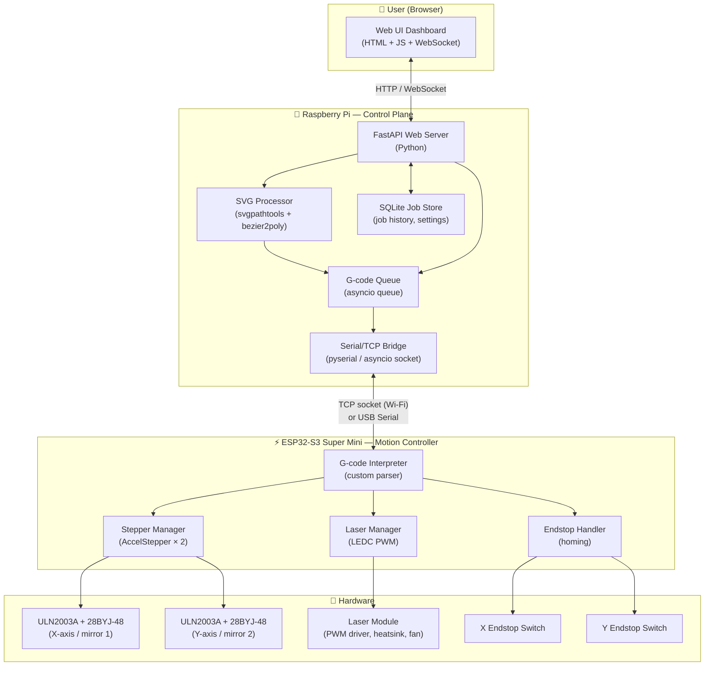
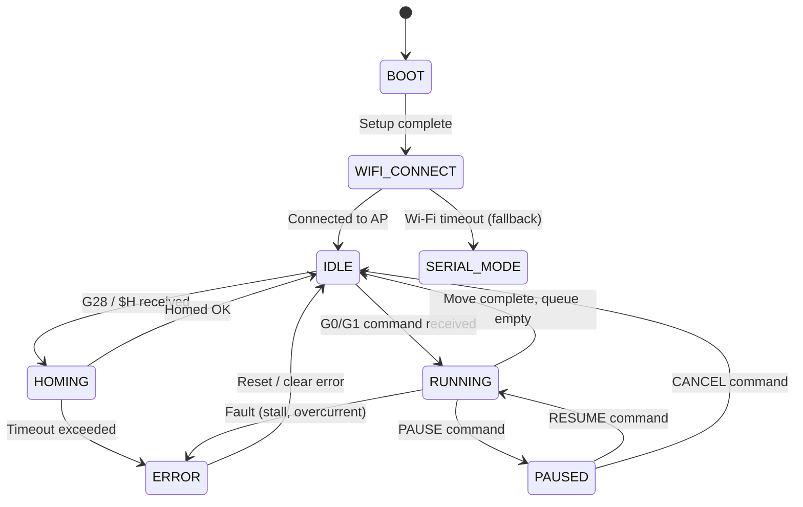

# Laser Engraver — Full Implementation Plan

**Project:** Custom SVG-Capable Laser Engraver  
**Base Chassis:** ThingEngineer / Laser-XY-Scanner (Thingiverse Thing 2710048)  
**Microcontroller:** ESP32-S3 Super Mini  
**Stepper Motors:** 28BYJ-48 × 2 (X-axis mirror + Y-axis mirror)  
**Stepper Drivers:** ULN2003A × 2  
**Laser Module:** Chinese PWM-controlled module (integrated driver, heatsink, fan)  
**Control Plane:** Raspberry Pi (any model with Wi-Fi) running a Python web server  
**Communication:** Wi-Fi TCP socket (primary) + USB Serial (fallback / flashing)  
**Primary Use Case:** SVG-based laser engraving via browser UI  

---

## Table of Contents

1. [System Architecture Overview](#sec-1-architecture)
2. [Hardware Configuration & Pin Mapping](#sec-2-hardware)
3. [Phase 0 — Laser Characterisation Test](#sec-3-phase0)
4. [Phase 1 — ESP32-S3 Firmware](#sec-4-phase1)
5. [Phase 2 — Raspberry Pi Web Server](#sec-5-phase2)
6. [Phase 3 — SVG → G-code Pipeline](#sec-6-phase3)
7. [Phase 4 — Web UI Dashboard](#sec-7-phase4)
8. [Phase 5 — Integration & System Test](#sec-8-phase5)
9. [Communication Protocol Specification](#sec-9-protocol)
10. [Project Directory Structure](#sec-10-structure)
11. [Technology Stack Summary](#sec-11-stack)
12. [Risk Register & Mitigations](#sec-12-risks)
13. [Build Sequence Checklist](#sec-13-checklist)
14. [Future Enhancements (Post-MVP)](#sec-14-future)

---

<a id="sec-1-architecture"></a>
## 1. System Architecture Overview

### 1.1 High-Level Block Diagram



### 1.2 Data Flow Summary

| Source | Destination | Medium | Content |
|--------|-------------|--------|---------|
| Browser | Raspberry Pi | HTTP POST | SVG file upload |
| Browser | Raspberry Pi | WebSocket | Live commands (start/stop/jog/power) |
| Raspberry Pi | ESP32-S3 | Wi-Fi TCP / USB Serial | G-code command stream |
| ESP32-S3 | Raspberry Pi | Wi-Fi TCP / USB Serial | Status messages (position, endstop, errors) |
| Raspberry Pi | Browser | WebSocket | Progress updates, position, status |

### 1.3 Architectural Decisions & Rationale

| Decision | Choice | Rationale |
|----------|--------|-----------|
| Language on Pi | Python (FastAPI) | Fastest iteration; rich SVG/math libraries; asyncio fits streaming |
| Communication | Wi-Fi TCP (primary) | Removes USB tether during operation; ESP32-S3 has built-in Wi-Fi |
| G-code dialect | GRBL-compatible subset | Reuses toolchain knowledge; Inkscape can export GRBL G-code directly |
| SVG parser | `svgpathtools` | Pure Python; handles Bezier curves natively; no Cairo runtime dep |
| Stepper library | AccelStepper (Arduino) | Well-tested on ESP32; handles acceleration natively |
| Laser PWM | ESP32 LEDC (12-bit) | Hardware PWM; 0–4095 resolution; configurable frequency; no CPU overhead |
| Job persistence | SQLite | Zero-config; stores engraving history and settings on Pi SD card |

---

<a id="sec-2-hardware"></a>
## 2. Hardware Configuration & Pin Mapping

### 2.1 ESP32-S3 Super Mini — Available Pins

The Super Mini exposes 14 usable GPIOs on its breakout headers. Below is the complete allocation:

```
    ESP32-S3 Super Mini
    ┌─────────────────────┐
    │ 3.3V            GND │
    │ 3.3V            GND │
    │ RST              5V │
    │ GPIO 4          5V  │ ← not used (USB power rail)
    │ GPIO 5         GPIO 43 (TX0) ←─ USB Serial / debug
    │ GPIO 6         GPIO 44 (RX0) ←─ USB Serial / debug
    │ GPIO 7         GPIO 1  │
    │ GPIO 8         GPIO 2  │
    │ GPIO 9         GPIO 42 │
    │ GPIO 10        GPIO 41 │
    │ GPIO 11        GPIO 40 │
    │ GPIO 12        GPIO 39 │
    │ GPIO 13        GPIO 38 │
    └─────────────────────┘
```

### 2.2 Pin Assignment Table

| GPIO | Signal | Connected To | Notes |
|------|--------|--------------|-------|
| GPIO 1 | STEP_X_IN1 | ULN2003A-X IN1 | Stepper X coil A |
| GPIO 2 | STEP_X_IN2 | ULN2003A-X IN2 | Stepper X coil B |
| GPIO 38 | STEP_X_IN3 | ULN2003A-X IN3 | Stepper X coil C |
| GPIO 39 | STEP_X_IN4 | ULN2003A-X IN4 | Stepper X coil D |
| GPIO 40 | STEP_Y_IN1 | ULN2003A-Y IN1 | Stepper Y coil A |
| GPIO 41 | STEP_Y_IN2 | ULN2003A-Y IN2 | Stepper Y coil B |
| GPIO 42 | STEP_Y_IN3 | ULN2003A-Y IN3 | Stepper Y coil C |
| GPIO 9 | STEP_Y_IN4 | ULN2003A-Y IN4 | Stepper Y coil D |
| GPIO 10 | LASER_PWM | Laser driver PWM in | LEDC channel 0, 5 kHz, 12-bit |
| GPIO 11 | ENDSTOP_X | X IR obstacle sensor (Active-LOW) | Active-LOW, internal pull-up |
| GPIO 12 | ENDSTOP_Y | Y IR obstacle sensor (Active-LOW) | Active-LOW, internal pull-up |
| GPIO 43 | USB_TX | Raspberry Pi RX / USB host | UART0 / USB-CDC |
| GPIO 44 | USB_RX | Raspberry Pi TX / USB host | UART0 / USB-CDC |
| GPIO 13 | STATUS_LED | Onboard LED (blue) | Job active / error blink |

> [!NOTE]
> GPIO 43/44 = UART0 default. When connected via USB cable (USB-CDC mode), these become the virtual COM port the OS sees. For Wi-Fi operation, the physical UART0 can be used for debug output only.

### 2.3 ULN2003A Wiring (per driver board, × 2)

```
ESP32-S3 (3.3V GPIO) ──→ IN1-4  [ULN2003A]  OUT1-4 ──→ Motor coils
                         VCC ← 5V rail (from USB or external 5V)
                         GND ← Common GND
```

> [!IMPORTANT]
> ULN2003A input HIGH threshold is ~1V. ESP32-S3 outputs 3.3V HIGH — fully compatible. However, share a common GND between the ESP32-S3, both ULN2003A boards, the laser module, and the Pi. A floating GND causes erratic stepping and PWM corruption.

### 2.4 Laser Module Wiring

Your laser comes with:
- **PWM input pin** — connect to GPIO 10 (LEDC output)
- **VIN / GND** — connect to a dedicated 12V supply (or whatever voltage the laser driver expects — check the module's label; typically 12V for these Chinese modules)
- **FAN/Heatsink** — passively connected on the module; no extra wiring needed

```
Raspberry Pi 5V ─┐
                 ├─→ ESP32-S3 5V (USB) + ULN2003A VCC
                 └─→ (do NOT power laser from Pi — use separate supply)

12V Supply ──────────→ Laser Module VIN + GND
ESP32-S3 GPIO10 ─────→ Laser PWM IN
GND (shared) ────────→ Laser GND (tie to ESP32-S3 GND)
```

### 2.5 Power Budget

| Component | Voltage | Typical Current | Peak Current |
|-----------|---------|----------------|--------------|
| ESP32-S3 Super Mini | 5V USB | 150 mA | 500 mA (Wi-Fi TX burst) |
| 28BYJ-48 × 2 | 5V | 130 mA each (260 mA total) | 350 mA |
| ULN2003A × 2 | 5V | negligible (logic) | — |
| Laser Module | 12V | 1–3 A (duty-cycle dependent) | 5 A |
| Raspberry Pi | 5V | 500–800 mA | 2 A |

**Recommendation:** Use two separate supplies:
1. **5V / 3A** — Powers Pi + ESP32-S3 + stepper boards (or power Pi separately and use its 5V rail for steppers)
2. **12V / 5A** — Powers laser module only (dedicated supply prevents voltage droop affecting logic)

---

<a id="sec-3-phase0"></a>
## 3. Phase 0 — Laser Characterisation Test

> [!CAUTION]
> Always wear certified laser safety goggles (OD 5+ @ 445nm for blue, or check your laser's wavelength) before powering the laser. Never aim at reflective surfaces or eyes. Work in a ventilated area — laser engraving produces toxic fumes.

This phase is **independent of all other phases**. It only requires the ESP32-S3, the laser module, and a USB connection for serial control.

### 3.1 Goal

- Determine the effective PWM range for the laser driver
- Map duty cycle (0–100%) → observable output (visual brightness, burn depth/time)
- Find the **minimum threshold PWM** below which the laser does not fire (many drivers have a dead band)
- Find the **safe idle PWM** (just enough to keep the diode warm without firing)
- Document the curve for use in the web UI power slider calibration

### 3.2 Test Firmware Sketch (`laser_pwm_test.ino`)

This is a **standalone test sketch** — not the production firmware. Upload it first.

```cpp
// laser_pwm_test.ino — PWM sweep test for laser characterisation
// Upload to ESP32-S3, open Serial Monitor @ 115200

#define LASER_PWM_PIN 10
#define LEDC_CHANNEL  0
#define LEDC_FREQ_HZ  5000   // 5 kHz — above audio range, below driver filter
#define LEDC_RES_BITS 12     // 12-bit resolution = 0–4095

void setup() {
  Serial.begin(115200);
  ledcSetup(LEDC_CHANNEL, LEDC_FREQ_HZ, LEDC_RES_BITS);
  ledcAttachPin(LASER_PWM_PIN, LEDC_CHANNEL);
  ledcWrite(LEDC_CHANNEL, 0);  // Start with laser OFF
  Serial.println("Laser PWM Test Ready.");
  Serial.println("Commands: S<0-100>  (e.g. S50 = 50% power)");
  Serial.println("          OFF       (laser off)");
  Serial.println("          SWEEP     (auto sweep 0-100% in steps)");
}

void loop() {
  if (Serial.available()) {
    String cmd = Serial.readStringUntil('\n');
    cmd.trim();
    
    if (cmd.startsWith("S")) {
      int pct = cmd.substring(1).toInt();
      pct = constrain(pct, 0, 100);
      int duty = map(pct, 0, 100, 0, 4095);
      ledcWrite(LEDC_CHANNEL, duty);
      Serial.printf("PWM set to %d%% (duty=%d/4095)\n", pct, duty);

    } else if (cmd == "OFF") {
      ledcWrite(LEDC_CHANNEL, 0);
      Serial.println("Laser OFF.");

    } else if (cmd == "SWEEP") {
      Serial.println("Starting sweep: 0% → 100% in 5% steps, 1s per step.");
      Serial.println("⚠️  Wear safety goggles! Laser will fire.");
      delay(3000);  // 3-second warning delay
      for (int pct = 0; pct <= 100; pct += 5) {
        int duty = map(pct, 0, 100, 0, 4095);
        ledcWrite(LEDC_CHANNEL, duty);
        Serial.printf("  → %d%% power (duty=%d)\n", pct, duty);
        delay(1000);
      }
      ledcWrite(LEDC_CHANNEL, 0);
      Serial.println("Sweep complete. Laser OFF.");
    }
  }
}
```

### 3.3 Test Procedure

1. Wire laser PWM pin to ESP32-S3 GPIO 10
2. Power laser from 12V dedicated supply
3. Upload `laser_pwm_test.ino` to ESP32-S3 via USB
4. Put on **laser safety goggles**
5. Open Serial Monitor (115200 baud)
6. Type `SWEEP` and observe
7. Record in a table:

| PWM % | Behaviour | Notes |
|-------|-----------|-------|
| 0% | No output | — |
| 5% | ? | Record min threshold |
| 10% | ? | |
| 20–80% | Proportional? | Check linearity |
| 100% | Full power | Note burn time on test card |

8. Point laser at a piece of black anodized aluminum or black card at ~15 cm range
9. Note at what PWM% a visible mark appears (engraving threshold)
10. Note at what PWM% a deep char occurs in 1 second (cutting threshold)

### 3.4 Calibration Output

After testing, fill in these constants that will be used in the production firmware and web UI:

```python
# laser_config.py — from characterisation test
LASER_MIN_DUTY_PCT   = 10    # Below this: no output (dead band)
LASER_ENGRAVE_PCT    = 25    # Minimum for surface marking
LASER_MAX_SAFE_PCT   = 90    # Conservative max (preserve diode life)
LASER_PWM_FREQ_HZ    = 5000  # Matches firmware LEDC config
LASER_LEDC_RESOLUTION = 12   # 12-bit
```

---

<a id="sec-4-phase1"></a>
## 4. Phase 1 — ESP32-S3 Firmware

### 4.1 Overview

The production firmware transforms the ESP32-S3 into a **G-code motion controller** with:
- A non-blocking G-code serial parser
- Coordinated dual-axis linear interpolation (Bresenham algorithm)
- Hardware PWM laser control via LEDC
- Endstop-based homing with timeout safety
- Wi-Fi TCP server for command reception (primary path)
- USB Serial fallback
- Status streaming back to the Pi

### 4.2 Firmware Architecture (State Machine)



### 4.3 Firmware File Structure

```
laser-engraver-firmware/
├── laser-engraver-firmware.ino   ← Main entry point
├── config.h                      ← All pin defs, constants, SSID/pass
├── gcode_parser.h / .cpp         ← G-code tokeniser and dispatcher
├── motion.h / .cpp               ← Stepper control, Bresenham interpolation
├── laser.h / .cpp                ← LEDC PWM, safe on/off, power mapping
├── homing.h / .cpp               ← Endstop homing sequence
├── wifi_server.h / .cpp          ← AsyncTCP server, command RX, status TX
└── status.h / .cpp               ← Status struct, JSON serialiser
```

### 4.4 `config.h` — All Constants in One Place

```cpp
// config.h
#pragma once

// ── Wi-Fi ──────────────────────────────────────────────────
#define WIFI_SSID     "YourSSID"
#define WIFI_PASSWORD "YourPassword"
#define TCP_PORT      8888

// ── Stepper X (Mirror 1) ───────────────────────────────────
#define STEP_X_IN1  1
#define STEP_X_IN2  2
#define STEP_X_IN3  38
#define STEP_X_IN4  39

// ── Stepper Y (Mirror 2) ───────────────────────────────────
#define STEP_Y_IN1  40
#define STEP_Y_IN2  41
#define STEP_Y_IN3  42
#define STEP_Y_IN4  9

// ── Laser ──────────────────────────────────────────────────
#define LASER_PWM_PIN    10
#define LASER_LEDC_CH    0
#define LASER_FREQ_HZ    5000
#define LASER_RES_BITS   12      // 0–4095
#define LASER_MAX_DUTY   4095

// ── Endstops ───────────────────────────────────────────────
#define ENDSTOP_X_PIN  11        // Active LOW (IR obstacle sensor OUT)
#define ENDSTOP_Y_PIN  12        // Active LOW (IR obstacle sensor OUT)

// ── Motion ─────────────────────────────────────────────────
#define STEPS_PER_REV     4096   // 28BYJ-48 in half-step mode
#define MAX_SPEED         500    // steps/sec (conservative; tune up)
#define HOMING_SPEED      200    // steps/sec during homing
#define HOMING_TIMEOUT_MS 10000  // 10s max homing time per axis

// ── Status LED ─────────────────────────────────────────────
#define STATUS_LED_PIN  13
```

### 4.5 Supported G-code Commands

| Command | Description | Example |
|---------|-------------|---------|
| `G0 X## Y##` | Rapid move (laser OFF) | `G0 X100 Y50` |
| `G1 X## Y## S##` | Cut move (laser ON at power S) | `G1 X200 Y100 S512` |
| `G28` | Home all axes | `G28` |
| `M3 S####` | Laser ON at duty (0–4095) | `M3 S1024` |
| `M5` | Laser OFF | `M5` |
| `M114` | Report current position | `M114` |
| `M17` | Enable stepper coils | `M17` |
| `M18` | Disable stepper coils (free motors) | `M18` |
| `!` | Emergency stop (immediate, any mode) | `!` |
| `~` | Resume after pause | `~` |
| `?` | Status query → JSON response | `?` |

### 4.6 Bresenham Linear Interpolation

The original firmware moves axes sequentially (X then Y). This produces **diagonal stair-steps** instead of true straight lines. The production firmware uses Bresenham's line algorithm for coordinated motion:

```cpp
// motion.cpp — coordinated Bresenham move
void motion_move_to(int32_t x_target, int32_t y_target, uint16_t laser_duty) {
    int32_t dx = abs(x_target - pos_x);
    int32_t dy = abs(y_target - pos_y);
    int32_t sx = (x_target > pos_x) ? 1 : -1;
    int32_t sy = (y_target > pos_y) ? 1 : -1;
    int32_t err = dx - dy;

    // Enable laser for G1 moves
    if (laser_duty > 0) laser_set_duty(laser_duty);

    while (pos_x != x_target || pos_y != y_target) {
        // Emergency stop check (interrupt-driven flag)
        if (emergency_stop_flag) {
            laser_off();
            return;
        }

        int32_t e2 = 2 * err;
        bool step_x = false, step_y = false;

        if (e2 > -dy) { err -= dy; step_x = true; }
        if (e2 <  dx) { err += dx; step_y = true; }

        if (step_x) { stepper_x.move(sx); pos_x += sx; }
        if (step_y) { stepper_y.move(sy); pos_y += sy; }

        // Run both steppers simultaneously
        stepper_x.runSpeed();
        stepper_y.runSpeed();

        delayMicroseconds(step_delay_us);  // Speed control
    }

    if (laser_duty > 0) laser_off();
}
```

### 4.7 Wi-Fi TCP Server Design

The ESP32-S3 will:
1. Connect to your Wi-Fi AP at boot
2. Start a TCP server on port 8888
3. Accept one client connection (the Pi)
4. Read line-terminated G-code commands (`\n`)
5. Execute and reply with `ok\n` or `error: <msg>\n`
6. Spontaneously send status JSON every 500ms

```cpp
// Status JSON format (sent periodically or on `?` query)
// {"x": 1234, "y": 567, "laser": 512, "state": "RUNNING", "progress": 42}
```

> [!TIP]
> Use the `AsyncTCP` + `ESPAsyncWebServer` libraries for non-blocking operation. They are stable on ESP32-S3 and prevent the TCP server from blocking stepper motion.

### 4.8 Key Libraries (Arduino IDE / PlatformIO)

| Library | Purpose | Install |
|---------|---------|---------|
| `ESP32 Arduino Core` | ESP32-S3 board support | Board Manager |
| `AccelStepper` | Stepper motion with acceleration | Library Manager |
| `AsyncTCP` | Non-blocking TCP (ESP32) | GitHub: me-no-dev |
| `ArduinoJson` | JSON status serialisation | Library Manager |
| `WiFi.h` | Built-in Wi-Fi (ESP32 core) | Built-in |

---

<a id="sec-5-phase2"></a>
## 5. Phase 2 — Raspberry Pi Web Server

### 5.1 Overview

The Raspberry Pi runs a **FastAPI** application that:
- Serves the web dashboard (HTML/JS)
- Receives SVG file uploads
- Converts SVG → G-code via the processor module
- Streams G-code to the ESP32-S3 over Wi-Fi TCP
- Relays live status to the browser via WebSocket
- Persists job history in SQLite

### 5.2 Server File Structure

```
laser-engraver-server/
├── main.py                    ← FastAPI app entry point
├── config.py                  ← Server settings (ESP32 IP, port, etc.)
├── laser_config.py            ← Laser characterisation constants
├── requirements.txt           ← Python dependencies
├── svg_processor/             ← SVG → G-code pipeline (Phase 3)
│   ├── __init__.py
│   ├── parser.py              ← SVG path parsing
│   ├── transform.py           ← Scale/fit/rotate to work area
│   ├── gcode_gen.py           ← G-code emitter
│   └── preview.py             ← SVG→PNG preview generator
├── esp32_bridge/              ← Communication with ESP32-S3
│   ├── __init__.py
│   ├── tcp_client.py          ← Async TCP socket client
│   └── serial_client.py       ← USB Serial fallback
├── static/                    ← Web UI assets (Phase 4)
│   ├── index.html
│   ├── app.js
│   └── style.css
├── db/
│   ├── database.py            ← SQLAlchemy + SQLite setup
│   └── models.py              ← Job, Setting models
└── tests/
    ├── test_svg_processor.py
    ├── test_gcode_gen.py
    └── test_api.py
```

### 5.3 REST API Endpoints

#### File & Job Management

| Method | Endpoint | Description | Request Body | Response |
|--------|----------|-------------|--------------|----------|
| `POST` | `/api/jobs/upload` | Upload SVG file, create job | Multipart SVG | `{ job_id, preview_url, estimated_time }` |
| `GET` | `/api/jobs` | List all jobs | — | `[{ job_id, name, status, created_at }]` |
| `GET` | `/api/jobs/{id}` | Job detail | — | `{ job_id, gcode_lines, status, ... }` |
| `DELETE` | `/api/jobs/{id}` | Delete job | — | `204 No Content` |

#### Engraving Control

| Method | Endpoint | Description | Request Body | Response |
|--------|----------|-------------|--------------|----------|
| `POST` | `/api/control/start/{job_id}` | Start engraving job | `{ speed_pct, power_pct }` | `{ status: "started" }` |
| `POST` | `/api/control/pause` | Pause running job | — | `{ status: "paused" }` |
| `POST` | `/api/control/resume` | Resume paused job | — | `{ status: "running" }` |
| `POST` | `/api/control/cancel` | Cancel and home | — | `{ status: "cancelled" }` |
| `POST` | `/api/control/estop` | Emergency stop | — | `{ status: "stopped" }` |
| `POST` | `/api/control/home` | Home all axes | — | `{ status: "homing" }` |

#### Laser Direct Control

| Method | Endpoint | Description | Request Body | Response |
|--------|----------|-------------|--------------|----------|
| `POST` | `/api/laser/on` | Laser ON (manual) | `{ power_pct }` | `ok` |
| `POST` | `/api/laser/off` | Laser OFF | — | `ok` |
| `POST` | `/api/laser/power` | Set power (while running) | `{ power_pct }` | `ok` |
| `POST` | `/api/laser/pulse` | Fire single test pulse | `{ power_pct, duration_ms }` | `ok` |

#### Jog / Manual Control

| Method | Endpoint | Description | Request Body | Response |
|--------|----------|-------------|--------------|----------|
| `POST` | `/api/jog` | Manual jog move | `{ x, y, speed_pct }` | `ok` |
| `POST` | `/api/jog/center` | Move to center of work area | — | `ok` |
| `POST` | `/api/jog/corner/{n}` | Move to corner (0–3) | — | `ok` |

#### Configuration & Status

| Method | Endpoint | Description | Response |
|--------|----------|-------------|----------|
| `GET` | `/api/status` | Live system status | `{ x, y, laser, state, progress, connection }` |
| `GET` | `/api/settings` | Get settings | `{ max_speed, power_pct, work_area_mm, ... }` |
| `PUT` | `/api/settings` | Update settings | Updated settings object |
| `GET` | `/api/health` | Server health check | `{ ok: true, esp_connected: bool }` |

#### WebSocket

| Endpoint | Direction | Message Types |
|----------|-----------|---------------|
| `ws://pi-ip/ws` | Bidirectional | Server→Client: `status`, `progress`, `error`, `log`; Client→Server: `pause`, `resume`, `estop` |

### 5.4 `main.py` Skeleton

```python
# main.py
from fastapi import FastAPI, WebSocket, UploadFile, File, BackgroundTasks
from fastapi.staticfiles import StaticFiles
from contextlib import asynccontextmanager
import asyncio

from esp32_bridge.tcp_client import ESP32Client
from svg_processor import process_svg
from db.database import init_db
from config import ESP32_HOST, ESP32_PORT

esp32 = ESP32Client(ESP32_HOST, ESP32_PORT)

@asynccontextmanager
async def lifespan(app: FastAPI):
    await init_db()
    asyncio.create_task(esp32.connect_loop())   # Persistent reconnect loop
    yield
    await esp32.disconnect()

app = FastAPI(title="Laser Engraver Control", lifespan=lifespan)
app.mount("/static", StaticFiles(directory="static"), name="static")

@app.post("/api/jobs/upload")
async def upload_svg(background_tasks: BackgroundTasks, file: UploadFile = File(...)):
    svg_content = await file.read()
    job_id = await create_job(file.filename)
    background_tasks.add_task(process_and_store_gcode, job_id, svg_content)
    return {"job_id": job_id, "status": "processing"}

@app.websocket("/ws")
async def websocket_endpoint(ws: WebSocket):
    await ws.accept()
    # Subscribe to ESP32 status stream and relay to browser
    async for msg in esp32.status_stream():
        await ws.send_json(msg)
```

### 5.5 ESP32 TCP Client (`tcp_client.py`)

```python
# esp32_bridge/tcp_client.py
import asyncio
from typing import AsyncIterator

class ESP32Client:
    def __init__(self, host: str, port: int):
        self.host = host
        self.port = port
        self._reader = None
        self._writer = None
        self._lock = asyncio.Lock()
        self.connected = False

    async def connect_loop(self):
        """Auto-reconnect loop — runs as a background task."""
        while True:
            try:
                self._reader, self._writer = await asyncio.open_connection(
                    self.host, self.port
                )
                self.connected = True
                print(f"Connected to ESP32 at {self.host}:{self.port}")
                await self._receive_loop()
            except (ConnectionRefusedError, OSError) as e:
                self.connected = False
                print(f"ESP32 connection failed: {e}. Retrying in 5s...")
                await asyncio.sleep(5)

    async def send_command(self, cmd: str) -> str:
        """Send a single G-code command and await `ok` or `error`."""
        async with self._lock:
            self._writer.write((cmd.strip() + "\n").encode())
            await self._writer.drain()
            response = await asyncio.wait_for(
                self._reader.readline(), timeout=10.0
            )
            return response.decode().strip()

    async def stream_gcode(self, lines: list[str],
                           progress_cb=None) -> None:
        """Stream a full G-code job, calling progress_cb with (line_no, total)."""
        total = len(lines)
        for i, line in enumerate(lines):
            line = line.strip()
            if not line or line.startswith(";"):
                continue  # Skip blank lines and comments
            resp = await self.send_command(line)
            if resp.startswith("error"):
                raise RuntimeError(f"ESP32 error on line {i}: {resp}")
            if progress_cb:
                await progress_cb(i + 1, total)

    async def status_stream(self) -> AsyncIterator[dict]:
        """Yield parsed status dicts as they arrive from ESP32."""
        import json
        while True:
            if self._reader:
                try:
                    line = await self._reader.readline()
                    data = json.loads(line.decode())
                    yield data
                except Exception:
                    yield {"state": "DISCONNECTED"}
                    await asyncio.sleep(1)
            else:
                await asyncio.sleep(0.1)
```

---

<a id="sec-6-phase3"></a>
## 6. Phase 3 — SVG → G-code Pipeline

### 6.1 Overview

The SVG processor converts an uploaded SVG file into an ordered list of G-code commands that the ESP32-S3 can execute. The pipeline stages are:


### 6.2 Pipeline Implementation

#### `parser.py` — SVG Path Extraction

```python
# svg_processor/parser.py
from svgpathtools import svg2paths2
import numpy as np
from typing import List, Tuple

Polyline = List[Tuple[float, float]]

def parse_svg(svg_content: bytes) -> List[Polyline]:
    """
    Parse SVG content and return a list of polylines.
    Each polyline is a list of (x, y) float tuples in SVG coordinate space.
    """
    import tempfile, os
    with tempfile.NamedTemporaryFile(suffix=".svg", delete=False) as f:
        f.write(svg_content)
        tmp_path = f.name

    try:
        paths, attributes, _ = svg2paths2(tmp_path)
    finally:
        os.unlink(tmp_path)

    polylines = []
    for path in paths:
        if path:
            polyline = _path_to_polyline(path)
            if len(polyline) >= 2:
                polylines.append(polyline)

    return polylines


def _path_to_polyline(path, samples_per_segment: int = 20) -> Polyline:
    """
    Convert an svgpathtools Path to a polyline by sampling each segment.
    Handles Line, CubicBezier, QuadraticBezier, Arc.
    """
    points = []
    for segment in path:
        n = samples_per_segment
        ts = np.linspace(0, 1, n, endpoint=False)
        for t in ts:
            pt = segment.point(t)
            points.append((pt.real, pt.imag))  # complex → (x, y)

    # Add the very last point
    if path:
        last = path[-1].point(1.0)
        points.append((last.real, last.imag))

    return points
```

#### `transform.py` — Scale & Fit to Work Area

```python
# svg_processor/transform.py
from typing import List, Tuple

Polyline = List[Tuple[float, float]]

def fit_to_work_area(
    polylines: List[Polyline],
    work_area_steps_x: int,
    work_area_steps_y: int,
    margin_pct: float = 0.05,
    keep_aspect: bool = True,
) -> List[Polyline]:
    """
    Scale all polylines to fit within the machine's step-space work area.
    Maintains aspect ratio by default.
    Returns polylines in step-space (integer-ready floats).
    """
    # Compute bounding box of all polylines in SVG space
    all_x = [p[0] for pl in polylines for p in pl]
    all_y = [p[1] for pl in polylines for p in pl]
    svg_w = max(all_x) - min(all_x)
    svg_h = max(all_y) - min(all_y)
    origin_x, origin_y = min(all_x), min(all_y)

    # Available step space with margin
    avail_x = work_area_steps_x * (1 - 2 * margin_pct)
    avail_y = work_area_steps_y * (1 - 2 * margin_pct)
    offset_x = work_area_steps_x * margin_pct
    offset_y = work_area_steps_y * margin_pct

    # Scale factors
    if svg_w == 0 or svg_h == 0:
        return polylines
    sx = avail_x / svg_w
    sy = avail_y / svg_h
    if keep_aspect:
        sx = sy = min(sx, sy)

    transformed = []
    for pl in polylines:
        new_pl = []
        for (x, y) in pl:
            nx = (x - origin_x) * sx + offset_x
            ny = (y - origin_y) * sy + offset_y
            new_pl.append((nx, ny))
        transformed.append(new_pl)

    return transformed
```

#### `gcode_gen.py` — G-code Emitter

```python
# svg_processor/gcode_gen.py
from typing import List, Tuple

Polyline = List[Tuple[float, float]]

def generate_gcode(
    polylines: List[Polyline],
    laser_duty: int = 1024,       # 0–4095 (LEDC 12-bit)
    travel_speed: int = 500,      # steps/sec for G0 (laser off)
    engrave_speed: int = 200,     # steps/sec for G1 (laser on)
    comment_header: str = "",
) -> List[str]:
    """
    Convert step-space polylines to G-code command list.
    Uses GRBL-compatible G0/G1/M3/M5 dialect.
    """
    lines = []
    if comment_header:
        lines.append(f"; {comment_header}")

    lines.append("; Generated by laser-engraver-server")
    lines.append("G28          ; Home all axes")
    lines.append("M5           ; Laser OFF")
    lines.append(f"M220 S{engrave_speed}  ; Set engrave speed")

    for i, polyline in enumerate(polylines):
        if not polyline:
            continue
        lines.append(f"; Path {i + 1}/{len(polylines)}")

        # Rapid move to path start (laser OFF)
        x0, y0 = polyline[0]
        lines.append(f"G0 X{int(x0)} Y{int(y0)}")

        # Laser ON at configured power
        lines.append(f"M3 S{laser_duty}")

        # Engrave along path (laser ON)
        for (x, y) in polyline[1:]:
            lines.append(f"G1 X{int(x)} Y{int(y)}")

        # Laser OFF at end of path
        lines.append("M5")

    # Return home
    lines.append("G28          ; Return home")
    lines.append("; Job complete")

    return lines
```

#### `preview.py` — SVG Path Preview (PNG)

```python
# svg_processor/preview.py
from PIL import Image, ImageDraw
from typing import List, Tuple
import io

Polyline = List[Tuple[float, float]]

def render_preview(
    polylines: List[Polyline],
    width: int = 400,
    height: int = 400,
    bg_color=(20, 20, 20),
    line_color=(0, 200, 255),
    travel_color=(80, 80, 80),
) -> bytes:
    """
    Render a preview image of the G-code path.
    Returns PNG bytes.
    """
    img = Image.new("RGB", (width, height), bg_color)
    draw = ImageDraw.Draw(img)

    # Scale polylines to image pixels
    all_x = [p[0] for pl in polylines for p in pl]
    all_y = [p[1] for pl in polylines for p in pl]
    if not all_x:
        return _to_png(img)

    min_x, max_x = min(all_x), max(all_x)
    min_y, max_y = min(all_y), max(all_y)
    span_x = max_x - min_x or 1
    span_y = max_y - min_y or 1

    def to_px(x, y):
        px = int((x - min_x) / span_x * (width - 20) + 10)
        py = int((y - min_y) / span_y * (height - 20) + 10)
        return px, py

    prev_end = None
    for pl in polylines:
        if len(pl) < 2:
            continue
        # Draw travel move from previous end to this path start
        if prev_end:
            draw.line([prev_end, to_px(*pl[0])], fill=travel_color, width=1)
        # Draw engrave path
        px_pts = [to_px(x, y) for (x, y) in pl]
        draw.line(px_pts, fill=line_color, width=2)
        prev_end = px_pts[-1]

    return _to_png(img)


def _to_png(img: Image.Image) -> bytes:
    buf = io.BytesIO()
    img.save(buf, format="PNG")
    return buf.getvalue()
```

### 6.3 Path Sorting (Nearest-Neighbour TSP)

Without path sorting, the laser head jumps randomly between paths, wasting time on long travel moves. We use a greedy nearest-neighbour heuristic to minimise total travel distance:

```python
# svg_processor/sorter.py
import math
from typing import List, Tuple

Polyline = List[Tuple[float, float]]

def sort_paths_nearest_neighbour(polylines: List[Polyline]) -> List[Polyline]:
    """Greedy nearest-neighbour path ordering to minimise travel moves."""
    if not polylines:
        return []

    remaining = list(polylines)
    sorted_paths = [remaining.pop(0)]
    current_end = sorted_paths[0][-1]

    while remaining:
        # Find the path whose start or end is closest to current_end
        best_idx = 0
        best_dist = float('inf')
        best_reversed = False

        for i, pl in enumerate(remaining):
            d_start = _dist(current_end, pl[0])
            d_end   = _dist(current_end, pl[-1])
            if d_start < best_dist:
                best_dist, best_idx, best_reversed = d_start, i, False
            if d_end < best_dist:
                best_dist, best_idx, best_reversed = d_end, i, True

        chosen = remaining.pop(best_idx)
        if best_reversed:
            chosen = list(reversed(chosen))
        sorted_paths.append(chosen)
        current_end = chosen[-1]

    return sorted_paths


def _dist(a: Tuple[float, float], b: Tuple[float, float]) -> float:
    return math.hypot(a[0] - b[0], a[1] - b[1])
```

### 6.4 `__init__.py` — Public Interface

```python
# svg_processor/__init__.py
from .parser import parse_svg
from .transform import fit_to_work_area
from .sorter import sort_paths_nearest_neighbour
from .gcode_gen import generate_gcode
from .preview import render_preview

async def process_svg(
    svg_content: bytes,
    work_area_steps: tuple[int, int] = (2000, 2000),
    laser_duty: int = 1024,
    engrave_speed: int = 200,
) -> tuple[list[str], bytes]:
    """
    Full pipeline: SVG bytes → (gcode_lines, preview_png_bytes)
    """
    polylines = parse_svg(svg_content)
    polylines = fit_to_work_area(polylines, *work_area_steps)
    polylines = sort_paths_nearest_neighbour(polylines)
    gcode = generate_gcode(polylines, laser_duty=laser_duty,
                            engrave_speed=engrave_speed)
    preview = render_preview(polylines)
    return gcode, preview
```

---

<a id="sec-7-phase4"></a>
## 7. Phase 4 — Web UI Dashboard

### 7.1 Design Goals

The dashboard must be usable on a phone or tablet (you might be leaning over the machine adjusting it). Key requirements:
- Large touch-friendly buttons
- No framework dependencies (pure HTML + vanilla JS + WebSocket)
- Dark theme (easier on the eyes in a workshop)
- Works without internet (self-hosted on Pi)

### 7.2 Dashboard Layout

```
┌────────────────────────────────────────────────────────┐
│  🔵 Laser Engraver Control           ● Connected       │
├───────────────────┬────────────────────────────────────┤
│                   │  Job: logo.svg          42%         │
│   PREVIEW         │  ██████████░░░░░░░░░░░░           │
│   (canvas)        │  Status: RUNNING                   │
│                   ├────────────────────────────────────┤
│                   │  [▶ Start] [⏸ Pause] [■ Cancel]   │
│                   │  [🏠 Home] [⚡ E-STOP]             │
├───────────────────┴────────────────────────────────────┤
│  🔆 Laser Power    [──────●──────────] 35%             │
│  ⚡ Speed          [───●──────────────] 20%             │
├────────────────────────────────────────────────────────┤
│  📁 Upload SVG:  [Choose File] [Upload & Preview]      │
├────────────────────────────────────────────────────────┤
│  🕹️ Jog Controls                                       │
│         [↑]                                            │
│    [←]  [⊕]  [→]    [Test Pulse] [Laser ON] [Laser OFF]│
│         [↓]                                            │
├────────────────────────────────────────────────────────┤
│  📋 Job History       ⚙️ Settings                       │
└────────────────────────────────────────────────────────┘
```

### 7.3 Feature List

#### Core Features (MVP)

| Feature | Implementation |
|---------|----------------|
| SVG Upload | `<input type="file">` + `fetch()` POST |
| Job Preview | Canvas rendering of G-code path after upload |
| Start / Pause / Resume / Cancel | Buttons → REST API calls |
| Emergency Stop | Large red button → `POST /api/control/estop` (also sends `!` directly via WS) |
| Home Axes | Button → `POST /api/control/home` |
| Laser Power Slider | Range input (0–100%) → `POST /api/laser/power` (real-time, debounced) |
| Speed Slider | Range input (0–100%) → stored in job settings |
| Progress Bar | Updated via WebSocket `progress` message |
| Status Badge | Connected / Homing / Running / Paused / Error |
| Live Position | X/Y readout updated every 500ms via WebSocket |
| Jog Controls | D-pad buttons → `POST /api/jog` with configurable step size |
| Jog Step Size | Toggle: 10 / 50 / 100 / 500 steps |

#### Enhanced Features (Post-MVP)

| Feature | Description |
|---------|-------------|
| **Material Presets** | Dropdown: "Cardboard / Wood / Acrylic / Leather" → pre-fills power + speed |
| **Test Pulse Button** | Fire laser for 100ms at current power to check focus |
| **Grid Overlay** | Canvas shows estimated work area grid for alignment |
| **Boundary Trace** | Command ESP32 to trace the bounding box of the design (laser off) so you can see where it'll engrave before starting |
| **Job History** | List of past jobs from SQLite — name, timestamp, duration, thumbnail |
| **Repeat Count** | Engrave the same design N times (for deeper cuts) |
| **SVG Transform UI** | Scale / rotate / translate the design before engraving (in-browser, updates preview) |
| **Fan Override** | Manual fan on/off (useful if laser driver fan isn't auto-controlled) |
| **Serial Monitor** | Collapsible raw log of G-code and ESP32 responses |
| **Night Mode Toggle** | Extra-dim UI for dark workshop use |

### 7.4 WebSocket Event Protocol (Browser ↔ Server)

**Server → Browser:**
```json
// Status update (every 500ms)
{"type": "status", "x": 1024, "y": 512, "laser": 2048, "state": "RUNNING"}

// Progress update (every completed G-code line)
{"type": "progress", "current": 142, "total": 856, "pct": 16}

// Log line
{"type": "log", "level": "info", "msg": "G1 X1024 Y512 → ok"}

// Error
{"type": "error", "msg": "ESP32 disconnected"}

// Job complete
{"type": "job_complete", "job_id": "abc123", "duration_s": 342}
```

**Browser → Server:**
```json
{"cmd": "pause"}
{"cmd": "resume"}
{"cmd": "estop"}
{"cmd": "jog", "x": 50, "y": 0}
{"cmd": "laser_power", "pct": 45}
```

---

<a id="sec-8-phase5"></a>
## 8. Phase 5 — Integration & System Test

### 8.1 Test Sequence

Perform these tests **in order**. Do not proceed to the next step until the current one passes.

| Step | Test | Pass Criteria | Laser State |
|------|------|---------------|-------------|
| 1 | Power on ESP32-S3, check Serial Monitor | Boot messages, Wi-Fi connects, TCP server starts | OFF |
| 2 | Connect Pi to ESP32 TCP socket (manual `nc` test) | `?` command returns status JSON | OFF |
| 3 | Run Pi server (`uvicorn main:app`) | `/api/health` returns `{"ok": true, "esp_connected": true}` | OFF |
| 4 | Open browser dashboard | UI loads, status badge = Connected | OFF |
| 5 | Click Home | ESP32 homes both axes, endstops trigger | OFF |
| 6 | Jog controls | X/Y position updates on dashboard | OFF |
| 7 | Upload a simple SVG (circle) | Preview renders correctly on canvas | OFF |
| 8 | Start job (laser off — disconnect laser PWM) | Motors trace the path correctly | DISCONNECTED |
| 9 | Reconnect laser, fire test pulse via UI | 100ms burn mark on test card | MANUAL ON |
| 10 | Run full circle job at 20% power | Clean circle engraved on black card | ON |
| 11 | Upload text SVG, run full job | Text readable | ON |
| 12 | Upload complex SVG (50+ paths), run | Completes without error | ON |
| 13 | Pause mid-job, resume | Resumes from correct position | ON |
| 14 | Cancel mid-job | Laser off, ESP32 homes | OFF |
| 15 | E-stop during move | Immediate halt, laser off | OFF |

### 8.2 Calibration Steps

1. **Work area calibration:** Command a G0 to the known maximum steps in X and Y. Measure the physical mirror angle range. Record as `work_area_steps_x` and `work_area_steps_y` in `config.py`.

2. **SVG scale calibration:** Upload a 10mm × 10mm square SVG. Measure the burned result with calipers. Adjust `work_area_steps_x/y` until physical size matches SVG dimensions.

3. **Speed calibration:** Run increasing speeds (100, 200, 300, 400 steps/sec) and observe engraving quality. Find the maximum speed before missed steps occur.

4. **Power calibration:** Use the characterisation results from Phase 0 to configure the `LASER_ENGRAVE_PCT` default and material presets.

---

<a id="sec-9-protocol"></a>
## 9. Communication Protocol Specification

### 9.1 Connection Setup

1. ESP32-S3 boots, connects to Wi-Fi AP (same AP as Pi)
2. ESP32-S3 TCP server listens on port 8888
3. Pi server's `tcp_client.py` connects (auto-retry every 5s)
4. Handshake: Pi sends `?\n`, ESP32 responds with status JSON
5. Connection is maintained persistently. If dropped, Pi retries.

### 9.2 Command Format (Pi → ESP32)

All commands are **newline-terminated ASCII strings**:

```
G0 X512 Y256\n          ← Rapid move
G1 X600 Y300 S1024\n    ← Engrave move with laser power
M3 S2048\n              ← Laser on at duty 2048/4095 (50%)
M5\n                    ← Laser off
G28\n                   ← Home
?\n                     ← Status query
!\n                     ← Emergency stop
~\n                     ← Resume
```

### 9.3 Response Format (ESP32 → Pi)

**Acknowledgement (after each command):**
```
ok\n                    ← Success
error: <message>\n      ← Failure
```

**Periodic status (every 500ms, unsolicited):**
```json
{"x": 1234, "y": 567, "laser": 1024, "state": "RUNNING", "progress": 42, "endstop_x": false, "endstop_y": false}\n
```

**States:** `IDLE` | `HOMING` | `RUNNING` | `PAUSED` | `ERROR`

### 9.4 USB Serial Fallback

If Wi-Fi is unavailable, the Pi connects via USB serial:
- Baud rate: **115200**
- Same command/response protocol
- Pi uses `pyserial` (`serial_client.py`) with the same interface as `tcp_client.py`
- The `ESP32Client` factory selects the transport based on config

---

<a id="sec-10-structure"></a>
## 10. Project Directory Structure

```
/home/mushfiq/Desktop/Laser-XY-Scanner/
├── report.md                             ← Existing analysis doc (do not modify)
│
├── laser-engraver-firmware/              ← Phase 1: ESP32-S3 Arduino project
│   ├── laser-engraver-firmware.ino
│   ├── config.h
│   ├── gcode_parser.h
│   ├── gcode_parser.cpp
│   ├── motion.h
│   ├── motion.cpp
│   ├── laser.h
│   ├── laser.cpp
│   ├── homing.h
│   ├── homing.cpp
│   ├── wifi_server.h
│   ├── wifi_server.cpp
│   ├── status.h
│   └── status.cpp
│
├── laser-engraver-server/                ← Phase 2–4: Raspberry Pi server
│   ├── main.py
│   ├── config.py
│   ├── laser_config.py
│   ├── requirements.txt
│   ├── esp32_bridge/
│   │   ├── __init__.py
│   │   ├── tcp_client.py
│   │   └── serial_client.py
│   ├── svg_processor/
│   │   ├── __init__.py
│   │   ├── parser.py
│   │   ├── transform.py
│   │   ├── sorter.py
│   │   ├── gcode_gen.py
│   │   └── preview.py
│   ├── db/
│   │   ├── database.py
│   │   └── models.py
│   ├── static/
│   │   ├── index.html
│   │   ├── app.js
│   │   └── style.css
│   └── tests/
│       ├── test_svg_processor.py
│       ├── test_gcode_gen.py
│       └── test_api.py
│
└── laser_pwm_test/                       ← Phase 0: Standalone laser test sketch
    └── laser_pwm_test.ino
```

---

<a id="sec-11-stack"></a>
## 11. Technology Stack Summary

| Layer | Technology | Version | Notes |
|-------|-----------|---------|-------|
| Firmware MCU | ESP32-S3 Arduino Core | ≥ 2.0.9 | Via Arduino IDE or PlatformIO |
| Firmware stepper | AccelStepper | ≥ 1.64 | Supports ESP32 |
| Firmware networking | AsyncTCP | latest | Non-blocking |
| Firmware JSON | ArduinoJson | ≥ 7.x | For status serialization |
| Pi OS | Raspberry Pi OS Lite (64-bit) | Bookworm | Headless |
| Pi runtime | Python | ≥ 3.11 | System Python or pyenv |
| Pi web framework | FastAPI | ≥ 0.111 | With uvicorn ASGI server |
| Pi WebSocket | fastapi + websockets | built-in | Via `WebSocket` class |
| Pi SVG parsing | svgpathtools | ≥ 1.6.1 | Pure Python |
| Pi image | Pillow | ≥ 10.x | For preview PNG generation |
| Pi serial | pyserial | ≥ 3.5 | USB Serial fallback |
| Pi database | SQLAlchemy + aiosqlite | ≥ 2.0 | Async SQLite ORM |
| Pi math | numpy | ≥ 1.26 | Bezier sampling |
| Web UI | HTML5 + Vanilla JS + CSS | — | No framework needed |

### `requirements.txt`
```
fastapi>=0.111.0
uvicorn[standard]>=0.29.0
websockets>=12.0
svgpathtools>=1.6.1
Pillow>=10.0.0
pyserial>=3.5
sqlalchemy>=2.0.0
aiosqlite>=0.19.0
numpy>=1.26.0
python-multipart>=0.0.9
```

---

<a id="sec-12-risks"></a>
## 12. Risk Register & Mitigations

| # | Risk | Probability | Impact | Mitigation |
|---|------|-------------|--------|------------|
| R1 | Wi-Fi latency causes step-timing jitter | Medium | High | Use streaming with flow control; step timing is done on ESP32 — Pi only sends commands, not clock pulses |
| R2 | 28BYJ-48 misses steps at high speed | High | Medium | Conservative max speed (500 steps/sec); tune with calibration step |
| R3 | Laser driver dead band makes low-power control non-linear | Medium | Medium | Phase 0 characterisation; apply power mapping curve in firmware |
| R4 | ESP32-S3 Super Mini runs out of GPIO | Low | High | Pin map verified: 11 signals, 14 pins available ✓ |
| R5 | SVG with very complex paths takes long time to process | Medium | Low | Process as background task; show spinner; store result in DB |
| R6 | Laser fires unexpectedly during homing | Low | Very High | M5 (laser off) always sent before G28; homing routine sets laser duty = 0 first in firmware |
| R7 | Pi SD card corruption causes job loss | Low | Medium | SQLite + periodic backup; optionally use tmpfs for G-code buffers |
| R8 | ESP32-S3 loses Wi-Fi connection mid-job | Medium | High | Pi detects disconnect → sends `!` over USB Serial fallback → firmware emergency stops → Pi retries TCP |
| R9 | SVG uses unsupported features (clip paths, masks, text) | Medium | Medium | Document supported subset; pre-process with Inkscape CLI (`--export-plain-svg`) |
| R10 | Fan noise from laser module is disruptive | Low | Low | No mitigation needed — fan is thermally necessary |

---

<a id="sec-13-checklist"></a>
## 13. Build Sequence Checklist

Use this as your build tracker. Check off each item as you complete it.

### Phase 0 — Laser Characterisation
- [ ] Wire laser module PWM pin to GPIO 10 on ESP32-S3
- [ ] Upload `laser_pwm_test.ino`
- [ ] Run `SWEEP` command, document dead band and thresholds
- [ ] Fill in `laser_config.py` constants
- [ ] Test pulse at 50% power on black anodized test card

### Phase 1 — Firmware
- [ ] Set up Arduino IDE with ESP32-S3 board support
- [ ] Install libraries: AccelStepper, AsyncTCP, ArduinoJson
- [ ] Create `laser-engraver-firmware/` project
- [ ] Implement `config.h` with pin mappings
- [ ] Implement `laser.h/.cpp` (LEDC PWM)
- [ ] Implement `homing.h/.cpp` (endstop sequence)
- [ ] Implement `motion.h/.cpp` (Bresenham stepper)
- [ ] Implement `gcode_parser.h/.cpp` (tokeniser)
- [ ] Implement `wifi_server.h/.cpp` (AsyncTCP server)
- [ ] Implement `status.h/.cpp` (JSON status)
- [ ] Wire stepper X to GPIO 1, 2, 38, 39
- [ ] Wire stepper Y to GPIO 40, 41, 42, 9
- [ ] Wire endstops to GPIO 11, 12
- [ ] Test: `G28` homes both axes
- [ ] Test: `G0 X100 Y100` moves correctly
- [ ] Test: `G1 X200 Y200 S512` moves with laser on
- [ ] Test: `!` stops immediately

### Phase 2 — Pi Web Server
- [ ] Set up Raspberry Pi (headless, SSH enabled, Wi-Fi configured)
- [ ] Clone project to Pi (`/home/pi/laser-engraver-server/`)
- [ ] Install Python 3.11+ and pip
- [ ] Install `requirements.txt`
- [ ] Configure `config.py` with ESP32 IP address
- [ ] Test: `uvicorn main:app` starts without errors
- [ ] Test: `GET /api/health` returns `{"ok": true, "esp_connected": true}`
- [ ] Test: `POST /api/control/home` triggers ESP32 homing via TCP

### Phase 3 — SVG Pipeline
- [ ] Implement `svg_processor/parser.py`
- [ ] Implement `svg_processor/transform.py`
- [ ] Implement `svg_processor/sorter.py`
- [ ] Implement `svg_processor/gcode_gen.py`
- [ ] Implement `svg_processor/preview.py`
- [ ] Run unit tests: `pytest tests/test_svg_processor.py`
- [ ] Test with a simple circle SVG
- [ ] Test with a complex multi-path SVG
- [ ] Verify preview PNG renders correctly
- [ ] Verify G-code output is valid GRBL-compatible syntax

### Phase 4 — Web UI
- [ ] Implement `static/index.html` dashboard
- [ ] Implement `static/app.js` with WebSocket client
- [ ] Implement `static/style.css` (dark theme)
- [ ] Test SVG upload flow end-to-end in browser
- [ ] Test all control buttons (start, pause, cancel, estop, home)
- [ ] Test laser power slider (real-time response)
- [ ] Test jog controls
- [ ] Verify progress bar updates during job
- [ ] Test on mobile browser (touch controls)

### Phase 5 — Integration
- [ ] Run full circle test (step 10 from §8.1)
- [ ] Run text SVG test (step 11)
- [ ] Run pause/resume test (step 13)
- [ ] Run E-stop test (step 15)
- [ ] Complete calibration (§8.2): work area, scale, speed, power

---

<a id="sec-14-future"></a>
## 14. Future Enhancements (Post-MVP)

These are ideas to implement after the core system is working:

| Enhancement | Description | Complexity |
|-------------|-------------|------------|
| **Inkscape Plugin** | Right-click "Send to Laser Engraver" from Inkscape via Pi API | Medium |
| **Camera Alignment** | Pi camera overlays a live image of the work surface; SVG is positioned on the image | High |
| **Closed-Loop Position Feedback** | AS5600 magnetic encoders on both stepper shafts → detect missed steps | High |
| **Multi-Pass Engraving** | Repeat each G1 line N times with increasing power (for depth) | Low |
| **Raster Mode** | Scan row-by-row for bitmap image engraving (grayscale → PWM) | Medium |
| **DXF/HPGL Import** | Additional file format support beyond SVG | Medium |
| **OTA Firmware Update** | Update ESP32 firmware via web UI without USB cable | Medium |
| **Telegram Bot Control** | Start/stop/status via Telegram chat | Low |
| **Time-Lapse Recording** | Pi camera captures a photo every N seconds during engraving | Low |
| **Auto-Focus** | VL53L0X laser rangefinder adjusts Z platform height for consistent focus | High |
| **Grbl Compatibility Mode** | Full GRBL 1.1 G-code compatibility for use with Lightburn / LaserGRBL | High |
| **MQTT Integration** | Publish status to home automation (Home Assistant) | Low |
| **Backlash Compensation** | Software-level compensation for gear play in 28BYJ-48 gearbox | Medium |

---

## Appendix A: ESP32-S3 Super Mini Boot Mode

To flash the firmware, the ESP32-S3 Super Mini may need to be put in download mode:

1. Hold the **BOOT** button
2. Press and release the **RST** button
3. Release **BOOT**
4. The port should now appear in Arduino IDE / PlatformIO

> [!NOTE]
> When using USB-CDC (native USB), the ESP32-S3 may enumerate on a different COM port than when using the UART bridge. If you don't see the port, try both boot mode and normal mode.

---

## Appendix B: Raspberry Pi Network Setup

```bash
# On Pi: find ESP32 IP after it connects to your network
sudo nmap -sn 192.168.1.0/24 | grep -i esp

# Or configure static DHCP lease for ESP32 MAC in your router
# MAC address visible in ESP32 Serial Monitor at boot:
# "WiFi connected. IP: 192.168.1.42, MAC: xx:xx:xx:xx:xx:xx"

# Pi server start command
cd ~/laser-engraver-server
uvicorn main:app --host 0.0.0.0 --port 8080 --reload

# Access dashboard from any device on the network:
# http://raspberrypi.local:8080  (or use Pi's IP)

# Run as a service (optional)
sudo systemctl enable laser-engraver
```

---

## Appendix C: SVG Preparation Tips

For best results:
1. Use **Inkscape** to prepare SVGs
2. Convert all text to paths: `Path → Object to Path`
3. Flatten all groups: `Edit → Select All → Object → Ungroup` (repeat)
4. Remove fills, keep only strokes
5. Simplify paths: `Path → Simplify` (Ctrl+L) to reduce node count
6. Set document size to match physical work area (optional)
7. Save as **Plain SVG** (not Inkscape SVG) to avoid namespace issues

---

*This plan was generated as part of the Laser-XY-Scanner modernisation project.*  
*Reference: [report.md](file:///home/mushfiq/Desktop/Laser-XY-Scanner/report.md)*  
*Last updated: 2026-10-09*
