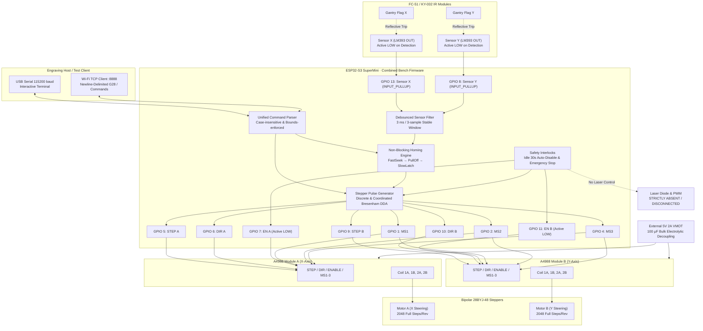
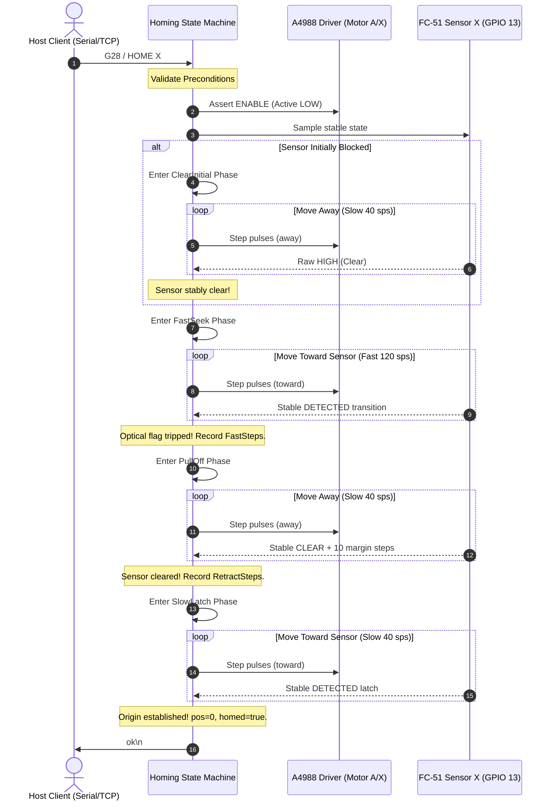

# Dual Stepper Motor & IR Optical Homing Test Guide

**Firmware Location:** `stepper_ir_homing_test/stepper_ir_homing_test.ino`  
**Target Hardware:** ESP32-S3 SuperMini  
**Actuators:** Dual 28BYJ-48 Stepper Motors (Converted to 4-Wire Bipolar)  
**Drivers:** Dual Allegro A4988 Stepper Drivers (VMOT=5V external, VDD=3.3V logic)  
**Sensors:** Dual FC-51 / KY-032 IR Obstacle Avoidance Sensors (LM393 Comparator)  
**Command Transports:** USB Serial (115200 baud) & Wi-Fi TCP Server (Port 8888)  
**Required Libraries:** None — Standard ESP32 Arduino Core only.

---

## 1. Purpose, Capabilities & Scope Boundaries

### 1.1 Purpose
This guide provides an end-to-end electrical, firmware, and operational procedure for commissioning the combined dual-axis stepper motor and dual optical homing endstop test bench. 

The primary goal of this fixture is to validate **real sensor-driven motor homing**: moving physical motors toward optical limit sensors, detecting the reflective flag with debounced electronic filtering, pulling off until clear, and performing a secondary slow latch approach to establish repeatable mechanical zero reference coordinates.

### 1.2 Hardware & Architectural Scope Boundaries
- **Standalone Bench Fixture:** This test setup is designed exclusively for two A4988 drivers operating on dedicated pulse/direction pins.
- **NO Laser:** No laser module, laser power supply, or laser PWM signal (GPIO 12) is connected or driven during these tests.
- **NO Status LED on GPIO 13:** On the ESP32-S3 SuperMini target board, GPIO 13 is directly assigned as the digital input for **Sensor X OUT**. It must **never** be configured as an output or driven as an LED. Status is communicated through Serial and TCP.
- **Production Firmware Mismatch:** The current production engraving firmware (`laser-engraver-firmware/`) utilizes different endstop pins (GPIO 11/12) and directly toggles 4-wire coil sequences rather than A4988 STEP/DIR signals. Furthermore, production `homing.cpp` is currently a stub that returns success without motion. Validating this bench fixture proves optical-motion integration, but does **not** constitute production firmware integration.

### 1.3 Measurement Honesty & Open-Loop Realities
- **No Encoder Feedback:** A4988 stepper drivers operate strictly open-loop. Position reports reflect commanded pulse counts, not electronically verified shaft angles. If a motor stalls, binds, or loses steps, the reported coordinate will deviate from reality until a physical homing cycle completes.
- **Stall & Benchmark Realities:** The `STALL` routine measures step timing and operator-observed stalls; it is not an electronic back-EMF stall detector. The `BENCHMARK` routine measures microcontroller GPIO toggling throughput with drivers disabled, not motor shaft rotational velocity.
- **Software Zero vs Physical Home:** The `ZERO` command resets logical coordinates to zero in software; it does not constitute physical sensor homing and will not set `homed = true`.

---

## 2. Safety Instructions & Electrical Rules of Engagement

> [!CAUTION]
> **Strict No-Hot-Plug Rule:** Never connect or disconnect stepper motor coil leads while the driver power supply (VMOT) is energized! Disconnecting an inductive coil under load creates high-voltage flyback spikes that instantly destroy the A4988 MOSFET output stages. Always remove all power before modifying motor wiring.

### 2.1 Essential Electrical Rules
1. **Laser Interlock:** Confirm that no laser diode, laser driver, or high-voltage laser rail is connected to the breadboard or fixture.
2. **Independent Power Supplies:**
   - **ESP32-S3 Logic:** Powered via 5V USB (VBUS).
   - **A4988 Logic (VDD):** 3.3V supplied from the ESP32-S3 3.3V regulator rail.
   - **A4988 Motor Power (VMOT):** Separate external 5V 2A DC regulated bench supply.
3. **Common Ground Reference:** All ground lines must tie into a single star-ground bus: ESP32-S3 GND, A4988 Logic GND, A4988 Power GND, Sensor GND, and External Supply Negative (-).
4. **Bulk Decoupling Capacitor:** An electrolytic capacitor of 47 µF to 1000 µF (100 µF recommended, rated for at least 16V) must be installed directly across the A4988 `VMOT` and `GND` pins to absorb inductive voltage spikes. Observe capacitor polarity strictly (stripe = negative).
5. **A4988 RST and SLP Jumper:** Connect the `~RESET` and `~SLEEP` pins together on each A4988 module. The driver's internal pull-up on SLEEP holds RESET high, keeping the driver active.
6. **Optical Sensor Voltage Verification:** Before connecting Sensor X OUT (GPIO 13) or Sensor Y OUT (GPIO 8) to the ESP32-S3, power the sensor module and verify with a digital multimeter that the output voltage never exceeds **3.3V**. Standard FC-51 modules powered from 5V often pull up to 5V through their onboard indicator LED, which will damage the 3.3V-tolerant ESP32-S3 GPIOs. If powered from 5V, use a resistive voltage divider (e.g. 10 kΩ / 20 kΩ) or power the sensor comparator from 3.3V.

### 2.2 A4988 Vref Current Limit Calibration

The bipolar-converted 28BYJ-48 motor has internal coil resistance of ~30–50 Ω and a safe continuous phase current limit of approximately **150 mA to 200 mA** ($I_{\text{max}} = 0.20\text{ A}$) to prevent excessive coil heating.

The current limit formula for the A4988 is:
$$I_{\text{trip}} = \frac{V_{\text{ref}}}{8 \times R_s}$$

Where $R_s$ is the onboard current sense resistor. Inspect the surface-mount sense resistors near the driver pins:
- If labeled `R100` ($R_s = 0.10\ \Omega$):
  $$V_{\text{ref}} = I_{\text{trip}} \times 8 \times 0.10 = 0.20 \times 0.8 = 0.16\text{ V}\ (160\text{ mV})$$
- If labeled `R050` ($R_s = 0.05\ \Omega$):
  $$V_{\text{ref}} = I_{\text{trip}} \times 8 \times 0.05 = 0.20 \times 0.4 = 0.08\text{ V}\ (80\text{ mV})$$

**Adjustment Procedure:**
1. Keep the motor coil disconnected during initial Vref adjustment.
2. Power the ESP32-S3 via USB so A4988 `VDD` is 3.3V, and turn on `VMOT`.
3. Clip the multimeter negative lead to GND.
4. Touch the positive test probe to the metal top of the small onboard potentiometer on the A4988.
5. Using a ceramic or insulated screwdriver, carefully turn the potentiometer until the DMM reads **0.16 V** (for R100 sense resistors).
6. Power off VMOT before connecting motor coils.

---

## 3. Combined System Architecture & Block Diagram



---

## 4. Pinout Matrix, Power Distribution & Wiring Tables

### 4.1 Authoritative Hardware Pin Map

| ESP32-S3 GPIO | Signal Name | Destination Pin | Direction / Electrical Characteristic |
|---:|---|---|---|
| **5** | Motor A STEP | A4988 A `STEP` | Output, active rising-edge pulse (min 3 µs) |
| **6** | Motor A DIR | A4988 A `DIR` | Output, logic level (HIGH=CW, LOW=CCW) |
| **7** | Motor A ENABLE | A4988 A `~ENABLE` | Output, active LOW (LOW=Energized, HIGH=Disabled) |
| **9** | Motor B STEP | A4988 B `STEP` | Output, active rising-edge pulse (min 3 µs) |
| **10** | Motor B DIR | A4988 B `DIR` | Output, logic level (HIGH=CW, LOW=CCW) |
| **11** | Motor B ENABLE | A4988 B `~ENABLE` | Output, active LOW (LOW=Energized, HIGH=Disabled) |
| **1** | Microstep MS1 | A4988 A & B `MS1` | Output, shared microstep mode select bit 1 |
| **2** | Microstep MS2 | A4988 A & B `MS2` | Output, shared microstep mode select bit 2 |
| **4** | Microstep MS3 | A4988 A & B `MS3` | Output, shared microstep mode select bit 3 |
| **13** | **Sensor X OUT** | **Sensor X `OUT`** | **Digital Input (`INPUT_PULLUP`), Active LOW default. NO LED!** |
| **8** | **Sensor Y OUT** | **Sensor Y `OUT`** | **Digital Input (`INPUT_PULLUP`), Active LOW default.** |
| *3* | *Unused* | *None* | *Explicitly left unassigned / open* |
| *None* | *Laser PWM* | *None* | *Strictly disconnected* |

### 4.2 Power Distribution & Rails Table

| Power Rail | Voltage | Sourced From | Connected Components |
|---|---|---|---|
| **USB 5V (VBUS)** | 5.0 V DC | USB Cable from Host/PC | ESP32-S3 SuperMini 5V pin |
| **Logic 3.3V** | 3.3 V DC | ESP32-S3 3.3V Out Pin | A4988 A `VDD`, A4988 B `VDD`, Sensor VCC (if 3.3V rated) |
| **Motor VMOT** | 5.0 V DC | External 2A Regulated Supply | A4988 A `VMOT`, A4988 B `VMOT` (with 100 µF capacitor) |
| **Common GND** | 0.0 V (Ref) | All Power Supplies | ESP32 GND, A4988 GND, Sensor GND, External Supply (-) |

### 4.3 28BYJ-48 Bipolar Motor Coil Assignment Table

After cutting the internal center tap trace (red wire) to convert to 4-wire bipolar:

| Motor Lead Color | Phase | A4988 Terminal | Resistance Check |
|---|---|---|---|
| **Blue** | Phase 1 (+) | **1A** | Blue to Yellow: ~30–50 Ω |
| **Yellow** | Phase 1 (-) | **1B** | Blue to Yellow: ~30–50 Ω |
| **Pink** | Phase 2 (+) | **2A** | Pink to Orange: ~30–50 Ω |
| **Orange** | Phase 2 (-) | **2B** | Pink to Orange: ~30–50 Ω |
| **Red** | Cut Center Tap | **NC (Isolated)** | Must read Infinite / Open Circuit to all pins |

---

## 5. Pre-Power Continuity & Voltage Verification Checklist

Complete this checklist with **all power disconnected**:

1. [ ] **Coil Phase Isolation:** With a DMM, measure between Blue and Pink leads. Must read open circuit ($\infty$ / OL).
2. [ ] **Center Tap Isolation:** Measure between the cut Red wire and all other wires. Must read open circuit ($\infty$ / OL).
3. [ ] **A4988 Strapping:** Verify a physical jumper bridges `~RESET` and `~SLEEP` on both A4988 modules.
4. [ ] **Electrolytic Capacitor Polarity:** Verify 100 µF capacitor negative stripe connects to GND and positive to VMOT.
5. [ ] **Common Star Ground:** Verify zero ohms resistance between ESP32-S3 GND, external power negative (-), and A4988 GND pins.
6. [ ] **Sensor Voltage Safety Check:**
   - Power the optical sensor module alone.
   - Measure DC voltage between Sensor `OUT` and `GND`.
   - **Crucial:** Voltage must **NOT exceed 3.3V**. If it reads ~5.0V, insert a level shifter or 10k/20k voltage divider before connecting to ESP32-S3 GPIO 13 or GPIO 8.
7. [ ] **No Laser Connection:** Confirm no wires are connected to GPIO 12 or laser power terminals.

---

## 6. Arduino IDE Configuration & First Boot Procedure

### 6.1 Tools & Core Settings in Arduino IDE
- **Board:** `ESP32S3 Dev Module`
- **USB CDC On Boot:** `Enabled` *(Essential for Serial Monitor on SuperMini USB)*
- **CPU Frequency:** `240MHz (WiFi)`
- **Flash Size:** `8MB` (or matched to SuperMini module)
- **Upload Speed:** `921600`
- **Port:** Select corresponding `/dev/ttyACM*` or `/dev/ttyUSB*` port.

### 6.2 Optional Local Wi-Fi Configuration
In `stepper_ir_homing_test.ino`, locate lines 44–45:
```cpp
static const char *WIFI_SSID     = "";
static const char *WIFI_PASSWORD = "";
```
To enable TCP testing on port 8888, enter your local network credentials. Leave blank to operate in standalone Serial-only mode.

### 6.3 First Boot Inspection (VMOT OFF)
1. Keep external motor power supply (VMOT) **OFF**.
2. Plug in the USB cable to the ESP32-S3.
3. Open Serial Monitor at **115200 baud** (set line ending to `Newline` or `Both NL & CR`).
4. You should observe the startup banner:
```text
+=======================================================================+
|     COMBINED STEPPER MOTOR & IR OPTICAL HOMING BENCH TEST FIXTURE    |
|     ESP32-S3 SuperMini | Dual A4988 Drivers | Dual FC-51 Sensors      |
+=======================================================================+
| Motor A (X) : STEP=GPIO 5, DIR=GPIO 6, EN=GPIO 7 (Active LOW)        |
| Motor B (Y) : STEP=GPIO 9, DIR=GPIO 10, EN=GPIO 11 (Active LOW)       |
| Microstep   : MS1=GPIO 1, MS2=GPIO 2, MS3=GPIO 4 (Shared Bus)          |
| Sensor X    : GPIO 13 (INPUT_PULLUP, homes Motor A)                     |
| Sensor Y    : GPIO 8  (INPUT_PULLUP, homes Motor B)                     |
| Notice      : GPIO 13 is Sensor X OUT. NO status LED is connected.    |
| Notice      : No laser module or laser power is connected.            |
+=======================================================================+
[READ] X (GPIO 13): Raw=HIGH State=CLEAR | Y (GPIO 8): Raw=HIGH State=CLEAR
[WIFI] No Wi-Fi SSID configured. Standalone Serial mode active.
```
5. Confirm that both A4988 drivers start **DISABLED** (measured voltage on GPIO 7 and GPIO 11 is 3.3V HIGH).

---

## 7. Phase 1: Cold Logic & Optical Sensor Qualification (VMOT OFF)

With motor power still OFF, thoroughly test and qualify optical sensors.

### 7.1 Single Snapshot Readout
Type `READ`:
```text
>> READ
[READ] X (GPIO 13): Raw=HIGH State=CLEAR | Y (GPIO 8): Raw=HIGH State=CLEAR
```
Place your reflective target flag in front of Sensor X:
```text
>> READ
[READ] X (GPIO 13): Raw=LOW State=DETECTED | Y (GPIO 8): Raw=HIGH State=CLEAR
```
Confirm:
- Sensor X trips independently without affecting Sensor Y.
- When clear, raw electrical voltage is HIGH (~3.3V).
- When blocked, raw electrical voltage drops to LOW (~0.1–0.4V).

### 7.2 Interactive Real-Time Dashboard
Type `DUAL`:
```text
>> DUAL
[DUAL] Real-Time Dual Sensor Dashboard. Send 'X' to exit.
  [X: CLEAR    [.....]]  [Y: CLEAR    [.....]]
  [X: DETECTED [#####]]  [Y: CLEAR    [.....]]
  [X: CLEAR    [.....]]  [Y: DETECTED [#####]]
```
Send `X` to close the dashboard.

### 7.3 Optical Sensitivity Trim-Pot Tuning
Run `CALIB`:
1. Position the target flag exactly at your desired homing trigger plane (e.g. 5–8 mm from the sensor LEDs).
2. If the module LED is not on, turn the onboard trim-pot counter-clockwise until the indicator LED just turns ON.
3. Back it away 2 mm; the LED should turn OFF.
4. Repeat for Sensor Y.

### 7.4 Debounce & Optical Noise Qualification
1. Run `NOISE 5`: Evaluates electrical background noise for 5 seconds while machine is undisturbed. Should report `EXCELLENT`.
2. Run `AMBIENT`: Samples at 10 kHz to ensure room fluorescent or LED lights do not induce 100/120 Hz flicker ripple into the comparator. Should report `PASSED`.

---

## 8. Phase 2: Stepper Motor Bring-up & Direction Validation (VMOT ON)

Once sensors are qualified, turn ON the external 5V VMOT bench supply.

### 8.1 Single-Axis Low-Speed Jog
1. Energize the driver coils:
   ```text
   >> ENABLE
   ok
   ```
   Feel the motor shafts gently: holding torque should now be active.
2. Command a short low-speed step on Motor A (X-axis):
   ```text
   >> STEP A 100 50
   ok
   ```
   Observe the rotation direction.
3. If Motor A moves in reverse of your desired homing approach direction:
   ```text
   >> DIR A CCW
   ok
   ```
   Or power down VMOT and swap the two wires of one coil (e.g. swap Blue and Yellow).
4. Repeat for Motor B (Y-axis):
   ```text
   >> STEP B 100 50
   ok
   ```

### 8.2 Microstepping Verification
Verify microstep resolution switching:
```text
>> MICRO 2
ok
>> MICRO 8
ok
>> MICRO 1
ok
```
Observe that the shared MS1, MS2, MS3 pins update according to the Allegro truth table.

### 8.3 Continuous Rotation & Emergency Stop
Test continuous rotation:
```text
>> START A 120
ok
```
Motor A spins continuously. Send `X` or `!`:
```text
>> X
[ABORT] Emergency stop triggered. All motion halted immediately.
```
Confirm motion halts instantly within sub-millisecond response time.

---

## 9. Phase 3: Physical Sensor Homing Commissioning & Tuning

### 9.1 Homing Sequence Theory of Operation



### 9.2 Overshoot & Filter Math
Because optical sensors have analog comparator switching times and digital debouncing:
$$n_{\text{overshoot}} \approx v \cdot \tau$$
- During `FastSeek` at $v = 120\text{ sps}$ and $\tau = 3\text{ ms}$, commanded overshoot is $\approx 0.36\text{ steps}$.
- During `SlowLatch` at $v = 40\text{ sps}$ and $\tau = 3\text{ ms}$, commanded overshoot is $\approx 0.12\text{ steps}$.
This guarantees sub-step latching accuracy at the motor shaft.

### 9.3 Commissioning Execution
1. Place carriage ~20 mm away from Sensor X.
2. Command X homing:
   ```text
   >> HOME X
   [HOME X] Homing routine initiated...
     [PHASE] FastSeek: Approaching endstop at fast speed...
     [PHASE] PullOff: Retracting until optical sensor clears...
     [PHASE] SlowLatch: Final precision approach at slow speed...
   [HOME X] Success. Origin zeroed. Fast=342, Retract=45, Latch=12 steps.
   ok
   ```
3. Query position:
   ```text
   >> POS
   [POS] X: 0 steps (0.00 deg, homed=1) | Y: 0 steps (0.00 deg, homed=0)
   ```
4. Repeat for Y axis:
   ```text
   >> HOME Y
   ok
   ```
5. Test Dual-Axis Sequential Homing:
   ```text
   >> HOME ALL
   [HOME ALL] Sequential homing initiated: Axis X first, then Axis Y.
   ...
   ok
   ```

---

## 10. Phase 4: Serial & TCP Network Command Verification

### 10.1 TCP Client Connection (Port 8888)
Connect from a laptop or workstation on the same network using `netcat` or Python:
```bash
nc <ESP32_IP_ADDRESS> 8888
```

### 10.2 TCP Homing Protocol Handshake
Send `G28` followed by newline:
```text
G28
```
The board will process the complete sequential homing routine. Crucially, **no intermediate diagnostic text is sent over TCP**. Once both axes complete latching, the socket receives:
```text
ok
```

### 10.3 TCP Error Handling Example
If Sensor Y is disconnected or blocked during homing:
```text
error: HOME_TIMEOUT_SEEK Y FAST_SEEK
```
The TCP protocol contract ensures:
- Exactly one final result line (`ok` or `error: ...`) is returned per request.
- No partial `ok` is ever sent if an axis fails.

---

## 11. Phase 5: Fault Injection, Failure Recovery & Edge Cases

| Scenario | Injected Condition | Expected Firmware Response | Verified? |
|---|---|---|:---:|
| **Emergency Abort** | Send `X` or `!` while `FastSeek` is moving | Stepping halts instantly. Sends `error: HOME_ABORTED X`. Axis marked `homed=false`. | [ ] |
| **Initially Blocked** | Hold card in front of Sensor X before sending `HOME X` | Firmware enters `ClearInitial`, moves away until clear, then executes normal seek/latch. | [ ] |
| **Stuck Active** | Keep card firmly glued to sensor so it cannot clear | Fails after `HOMING_MAX_CLEAR_STEPS` (1024 steps). Sends `error: HOME_LIMIT_RETRACT X CLEAR_INITIAL`. | [ ] |
| **Disconnected Wire** | Disconnect Sensor X OUT wire (floats HIGH) | Motor seeks until `HOMING_MAX_SEEK_STEPS` (4096 steps) expires. Halts safely with `error: HOME_LIMIT_SEEK X FAST_SEEK`. | [ ] |
| **Busy Rejection** | Send `STEP A 500` while `HOME ALL` is actively stepping | Command rejected immediately with `error: BUSY`. Active homing unaffected. | [ ] |
| **Second TCP Client** | Connect 2nd TCP client while 1st is connected | Second client rejected with `error: BUSY_ANOTHER_CLIENT_CONNECTED` and closed immediately. | [ ] |
| **Wi-Fi Loss** | Turn off Wi-Fi router during operation | Serial Monitor continues operating with zero interruptions or stalls. | [ ] |

---

## 12. Comprehensive Command Quick-Reference Card

| Command | Arguments | Moves? | Prerequisites | Description & Example |
|---|---|:---:|---|---|
| `HOME X` | None | Yes | Safe clearance | Physically home Axis X (Motor A, Sensor X). |
| `HOME Y` | None | Yes | Safe clearance | Physically home Axis Y (Motor B, Sensor Y). |
| `HOME ALL` | None | Yes | Safe clearance | Sequentially home X, then Y. |
| `G28` | None | Yes | Safe clearance | G-code standard alias to `HOME ALL` (Serial & TCP). |
| `X` or `!` | None | **STOP** | None | **Emergency Stop**: Aborts all motion, clears homed flags. |
| `ENABLE` | None | No | VMOT on | Energize motor coils. |
| `DISABLE` | None | No | None | De-energize motor coils (unhomes axes). |
| `START` | `[A\|B] [sps]` | Yes | None | Continuous rotation: `START A 120`. |
| `STOP` | `[A\|B\|ALL]` | No | None | Stop continuous rotation. |
| `STEP` | `[A\|B] <n> [sps]` | Yes | Coils on | Discrete jog: `STEP A 500 100`. |
| `GOTO` | `[A\|B] <pos> [s]` | Yes | Coils on | Absolute move: `GOTO A 2048 150`. |
| `POS` | None | No | None | Display coordinates and homed status. |
| `ZERO` | None | No | None | Reset software coordinates to 0 (does not home). |
| `DIR` | `[A\|B] [CW\|CCW]` | No | None | Invert direction logic: `DIR A CCW`. |
| `SPEED` | `[A\|B] <sps>` | No | None | Configure speed: `SPEED A 200`. |
| `REV` | `[A\|B] <n> [sps]` | Yes | Coils on | Revolution move: `REV A 1.5 100`. |
| `RPM` | None | No | None | Display calculated shaft RPM. |
| `MICRO` | `<1\|2\|4\|8\|16>` | No | Motors idle | Set shared microstepping mode: `MICRO 8`. |
| `DUAL STEP`| `<nA> <nB> [sps]` | Yes | Coils on | Coordinated multi-axis jog: `DUAL STEP 200 400`. |
| `DUAL GOTO`| `<xA> <yB> [sps]` | Yes | Coils on | Coordinated absolute target move. |
| `DUAL HOME`| None | Yes | Coils on | **Open-loop return to logical (0,0) (NOT sensor homing!)** |
| `DUAL CIRCLE`| `[r] [segs] [sps]`| Yes | Coils on | Trace circular pattern: `DUAL CIRCLE 400 32`. |
| `DUAL SQUARE`| `[size] [sps]` | Yes | Coils on | Trace square pattern: `DUAL SQUARE 500`. |
| `READ` | None | No | None | Snapshot of raw and debounced sensor states. |
| `DUAL` | None | No | None | Live real-time dual-sensor ASCII dashboard. |
| `DUAL SYNC`| None | No | None | Dual sensor trigger alignment test. |
| `CALIB` | None | No | None | Guided sensor trim-pot calibration wizard. |
| `RANGE` | None | No | None | Detection distance verification test. |
| `THRESHOLD`| None | No | None | Sensor hysteresis and threshold diagnostic. |
| `DEBOUNCE` | `[samples] [ms]` | No | None | Display or set debounce parameters. |
| `EDGES` | `[seconds]` | No | None | Count raw electrical edge transitions. |
| `RESPONSE` | None | No | None | Measure comparator response time & overshoot. |
| `NOISE` | `[seconds]` | No | None | Measure electrical glitch noise at rest. |
| `AMBIENT` | None | No | None | Check for 100/120 Hz AC room lighting interference. |
| `STATS` | None | No | None | Print cumulative trigger/release event statistics. |
| `INVERT` | None | No | Motors idle | Toggle sensor active polarity (LOW <-> HIGH). |
| `HOMESIM` | `[delay_ms]` | No | None | Simulated dry-run homing (NO MOTOR MOTION). |
| `STATUS` | None | No | None | Comprehensive system status report. |
| `RESET` | None | No | None | Restore default settings & unhome axes. |
| `HELP` | None | No | None | Display complete command reference table. |

---

## 13. Production Firmware Integration Gap Analysis

| Characteristic | Bench Test Fixture (`stepper_ir_homing_test`) | Production Firmware (`laser-engraver-firmware`) | Gap Resolution Required Before Production |
|---|---|---|---|
| **Motor Drivers** | Dual Allegro A4988 Step/Dir modules | ULN2003 / Direct 4-wire coil sequence | Hardware driver abstraction must match actual machine driver. |
| **Motor Pin Map** | A: 5, 6, 7 \| B: 9, 10, 11 | Coil pins defined in `config.h` | Must not reassign bench pins to production without driver review. |
| **Endstop Pins** | Sensor X: GPIO 13, Sensor Y: GPIO 8 | Sensor X: GPIO 11, Sensor Y: GPIO 12 | Align production `config.h` to verified physical hardware endstop pins. |
| **Homing State** | Real 3-stage FSM (Seek, Retract, Latch) | `homing.cpp` stubs returning `true` | Replace production `homing.cpp` stubs with non-blocking FSM. |
| **Laser Control** | Disconnected & Absent | GPIO 12 PWM Laser Driver | Laser must remain interlocked and disabled during all homing sequences. |
| **TCP Protocol** | Single-line deterministic reply (`ok` or `error:`) | Returns `ok` before homing executes | Update production TCP server to await homing result before sending `ok`. |

---

## 14. Test Measurement Worksheet & Acceptance Sign-Off

### 14.1 Hardware Measurement Log Sheet
- **Test Date:** `____________________`
- **Operator Name:** `____________________`
- **ESP32-S3 Board Rev:** `ESP32-S3 SuperMini`
- **A4988 Sense Resistor ($R_s$):** `[ ] R100 (0.10 Ω)   [ ] R050 (0.05 Ω)`
- **Measured Vref:** `Motor A: _______ V  |  Motor B: _______ V`
- **Reflective Target Material:** `[ ] 3D White PLA   [ ] Aluminum Tape   [ ] Black ABS`
- **Optical Trigger Distance:** `Sensor X: _______ mm  |  Sensor Y: _______ mm`

### 14.2 Homing Repeatability Log (5 Consecutive Runs)

| Run # | Axis X Fast Steps | Axis X Retract Steps | Axis X Latch Steps | Axis Y Fast Steps | Axis Y Retract Steps | Axis Y Latch Steps |
|:---:|:---:|:---:|:---:|:---:|:---:|:---:|
| 1 | | | | | | |
| 2 | | | | | | |
| 3 | | | | | | |
| 4 | | | | | | |
| 5 | | | | | | |
| **Spread**| $\Delta = $ | $\Delta = $ | $\Delta = $ | $\Delta = $ | $\Delta = $ | $\Delta = $ |

*(Acceptance criterion: Latch step spread $\le 2$ steps across 5 runs).*

### 14.3 Formal Acceptance Checklist

- [ ] **Tier 1: Compilation Verification**
  - Standalone sketch compiles with zero errors for ESP32-S3.
  - Native C++ TDD logic test suite passes with 100% assertions.
- [ ] **Tier 2: Cold Logic & Electrical Verification (VMOT OFF)**
  - Drivers start de-energized with STEP pins held LOW.
  - Optical sensors read raw HIGH when clear and LOW when tripped.
  - Sensor output voltage confirmed $\le 3.3\text{ V}$.
  - Noise and ambient lighting tests pass with zero false glitches.
- [ ] **Tier 3: Powered Bench Movement & Physical Homing (VMOT ON)**
  - Low-speed jogs confirm correct physical motor travel directions.
  - Emergency stop (`X` or `!`) aborts motion immediately.
  - `HOME X` stops at Sensor X, pulls off, latches, and establishes $X=0$.
  - `HOME Y` stops at Sensor Y, pulls off, latches, and establishes $Y=0$.
  - `HOME ALL` and TCP `G28` complete sequentially and return `ok`.
  - Fault injection (stuck sensor, disconnected wire) returns explicit stable error.
