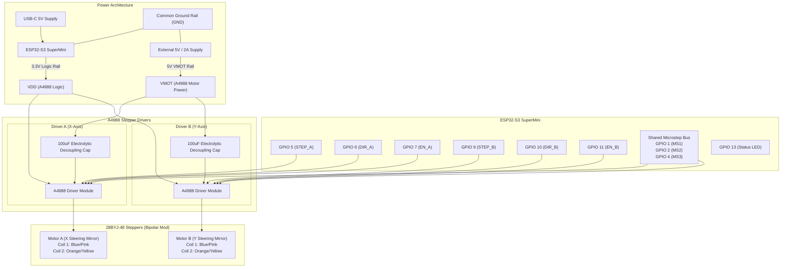

# Dual Stepper Motor & A4988 Driver Test Guide

**Sketch location:** `stepper_motor_test/stepper_motor_test.ino`  
**Target Board:** ESP32-S3 SuperMini  
**Motors:** Dual 28BYJ-48 Stepper Motors (Converted to 4-Wire Bipolar)  
**Drivers:** Dual Allegro A4988 Microstepping Drivers  
**Power Rails:** 5V VMOT (Motor Power) | 3.3V VDD (Logic from ESP32-S3)  
**No external libraries required** — uses standard ESP32 Arduino Core.

---

## Table of Contents

1. [System Architecture & Block Diagram](#1-system-architecture--block-diagram)
2. [28BYJ-48 Bipolar Conversion Guide](#2-28byj-48-bipolar-conversion-guide)
3. [A4988 Driver Specifics & Vref Current Calibration](#3-a4988-driver-specifics--vref-current-calibration)
4. [Circuit Wiring Diagrams](#4-circuit-wiring-diagrams)
   - [Single Motor Test Wiring (Motor A Only)](#41-single-motor-test-wiring-motor-a-only)
   - [Dual Motor Test Wiring (Motor A + Motor B)](#42-dual-motor-test-wiring-motor-a--motor-b)
5. [Microstepping Resolution & Kinematics Table](#5-microstepping-resolution--kinematics-table)
6. [Arduino IDE & Board Configuration](#6-arduino-ide--board-configuration)
7. [Phase-by-Phase Testing Roadmap](#7-phase-by-phase-testing-roadmap)
   - [Phase 1: Cold Logic Verification (VMOT OFF)](#phase-1-cold-logic-verification-vmot-off)
   - [Phase 2: Motor A Rotation & Direction (VMOT ON)](#phase-2-motor-a-rotation--direction-vmot-on)
   - [Phase 3: Speed Characterisation & Stall Limit](#phase-3-speed-characterisation--stall-limit)
   - [Phase 4: Microstepping Transitions (1/1 to 1/16)](#phase-4-microstepping-transitions-11-to-116)
   - [Phase 5: Gear Backlash Characterisation](#phase-5-gear-backlash-characterisation)
   - [Phase 6: Dual-Axis Coordinated Vectoring (Square, Circle)](#phase-6-dual-axis-coordinated-vectoring-square-circle)
   - [Phase 7: Full Automated Self-Test & Benchmark](#phase-7-full-automated-self-test--benchmark)
8. [Troubleshooting Guide](#8-troubleshooting-guide)
9. [Serial Command Reference](#9-serial-command-reference)

---

## 1. System Architecture & Block Diagram



---

## 2. 28BYJ-48 Bipolar Conversion Guide

The stock 28BYJ-48 is a 5-wire unipolar stepper driven by Darlington arrays (e.g. ULN2003A). In unipolar mode, only half of each coil carries current at any given instant. 

By converting the motor to a **4-wire bipolar configuration**, both phases are driven symmetrically by an H-bridge driver (A4988), doubling torque production, improving efficiency, and allowing microstepping.

### Step-by-Step Conversion Procedure

1. **Remove Blue Plastic Cover:**
   - Gently pry the small tabs of the blue plastic cap on the rear of the 28BYJ-48 using a hobby knife or flat miniature screwdriver.
   - Slide the cap off to expose the internal small printed circuit board (PCB) where the 5 colored leads are soldered.

2. **Locate the Center Tap Trace:**
   - You will see 5 solder pads: `Blue`, `Pink`, `Yellow`, `Orange`, and `Red`.
   - The `Red` wire is the center tap. A trace runs across the PCB connecting the red wire's solder pad to the midpoint of the internal coils.

3. **Cut the PCB Trace:**
   - With an X-Acto knife or sharp razor, carefully scrape/slice through the copper trace running between the red pad and the center connection.
   - Cut through until the underlying substrate is visible. Ensure no stray copper burrs bridge the cut.

4. **Isolate or Desolder the Red Wire:**
   - Snip the red wire flush at the PCB, or heat shrink its free end. It will **not** be connected to the A4988.

5. **Verify with a Multimeter (DMM):**
   - Measure resistance between **Blue** and **Pink**: Should measure approximately **95 Ω to 105 Ω** (Phase A).
   - Measure resistance between **Orange** and **Yellow**: Should measure approximately **95 Ω to 105 Ω** (Phase B).
   - Measure resistance between **Red** and **any other wire**: Must read **infinite (open circuit / OL)**.
   - Measure resistance between **Blue** and **Yellow**: Must read **infinite (isolated phases)**.

### Wiring Assignment to A4988

| Motor Wire Color | Motor Phase | A4988 Pin |
|---|---|---|
| **Blue** | Phase A (+) | **1A** |
| **Pink** | Phase A (-) | **1B** |
| **Yellow** | Phase B (+) | **2A** |
| **Orange** | Phase B (-) | **2B** |
| **Red** | Cut Center Tap | **NC (Disconnected)** |

> [!TIP]
> If a motor rotates in reverse of your desired direction, you can either issue the firmware command `DIR CCW` or simply swap the two wires of one coil (e.g. swap Blue and Pink).

---

## 3. A4988 Driver Specifics & Vref Current Calibration

### Essential Hardware Pin Strapping

1. **RST and SLP Tied Together:**
   - The A4988 `~RESET` and `~SLEEP` pins are active LOW logic inputs.
   - Jumper `RESET` directly to `SLEEP`. The driver's internal pull-up on SLEEP holds RESET high, keeping the driver active.
2. **ENABLE Pin Control:**
   - The `~ENABLE` pin is **active LOW**.
   - Connected to ESP32 GPIO: `LOW` = Driver energized; `HIGH` = Outputs high-impedance (de-energized, cool idle).
3. **VMOT Decoupling Capacitor Selection (Is 100 µF Mandatory?):**
   - **No, 100 µF is NOT strictly mandatory — it is simply the typical nominal value recommended in the Pololu datasheet!**
   - **Any electrolytic capacitor from 47 µF up to 1000 µF rated at 16V or 25V is completely safe and effective for your 5V VMOT setup:**
     - **`47 µF (16V or 25V)`:** Acceptable for a single driver bench test. (Small, easy to fit on breadboard).
     - **`470 µF (16V or 25V)` [RECOMMENDED OPTION]:** **The sweet spot!** Provides exceptional transient absorption, dampens inductive coil kickback, and filters switching ripple significantly better than 100 µF without causing excessive power-on inrush current.
     - **`1000 µF (25V)`:** Also completely safe electrically. However, its physical barrel size is large on a breadboard, and charging a 1000 µF cap draws a momentary inrush pulse when switching on 5V.
     - **Voltage Rating Check:** Since your motor supply is **5V DC**, both **16V** and **25V** capacitors provide more than 3x to 5x voltage headroom (derating rule requires capacitor rated $\ge 1.5 	imes V_{	ext{rail}}$), so both are 100% safe.
   - **Polarity Warning:** Observe electrolytic polarity! The stripe with **minus signs (-)** connects to **GND**, and the longer lead (+) connects to **VMOT**.
   - **Crucial Rule:** Always keep the capacitor physically close to the A4988 VMOT and GND pins. Never plug or unplug a stepper motor while VMOT is energized — inductive flyback spikes will blow the driver FETs.

### Current Limit Setting ($V_{ref}$ Formula)

The 28BYJ-48 converted to bipolar has a DC coil resistance of $\approx 100\,\Omega$. When running on a 5V supply, the natural continuous DC current is:
$$I = \frac{5\,\text{V}}{100\,\Omega} = 50\,\text{mA}$$

To achieve fast step transitions and overcome gear inertia at higher step rates, the A4988 chopper is calibrated between **150 mA and 200 mA** per phase ($I_{max}$).

The Allegro A4988 current trip formula is:
$$I_{max} = \frac{V_{ref}}{8 \times R_s}$$

Where $R_s$ is the onboard current sense resistor.

#### Identifying Your Current Sense Resistors ($R_s$)
Inspect the two small surface-mount resistors on the A4988 module near the chip:
- Resistor labeled `R100` $\implies R_s = 0.10\,\Omega$ *(Most common on Pololu and standard modules)*
- Resistor labeled `R050` $\implies R_s = 0.05\,\Omega$
- Resistor labeled `R200` $\implies R_s = 0.20\,\Omega$

#### Target $V_{ref}$ Calculation Table

For the standard $R_s = 0.10\,\Omega$ module:
$$V_{ref} = I_{max} \times 8 \times R_s = I_{max} \times 0.8$$

| Target Phase Current ($I_{max}$) | $R_s = 0.10\,\Omega$ ($V_{ref}$) | $R_s = 0.05\,\Omega$ ($V_{ref}$) | Thermal Profile |
|---|---|---|---|
| **120 mA** | **0.096 V (96 mV)** | 0.048 V (48 mV) | Cool, low torque |
| **150 mA (Recommended)** | **0.120 V (120 mV)** | 0.060 V (60 mV) | **Optimal balance of torque & heat** |
| **180 mA** | **0.144 V (144 mV)** | 0.072 V (72 mV) | High torque, warm motor |
| **200 mA (Max)** | **0.160 V (160 mV)** | 0.080 V (80 mV) | Maximum torque, hot motor |

### How to Adjust $V_{ref}$:
1. Connect the ESP32-S3 logic ground (`GND`) to your multimeter's negative black lead (e.g. using an alligator clip).
2. Set multimeter to DC Volts (millivolt range, e.g. 200 mV or 2 V DC).
3. Connect 3.3V logic supply to A4988 `VDD` and `GND` (motor 5V VMOT can be ON or OFF during measurement).
4. Touch the multimeter's red probe carefully to the metal top of the small onboard potentiometer (trimpot).
5. Using a miniature ceramic or insulated screwdriver, gently rotate the trimpot until the meter reads **120 mV (0.12 V)**.
   - Clockwise usually increases voltage; counter-clockwise decreases it.

---

## 4. Circuit Wiring Diagrams & Detailed Component Schematics

> [!TIP]
> ### 🌟 Interactive Dynamic HTML Schematic Available!
> For an animated, interactive visual schematic with signal pulsing, pin tooltips, and a **Single Motor vs Dual Motor toggle**, open:  
> **👉 [`stepper_motor_test/circuit_diagram.html`](file:///home/mushfiq/Desktop/Laser-XY-Scanner/stepper_motor_test/circuit_diagram.html)** directly in your web browser!

> [!NOTE]
> ### 💡 Is `stepper_motor_test.ino` for both Single and Dual Stepper Testing?
> **YES!** `stepper_motor_test.ino` is a unified, all-in-one test suite designed for both stages:
> 1. **Phase 1 (Single Stepper Bring-Up):** Wire only **Motor A (X-Axis)**. Motor B's pins are held inactive. You can run all single-axis commands (`STEP <n>`, `SPEED <sps>`, `RUN <sps>`, `STOP`, `REV <n>`, `BACKLASH`, `RAMP`, `STALL`).
> 2. **Phase 2 (Dual Stepper Coordinated Testing):** Add **Motor B (Y-Axis)** when ready. You can test both motors together with vector interpolation commands (`DUAL STEP <nA> <nB>`, `DUAL GOTO <xA> <yB>`, `DUAL CIRCLE <r>`, `DUAL SQUARE <s>`).
>
> You do **not** need a separate sketch—the single firmware safely accommodates both wiring states!

---

### 4.0 Component Pinout References

#### 1. ESP32-S3 SuperMini Physical Header Pinout (Top View)
*(Castellated 18-pin DIP footprint: 9 pins Left, 9 pins Right, USB-C at Top)*
```
                  ┌────────────────────────┐
                  │      [ USB-C PORT ]    │
                  │                        │
       5V Power   │ [5V]             [GND] │ Ground (Common Bus)
       Ground Bus │ [GND]            [IO7] │ Motor A EN (Active LOW)
       3.3V Logic │ [3V3]            [IO8] │ Unused GPIO
 MS1 Shared Bus   │ [IO1]            [IO9] │ Motor B STEP Pulse
 MS2 Shared Bus   │ [IO2]           [IO10] │ Motor B DIR Direction
 Unused / Strap   │ [IO3]           [IO11] │ Motor B EN (Active LOW)
 MS3 Shared Bus   │ [IO4]           [IO12] │ Unused GPIO
 Motor A STEP     │ [IO5]           [IO13] │ Onboard Status LED
 Motor A DIR      │ [IO6]           [TX0]  │ Debug UART TX (GPIO 43)
                  │                        │
                  └────────────────────────┘
```
*(Notice: **GPIO 4** is utilized for MS3 because it is physically exposed on the outer breadboard header, completely avoiding the need to solder to underside castellated pads!)*

#### 2. Allegro A4988 Module Physical Pinout (Top View)
```
                     ┌──────────────────┐
                     │   [TRIMPOT VREF] │
       Enable (LOW)  │ [ENABLE]  [VMOT] │ Motor DC Supply (5V)
    Microstep Bit 1  │ [MS1]      [GND] │ Motor Ground
    Microstep Bit 2  │ [MS2]       [2B] │ Coil B (-)  --> Orange Wire
    Microstep Bit 3  │ [MS3]       [2A] │ Coil B (+)  --> Yellow Wire
       Reset Input   │ [RESET]     [1A] │ Coil A (+)  --> Blue Wire
       Sleep Input   │ [SLEEP]     [1B] │ Coil A (-)  --> Pink Wire
         Step Pulse  │ [STEP]     [VDD] │ Logic Power (3.3V from ESP32)
    Direction Logic  │ [DIR]      [GND] │ Logic Ground (Common GND)
                     └──────────────────┘
```

#### 3. Converted 28BYJ-48 4-Wire Bipolar Stepper Pinout
```
                ┌───────────────────────────────────┐
                │     28BYJ-48 Stepper Motor        │
                │        (Bipolar Modded)           │
                │                                   │
                │   [Coil Phase A (~100 Ω)]         │
                │   • Blue Wire   ──────> A4988 1A  │
                │   • Pink Wire   ──────> A4988 1B  │
                │                                   │
                │   [Coil Phase B (~100 Ω)]         │
                │   • Yellow Wire ──────> A4988 2A  │
                │   • Orange Wire ──────> A4988 2B  │
                │                                   │
                │   [Cut Center Tap]                │
                │   • Red Wire    ──────> NOT USED  │
                │                         (Cut/NC)  │
                └───────────────────────────────────┘
```

---

### 4.1 Single Motor Test Wiring (Motor A Only)

For initial bring-up, current calibration, and single-axis speed tuning:

```
+================================================================================================================+
|                                SINGLE MOTOR (MOTOR A) BENCH TEST SCHEMATIC                                     |
+================================================================================================================+

       +------------------------------------+
       |        ESP32-S3 SuperMini          |
       |                                    |
       |   [3.3V] ──────────────────────────┼───────────────────────────────┐
       |                                    |                               │
       |   [GND]  ──+                       |                               │
       |            │ (Common GND)          |                               │
       |   [IO5] ───┼───────────────────────┼─────────────┐ (STEP)          │
       |            │                       |             │                 │
       |   [IO6] ───┼───────────────────────┼───────┐     │                 │
       |            │                       |       │     │                 │
       |   [IO7] ───┼───────────────────────┼─┐     │     │                 │
       |            │                       | │     │     │                 │
       |   [IO1] ───┼─────────────────┐     | │     │     │                 │
       |   [IO2] ───┼───────────┐     │     | │     │     │                 │
       |   [IO4] ───┼─────┐     │     │     | │     │     │                 │
       +------------+-----│-----│-----│-----+ │     │     │                 │
                          │     │     │       │     │     │                 │
                          │     │     │       v     v     v                 v
                       +--┴─────┴─────┴───────┴─────┴─────┴─────────────────┴----+
                       | MS3   MS2   MS1     EN    DIR   STEP              VDD   |
                       |                                                         |
                       |                     A4988 DRIVER MODULE                 |
                       |                          (MOTOR A)                      |
                       |                                                         |
                       | [RESET]  [SLEEP]    2B    2A    1A    1B   GND    VMOT  |
                       +----┬────────┬--------┬─────┬─────┬─────┬────┬───────┬---+
                            │        │        │     │     │     │    │       │
                            +──Jumper+        │     │     │     │    │       │
                            (Tied Together)   │     │     │     │    │       │
                                              │     │     │     │    │       │
              +-------------------------------+     │     │     │    │       │
              | Orange Wire                         │     │     │    │       │
              |        +----------------------------+     │     │    │       │
              |        | Yellow Wire                      │     │    │       │
              |        |        +-------------------------+     │    │       │
              |        |        | Blue Wire                     │    │       │
              |        |        |        +----------------------+    │       │
              |        |        |        | Pink Wire                 │       │
              v        v        v        v                           │       │
       +------------------------------------+                        │       │
       |       28BYJ-48 Stepper Motor       |                        │       │
       |       Phase B        Phase A       |                        │       │
       |   [Orange/Yellow]  [Blue/Pink]     |                        │       │
       |                                    |                        │       │
       |    Red Wire (Center-Tap): CUT / NC |                        │       │
       +------------------------------------+                        │       │
                                                                     │       │
       +------------------------------------+                        │       │
       |   ESP32 5V PIN OR 5V BENCH SUPPLY  |                        │       │
       |                                    |                        │       │
       |   [+5V Output] ────────────────────┼────────────────────────┼───────┘
       |                                    |                        │
       |   [GND Output] ────────────────────┼───────────┬────────────┘
       +------------------------------------+           │
                         │                              │
                         │           +───────────[ - ]──┴─────────────────+
                         │           |  ELECTROLYTIC FILTER CAPACITOR     |
                         │           |  47uF, 470uF, or 1000uF (16V / 25V)|
                         │           |  (470uF 25V Recommended)           |
                         │           +───────────[ + ]──┬─────────────────+
                         │                              │
                         +──────────────────────────────┴──────────────────> Ties to VMOT
                         │
                         v
                [ COMMON SYSTEM GND ] <═════ Tied to ESP32-S3 [GND] pin
```

---

### 4.2 Dual Motor Test Wiring (Motor A + Motor B)

This schematic connects both Motor A (X-Mirror) and Motor B (Y-Mirror) to the ESP32-S3 SuperMini, using a **shared 3-wire microstepping bus** (MS1, MS2, MS3) and independent STEP, DIR, and ENABLE control lines.

```
+==================================================================================================================+
|                                    DUAL MOTOR BENCH TEST FULL SCHEMATIC                                          |
+==================================================================================================================+

                                             ESP32-S3 SuperMini
                                     ┌─────────────────────────────────┐
                       USB 5V Supply │ [5V]                      [GND] ├─── Common System GND
               Common System GND Bus │ [GND]                     [IO7] ├─── Motor A EN (GPIO 7)
               Common 3.3V Logic Bus │ [3V3]                     [IO8] │
                      MS1 Shared Bus │ [IO1]                     [IO9] ├─── Motor B STEP (GPIO 9)
                      MS2 Shared Bus │ [IO2]                    [IO10] ├─── Motor B DIR (GPIO 10)
                      Unused / Strap │ [IO3]                    [IO11] ├─── Motor B EN (GPIO 11)
                      MS3 Shared Bus │ [IO4]                    [IO12] │
                  Motor A STEP Pulse │ [IO5]                    [IO13] ├─── Status LED
               Motor A DIR Direction │ [IO6]                     [TX0] │    (Debug Serial)
                                     └─────────────────────────────────┘
                                        │   │   │   │   │   │   │   │
                     ┌──────────────────┘   │   │   │   │   │   │   └───────────────────────────────┐
                     │                      │   │   │   │   │   └───────────────────────┐       │
                     │  ┌───────────────────┘   │   │   │   └───────────────┐       │       │       │
                     │  │                       │   │   └───────────┐   │       │       │       │       │
                     │  │  ┌────────────────────┘   │               │   │       │       │       │       │
                     │  │  │                        └───────┐       │   │       │       │       │       │
                     │  │  │  ┌─────────────────────────────┼───────┼───┼───────┼───────┼───────┼──┐    │
                     │  │  │  │                             │       │   │       │       │       │  │    │
                     v  v  v  v                             │       │   │       │       │       v  v    v
                 +-------------------+                      │       │   │       │      +-------------------+
                 | EN  DIR STEP VDD  |                      │       │   │       │      | EN  DIR STEP VDD  |
                 |                   |                      │       │   │       │      |                   |
                 |   A4988 DRIVER    |                      │       │   │       │      |   A4988 DRIVER    |
                 |     MODULE A      |                      │       │   │       │      |     MODULE B      |
                 |     (X-AXIS)      |                      │       │   │       │      |     (Y-AXIS)      |
                 |                   |                      │       │   │       │      |                   |
                 | MS1 MS2 MS3 RESET |                      │       │   │       │      | MS1 MS2 MS3 RESET |
                 | GND VMOT    SLEEP |                      │       │   │       │      | GND VMOT    SLEEP |
                 | 1B  1A  2A  2B    |                      │       │   │       │      | 1B  1A  2A  2B    |
                 +--┬──┬──┬──┬──┬─┬--+                      │       │   │       │      +--┬──┬──┬──┬──┬─┬--+
                    │  │  │  │  │ │                         │       │   │       │         │  │  │  │  │ │
          MS1 Bus ──┼──┼──┼──┼──┼─┼─────────────────────────┼───────┼───┼───────┼─────────┘  │  │  │  │ │
          MS2 Bus ──┼──┼──┼──┼──┼─┼─────────────────────────┼───────┼───┼───────┴────────────┘  │  │  │ │
          MS3 Bus ──┼──┼──┼──┼──┼─┼─────────────────────────┼───────┼───┼───────────────────────┘  │  │ │
                    │  │  │  │  │ └──[RESET tied to SLEEP]  │       │   │                          │  │ └──[RESET tied to SLEEP]
                    │  │  │  │  │                           v       v   v                          │  │
                    │  │  │  │  │                         [From ESP32-S3]                          │  │
                    │  │  │  │  │                         IO11   IO10  IO9                         │  │
                    │  │  │  │  │                         (EN)  (DIR) (STEP)                       │  │
                    │  │  │  │  │                           │       │   │                          │  │
                    │  │  │  │  │                           └───────┼───┼──────────────────────────┘  │
                    │  │  │  │  │                                   └───┼─────────────────────────────┘
                    │  │  │  │  │                                       └─────────────────────────────┘
                    │  │  │  │  │
                    │  │  │  │  │   +-------------------------+     +-------------------------+
                    │  │  │  │  │   | 28BYJ-48 MOTOR A (X)    |     | 28BYJ-48 MOTOR B (Y)    |
                    │  │  │  │  │   |   Coil A:               |     |   Coil A:               |
                    │  │  │  │  └───┤     • 1B -> Pink        |     |     • 1B -> Pink        ├─────┐
                    │  │  │  └──────┤     • 1A -> Blue        |     |     • 1A -> Blue        ├──┐  │
                    │  │  └─────────┤   Coil B:               |     |   Coil B:               |  │  │
                    │  └────────────┤     • 2A -> Yellow      |     |     • 2A -> Yellow      ├┐ │  │
                    └───────────────┤     • 2B -> Orange      |     |     • 2B -> Orange      ├┼─┘  │
                                    |                         |     |                         |│ │  │
                                    |   Red Wire: Cut / NC    |     |   Red Wire: Cut / NC    |│ │  │
                                    +-------------------------+     +-------------------------+│ │  │
                                                                                               │ │  │
                                             ┌─────────────────────────────────────────────────┘ │  │
                                             ├───────────────────────────────────────────────────┘  │
                                             ├──────────────────────────────────────────────────────┘
                                             │
      +======================================┴======================================================+
      |                                  POWER DISTRIBUTION NETWORK                                 |
      +=============================================================================================+

       5V Motor Power Supply                       Driver A Filter Cap             Driver B Filter Cap
      ┌─────────────────────┐                   ┌────────────────────────┐      ┌────────────────────────┐
      │  +5V DC Rail        ├───────────────────┤ (+) 47uF to 1000uF     ├──────┤ (+) 47uF to 1000uF     ├──> VMOT (Both A4988)
      │                     │                   │     (470uF 16/25V rec) │      │     (470uF 16/25V rec) │
      │  GND Rail           ├──┬────────────────┤ (-)                    ├──┬───┤ (-)                    ├──> GND (Both A4988)
      └─────────────────────┘  │                └────────────────────────┘  │   └────────────────────────┘
                               │                                            │
                               v                                            v
                      [ STAR GROUND POINT ] <═══════════════════════════════╧═══> Tied to ESP32-S3 GND
```

---

### 4.3 Capacitor Selection Analysis (Addressing Your Inventory)

You asked whether the **100 µF capacitor is mandatory** and noted that you have **1000 µF, 47 µF, and 470 µF capacitors rated at 16V and 25V**. Here is the definitive engineering analysis:

| Your Capacitor | Voltage Rating | Verdict | Detailed Technical Assessment |
|---|---|---|---|
| **`470 µF`** | **16V or 25V** | **BEST CHOICE (RECOMMENDED)** | **The ideal capacitor.** 470 µF provides nearly 5x the charge reservoir of 100 µF, significantly smoothing the motor switching ripple and absorbing inductive back-EMF without drawing an excessive power-on inrush current. Fits comfortably on a breadboard. |
| **`1000 µF`** | **25V** | **FULLY COMPATIBLE & SAFE** | Electrically safe and provides massive bulk capacitance. It will easily handle both motors. Note: When first connected to 5V, it draws a momentary inrush spike as it charges up; ensure your 5V supply does not trip. |
| **`47 µF`** | **16V or 25V** | **ACCEPTABLE (Single Motor)** | Perfectly fine for single-motor bring-up and characterization. Slightly small for dual simultaneous rapid acceleration, but completely safe. |

#### Voltage Rating Verification:
- **Your Supply:** 5V DC VMOT.
- **Capacitor Ratings:** 16V and 25V.
- **Rule of Thumb:** Working voltage should be $\ge 1.5 	imes V_{	ext{rail}}$ (i.e. $\ge 7.5\,	ext{V}$).
- **Result:** Both **16V** ($3.2	imes$ safety margin) and **25V** ($5	imes$ safety margin) have massive headroom and will never suffer overvoltage breakdown.

#### Installation Rules:
1. **Polarity:** Always connect the negative lead (marked with a white stripe and minus symbols `-`) to **GND**, and the positive lead (longer leg) to **VMOT**.
2. **Proximity:** Position the capacitor as close as physically possible to the A4988 `VMOT` and `GND` pins on the breadboard (within 1 to 2 cm) to minimize wire inductance.
3. **Dedicated Cap per Driver:** If running both motors, placing one 470 µF capacitor near Driver A and one 470 µF (or 47 µF) near Driver B is far better than a single capacitor placed far away.

---
## 5. Microstepping Resolution & Kinematics Table

The 28BYJ-48 features a 4-stage internal spur reduction gearbox. 
- Rotor: 32 full steps per revolution (11.25° step angle).
- Gear ratio: $63.68395 : 1$ (commonly approximated as $64:1$).
- Full-step output resolution: $32 \times 64 = 2048$ steps per revolution.

| Mode | Command | MS1 | MS2 | MS3 | Steps/Rev | Deg / Step | Arcmin / Step | Arcsec / Step | Mirror Res (@ 100mm) |
|---|---|---|---|---|---|---|---|---|---|
| **1/1 Full** | `MICRO 1` | LOW | LOW | LOW | **2,048** | 0.1758° | 10.55' | 632.8" | 306 µm |
| **1/2 Half** | `MICRO 2` | HIGH | LOW | LOW | **4,096** | 0.0879° | 5.27' | 316.4" | 153 µm |
| **1/4 Quarter**| `MICRO 4` | LOW | HIGH | LOW | **8,192** | 0.0439° | 2.64' | 158.2" | 76 µm |
| **1/8 Eighth** | `MICRO 8` | HIGH | HIGH | LOW | **16,384** | 0.0220° | 1.32' | 79.1" | 38 µm |
| **1/16 16th**  | `MICRO 16`| HIGH | HIGH | HIGH| **32,768** | 0.0110° | 0.66' | 39.5" | **19 µm** |

> [!NOTE]
> **Optical Reflection Multiplier:**  
> When steering a laser beam with a mirror, rotation of the mirror by an angle $\theta$ deflects the reflected beam by **$2\theta$** (Law of Reflection). 
> At 1/16 microstepping, each individual microstep delivers an optical beam resolution of **0.022° (1.32 arcmin)**!

---

## 6. Arduino IDE & Board Configuration

### Board Settings (Tools Menu)

| Setting | Selection | Purpose |
|---|---|---|
| **Board** | `ESP32S3 Dev Module` | Standard core for ESP32-S3 |
| **USB Mode** | `Hardware CDC and JTAG` / `USB-OTG` | Native USB communication |
| **USB CDC On Boot** | **`Enabled`** | **Mandatory** for Serial Monitor over USB-C |
| **Upload Mode** | `UART0 / Hardware CDC` | Automatic flashing |
| **Flash Size** | `4MB` or `8MB` | Match your SuperMini flash |
| **Partition Scheme**| `Default 4MB with spiffs` | Standard layout |
| **PSRAM** | `Disabled` | SuperMini does not feature external PSRAM |
| **CPU Frequency** | `240MHz` | Full performance for precision microsecond pulses |

---

## 7. Phase-by-Phase Testing Roadmap

Follow these 7 structured validation phases sequentially:

---

### Phase 1: Cold Logic Verification (VMOT OFF)

**Objective:** Verify ESP32-S3 GPIO outputs, serial commands, and microstepping pin states before turning on 5V motor power.

1. Disconnect 5V VMOT supply (or leave supply turned OFF). Keep USB-C plugged in.
2. Open Serial Monitor at **115200 baud** (Newline).
3. Confirm boot banner appears:
   ```text
   +==================================================+
   |   STEPPER MOTOR & A4988 DRIVER TEST FIRMWARE     |
   |   ESP32-S3 Super Mini  |  Dual 28BYJ-48 Bipolar  |
   +==================================================+
   ```
4. Type `STATUS` and press Enter. Verify:
   - Drivers Disabled: `YES`
   - Positions: `A=0, B=0`
5. Test microstepping pin switching:
   - Type `MICRO 16`. Verify response: `Microstepping set to 1/16`.
   - Measure voltage with DMM on pins MS1, MS2, MS3: All three must read **3.3V**.
   - Type `MICRO 1`. Measure MS1, MS2, MS3: All three must read **0.0V**.
6. **Pass Criteria:** Firmware boots cleanly, commands respond, GPIO logic transitions properly.

---

### Phase 2: Motor A Rotation & Direction (VMOT ON)

**Objective:** Confirm coil wiring, holding torque, and forward/reverse rotation on Motor A.

1. Turn ON the external 5V VMOT power supply.
2. Type `ENABLE`.
   - You should feel holding torque on the Motor A output shaft (it will resist turning by hand).
3. Type `STEP 200`.
   - Motor A should smoothly take 200 steps clockwise.
4. Type `STEP -200`.
   - Motor A should step 200 steps counter-clockwise, returning to the starting point.
5. Type `REV 1`.
   - Motor A should rotate exactly one full revolution of the output shaft (2048 steps).
6. **Pass Criteria:** Motor turns smoothly without clicking, buzzing, or running backwards.

---

### Phase 3: Speed Characterisation & Stall Limit

**Objective:** Determine the maximum reliable pulse rate and torque drop-off threshold.

1. Test conservative stepping speed:
   - `SPEED 300` $\implies$ Motor spins continuously at ~8.8 RPM.
   - Type `STOP` to halt.
2. Step speed progression:
   - `SPEED 500` $\implies$ Verify smooth rotation.
   - `SPEED 800` $\implies$ Normal upper speed limit in full-step mode.
   - `SPEED 1200` $\implies$ Listen for skipped steps or high-pitched rotor stall.
3. Automated stall diagnostic:
   - Type `STALL 800 2048`.
   - The firmware measures execution duration with microsecond timers and reports timing variance.
4. **Pass Criteria:** Motor completes continuous rotation up to 600–800 steps/sec in full-step mode without losing synchronisation.

---

### Phase 4: Microstepping Transitions (1/1 to 1/16)

**Objective:** Verify smooth acoustic resonance suppression and fine step resolution.

1. Set Half-Step:
   - `MICRO 2`
   - `REV 1` (Motor performs 4,096 pulses per rev; noticeably quieter).
2. Set 1/16 Microstepping:
   - `MICRO 16`
   - `REV 1` (Motor performs 32,768 pulses per rev; near-silent gear glide).
3. Observe output shaft:
   - Motion is ultra-smooth with zero step-induced vibration, ideal for laser mirrors.
4. **Pass Criteria:** At 1/16 microstepping, motor operates silently without resonance vibration.

---

### Phase 5: Gear Backlash Characterisation

**Objective:** Measure internal spur gearbox hysteresis (gear play) when reversing direction.

1. Type `BACKLASH`.
2. Firmware runs a 3-second countdown.
3. Observe the output shaft / mirror indicator:
   - Motor pre-loads forward by +200 steps.
   - Firmware steps reverse in increments of: 5, 10, 15, 20, 25, 30, 40 steps.
4. Note the step threshold at which physical movement is visually detected upon reversing.
5. **Pass Criteria:** Backlash is quantified (typically 15 to 30 steps / 0.5° to 1.0°). Use this value to configure software backlash compensation.

---

### Phase 6: Dual-Axis Coordinated Vectoring (Square, Circle)

**Objective:** Verify synchronous dual-axis motion (Bresenham / DDA interpolation) for X-Y mirror rastering.

1. Test diagonal simultaneous step:
   - `DUAL STEP 500 500`
   - Both motors step synchronously at 45°.
2. Test coordinated square:
   - `DUAL SQUARE 600`
   - Motor A and B draw a closed square polygon and return to start.
3. Test coordinated circle:
   - `DUAL CIRCLE 400 32`
   - Coordinated sine/cosine trajectory tracing.
4. Test automated return:
   - `DUAL HOME`
   - Both axes smoothly return to coordinate `(0, 0)`.
5. **Pass Criteria:** Both axes move simultaneously without binding or timing jitter.

---

### Phase 7: Full Automated Self-Test & Benchmark

**Objective:** Execute automated hardware self-test suite and measure ESP32-S3 interrupt/timer headroom.

1. Type `TEST`.
   - Firmware runs all 6 hardware tests: LED, Microstepping logic, Motor A motion, Motor B motion, Dual diagonal vector, and Microstepping resolution switch.
   - Verify `[ALL SELF-TEST CHECKS PASSED [OK]]`.
2. Type `BENCHMARK`.
   - ESP32-S3 evaluates raw GPIO step generation and DDA math overhead.
   - Observe step pulse capability exceeds 100 kHz (far above 28BYJ-48 requirement).
3. **Pass Criteria:** All automated diagnostics report `PASS`.

---

## 8. Troubleshooting Guide

| Symptom | Probable Cause | Corrective Action |
|---|---|---|
| **Motor hums / whines loudly but does not turn** | 1. Coil wiring swapped (e.g. Phase A and B crossed)<br>2. Step rate exceeds motor starting torque<br>3. $V_{ref}$ set too low ($< 80\,\text{mV}$)<br>4. 5V VMOT supply absent | 1. Check wire pairs with DMM: Blue-Pink must be ~100Ω, Orange-Yellow ~100Ω.<br>2. Reduce speed: Try `SPEED 200`.<br>3. Adjust $V_{ref}$ to 120 mV.<br>4. Verify 5V VMOT rail with DMM. |
| **Motor shaft spins backwards** | Direction inverted | Type `DIR CCW` to invert logic, or swap the Blue and Pink wires on the A4988 header. |
| **Motor gets excessively hot (> 60°C)** | 1. $V_{ref}$ calibrated too high ($> 180\,\text{mV}$)<br>2. Motor left energized while stationary | 1. Re-adjust trimpot to 120 mV.<br>2. Confirm `AUTODISABLE 1` is active (de-energizes coils after 30s idle). |
| **A4988 driver cuts out intermittently** | Driver thermal shutdown (overheating) | 1. Check $V_{ref}$; lower if necessary.<br>2. Attach adhesive aluminum heatsink to A4988 IC.<br>3. Ensure logic VDD is 3.3V, not 5V. |
| **Motor stutters or loses steps at high speed** | Rotor inertia stall (characteristic of 28BYJ-48) | 1. Switch to microstepping (`MICRO 4` or `MICRO 16`).<br>2. Use acceleration ramps rather than instantaneous full-speed jumps. |
| **Serial Monitor displays garbled symbols** | Baud rate mismatch | Set Serial Monitor baud rate to **115200**. |
| **Serial Monitor empty / no port found** | `USB CDC On Boot` disabled | In Arduino IDE Tools menu, set `USB CDC On Boot = Enabled` and re-flash. |

---

## 9. Serial Command Reference

| Command | Arguments | Example | Description |
|---|---|---|---|
| `STEP` | `[<n>]` | `STEP 500` / `STEP -200` | Step Motor A by $N$ microsteps (+ forward, - reverse). |
| `SPEED` | `<sps>` | `SPEED 600` | Run Motor A continuously at specified steps/sec. |
| `STOP` | *None* | `STOP` | Stop continuous motion immediately. |
| `GOTO` | `<pos>` | `GOTO 2048` | Move Motor A to absolute step coordinate. |
| `POS` | *None* | `POS` | Report current step positions, angles, and revolutions. |
| `ZERO` | *None* | `ZERO` | Reset axis position counters to 0 (Home). |
| `DIR` | `<CW\|CCW>` | `DIR CCW` | Invert or restore default Motor A rotation direction. |
| `REV` | `<n>` | `REV 1.5` / `REV -2` | Move Motor A by exact number of output revolutions. |
| `RPM` | *None* | `RPM` | Display current rotational speed in RPM. |
| `MICRO` | `<1\|2\|4\|8\|16>` | `MICRO 16` | Set microstepping mode via MS1/MS2/MS3 pins. |
| `ENABLE` | *None* | `ENABLE` | Assert driver ENABLE pin (active LOW, energized). |
| `DISABLE`| *None* | `DISABLE` | Release driver ENABLE pin (high-Z, coils off). |
| `DUAL STEP` | `<nA> <nB>` | `DUAL STEP 200 400` | Step Motor A and Motor B simultaneously. |
| `DUAL GOTO` | `<xA> <yB>` | `DUAL GOTO 1000 1000` | Coordinated Bresenham move to $(X, Y)$ coordinate. |
| `DUAL SPEED`| `<sA> <sB>` | `DUAL SPEED 600 600` | Configure default individual speeds for A and B. |
| `DUAL CIRCLE`| `<radius> [segs]` | `DUAL CIRCLE 500 48` | Trace parametric circular vector path. |
| `DUAL SQUARE`| `<size>` | `DUAL SQUARE 600` | Trace square vector path of side length $S$. |
| `DUAL HOME`| *None* | `DUAL HOME` | Return both axes back to $(0, 0)$ coordinate. |
| `BACKLASH`| *None* | `BACKLASH` | Run spur gear backlash diagnostic sequence. |
| `STALL` | `<sps> <steps>` | `STALL 1000 2048` | High-speed step generator test & jitter analysis. |
| `TEST` | *None* | `TEST` | Execute full automated hardware self-test suite. |
| `BENCHMARK`| *None* | `BENCHMARK` | Measure ESP32-S3 max pulse generation throughput. |
| `ACCEL` | `<sps2>` | `ACCEL 3000` | Set acceleration parameter (steps/sec$^2$). |
| `AUTODISABLE`| `<0\|1>` | `AUTODISABLE 1` | Enable/disable 30-second idle driver power cut. |
| `STATUS` / `?`| *None* | `STATUS` | Print comprehensive status report in ASCII box. |
| `HELP` / `H`| *None* | `HELP` | Print command cheat sheet and safety notes. |
| `RESET` | *None* | `RESET` | Restore all settings to safe defaults, disable drivers. |
| **`X`** | *Key* | `X` | **Emergency abort** — instantly halts any active move. |
